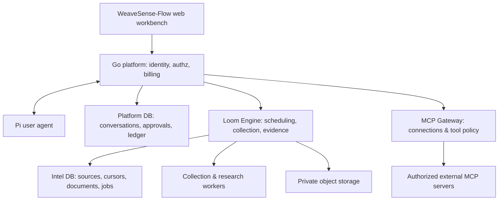

# WeaveSense-Flow Architecture

**Canvas (Go platform) owns product, identity, main agent and billing. Loom Engine owns collection, materials, scheduling and research.**
Loom Engine is the internal intelligence service extracted from WeaveSense (`services/loom-engine`).

## Data and execution ownership

| Data / action | Authoritative owner | Integration rule |
|---|---|---|
| Users, tenants, memberships, workspaces | Go platform | Single login and permission model |
| Main conversations, agent runs, approvals | Go platform | One conversation surface for the user |
| Balance, reservations, settlement | Go platform | Engine submits usage, never holds a spendable balance |
| Sources, monitors, cursors, document revisions | Loom Engine | Accessed via internal API only |
| Collection, extraction, research jobs | Loom Engine | Platform shows linked operations (projection) |
| Periodic collection & briefing schedules | Loom Engine | Platform grants; Engine executes when due |
| User notifications | Go platform | Sent after consuming report-completed events |

## Deployment rules
- One PostgreSQL cluster, two logical DBs (`flow_platform`, `flow_intel`) with separate roles and separate migration trees (`backend/…` vs `services/loom-engine/migrations`). Services never write each other's tables; cross-service delivery uses API + Outbox/Inbox.
- Only `web` publishes a port; everything else is on the internal network.
- Pi stays the primary agent runtime in phase 1. Eino/OpenCode remain specialist research executors reached via delegated research jobs and must call the platform Model Gateway (no independent provider keys).
- Multi-tenancy (Tenant, Membership, Workspace, WorkspaceMembership, ServicePrincipal, BillingAccount) enters the model in P1. Adding `tenant_id` alone is insufficient: queries, unique constraints, jobs, caches, object paths, retrieval, tools, SSE, exports, reports and usage all need scoping. PostgreSQL RLS is a second layer only (beware owner/BYPASSRLS roles and pooled connection scope).
- Starting capacity for a text-first pilot: 4–8 vCPU, 8–16 GB RAM (measure; not a commitment).

## Source capability boundaries (from audit of bec6212)
| Source | Reusable today | Boundary |
|---|---|---|
| RSS/Atom | fetch & parse | best first validation |
| Telegram | Telethon incremental history; web preview fallback | `save_media` returns empty — no media support yet |
| WeChat OA | auth gateway, feed ingest, backup providers | depends on external feed/provider |
| YouTube | channel RSS | not video/subtitle download |
| Bilibili | public list/search APIs | pagination/stability untested |
| Douyin, Xiaohongshu, Xigua | RSSHub adapter entry | needs a working feed; no native collectors |
