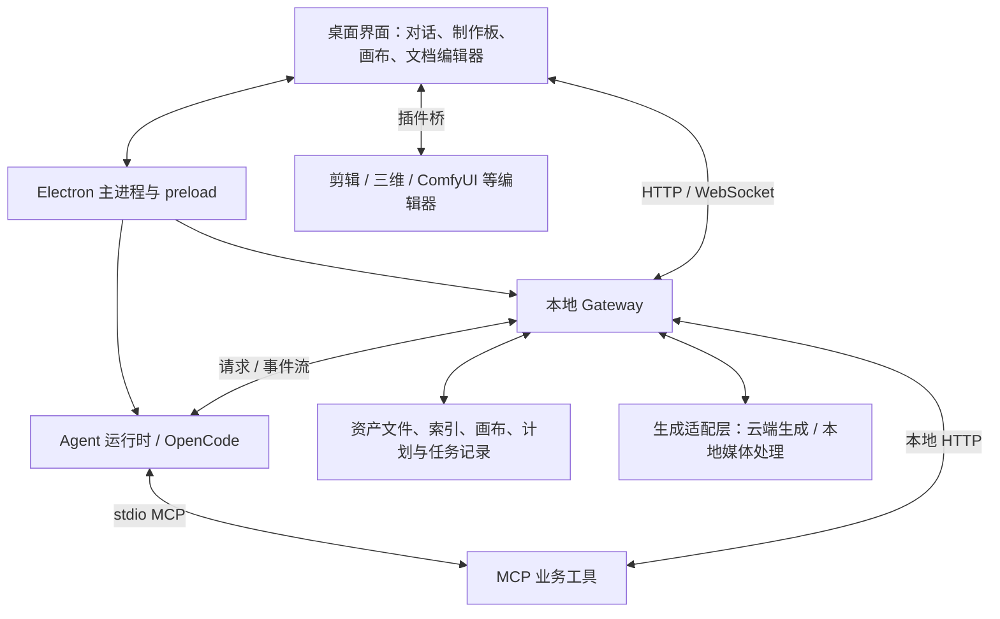
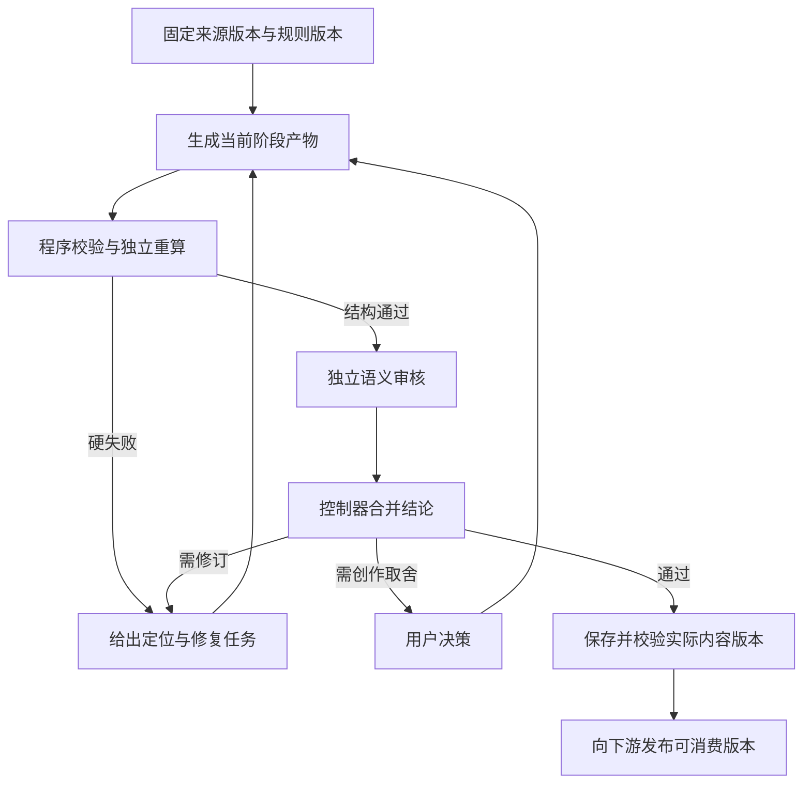

# MiniMax Design 技术架构、实现原理与复现分析报告（第二版）

> 整理日期：2026-09-20。整合原报告、当前安装产物、用户提供的真实分镜与生成清单，以及 Toonflow 监督层的只读排查。  
> 当前安装基线：MiniMax Design 3.0.16；原报告基线：2.0.18。  
> 本版新增重点：剧本到详细生成清单的编译机制、审核职责分离、可配置审核标准与移植边界。  
> 文档性质：架构分析与复现设计。文中“建议新增”的监督模块尚未实现；本次不修改应用，也不提交媒体生成任务。

## 1. 核心判断与证据边界

MiniMax Design 的主要架构可以概括为：**Electron 桌面宿主、React 画布、本地 Gateway、独立 Agent 运行时、MCP 业务工具、文件与资产索引，以及媒体生成服务。** 它的价值在于这些组件之间的状态、身份、依赖和失败恢复契约，而不只是界面或一组提示词。

截图中的完整分镜主要由 **planner 读取剧本及短剧工作流规范后创作**，再保存为 Markdown 资产与画布节点。它不是画布自动展开出来的表格，也不是某个已独立封装的确定性“剧本转分镜函数”。详细生成清单则来自下一层编译：分镜、站位、资产引用和模型约束被转换为逐组视频工作项与完整提示词。

对“是否有监督层”的准确回答是：

- **常规制作流程有约束与审阅机制**：创作角色自检、执行器约束、程序化计划校验、阶段状态门禁和用户结果审阅。
- **当前常规 v2 角色中未发现专门负责整条分镜链质量评审的独立 reviewer/director/supervisor**。不能把提示词里的“检查清单”理解为已经执行了一次独立审计。
- **产品存在 BenchmarkSupervisor**，但属于评测运行的完成、停滞和继续推进控制；其存在不能证明每个正常制作阶段都会接受独立内容审核。
- **Toonflow 有独立编辑/监制子 Agent 的调用机制**。值得借鉴的是职责分离与反馈回路；其审核范围和风格规则需要根据 MiniMax 式详细分镜重新配置。

本版使用四种证据标签：

| 标签 | 含义 | 使用限制 |
|---|---|---|
| 当前静态证据 | 当前安装配置、打包代码中可以定位 | 证明实现存在，不等于已运行成功 |
| 历史项目证据 | 已保存的计划、分镜、生成清单 | 证明当时保存了什么，不证明当前任务或账务状态 |
| 原报告继承 | 原版对 2.0.18 的静态分析 | 本版未逐项重审者，不升级为 3.0.16 的逐行结论 |
| 复现建议 | 为新宿主提出的设计 | 不描述成原产品或已交付迁移包的现成能力 |

原报告称未读取用户项目；本次范围已按用户要求扩大到指定项目的计划与创作文档。没有启动原产品生成链、查询远端计费，也没有完整还原历史模型会话。附件里的旧审批、任务状态和操作指令均作为材料，而非本次执行指令。

## 2. 版本基线与报告修订原则

| 项目 | 原版报告 | 本版当前工作区 |
|---|---|---|
| 日期 | 2026-09-17 | 2026-09-20 |
| 根目录 | `C:/Users/Administrator/AppData/Local/com.minimax.hub.global` | `F:/MiniMaxDesignThings0918/MiniMax Design/current` |
| 应用版本 | 2.0.18 | 3.0.16，见 `sq.version` |
| 包标识 | 原报告记为 `com.minimax.hub.global` | `com.minimax.hub` |
| Electron 版本 | 原报告记为 43.1.0 | 随包 `version` 文件为 43.7.0 |
| 核心新增材料 | 安装产物与示例包 | 当前 v2 工作流、真实项目计划/分镜/生成清单、Toonflow 代码 |

当前文件 SHA-256：

```text
resources/app.asar
6764625EE4E0DA018E391DA376F0051022BFF828102B47DDFFF44B63266914A4

resources/gateway/dist/main.js
89D8C26D198C2EEFABA304B3475FC79F8A93B7ED49DBE46019C1898D8591772D

resources/mcp-tools/dist/main.js
4371301D9B036769F08707D59BFF23DD40352C07C374555BBF9BD907253305EE
```

原版报告原样保留，其 SHA-256 为 `6C86B1BC7F3C2E9008F3DB6ED0D9505056700E2500EE2C4CA162DB6DDEE69F3E`。原版的旧路径、旧 bundle 行号、依赖版本范围不能直接当作新版证据。本版保留其架构认识，重点重新核实与分镜编译、计划校验和监督职责有关的当前路径。

本轮还直接在内存中读取当前 `app.asar` 内的 `package.json`，确认 `@hilo/desktop` 版本为 3.0.16；选择性使用的解包文件与归档对应条目做了哈希一致性核对，避免把旧解包目录误当当前原件。

## 3. 总体架构与通信边界

下图整合原报告的架构，并标明本轮重点核实的业务链。具体旧版端口、缓存容量、依赖小版本不作为新实现必须复制的常量。



| 层 | 主要职责 | 复现时应保持的边界 |
|---|---|---|
| Desktop | 启动、窗口、进程、工作区与运行时连接 | 不把生成业务都放进主进程 |
| Canvas / Editor | 节点、连线、文档展示、修改与撤销 | 展示节点与底层资产身份分开 |
| Gateway | 项目上下文、资产落盘、业务接口、事件与恢复 | 维护可信业务状态 |
| Agent runtime | 模型上下文、角色调用、工具决策 | 与媒体生成模型分开配置 |
| MCP tools | 可验证输入、业务操作与结构化结果 | 不以自然语言成功声明代替结果身份 |
| Media adapters | 提交、查询、下载与本地加工 | 云端成功、本地保存、登记节点分别记录 |
| Storage | 资产、依赖、计划、版本与任务账本 | 稳定 ID、修订号、幂等和恢复 |

原报告识别的技术栈包括 Electron、React/React Flow、NestJS/Express、SQLite/better-sqlite3、Zod、FFmpeg，以及编辑器与插件各自的前端库。它们是可替换的实现选择。复现时更应保留协议和一致性语义，而非凑齐同一套依赖。

当前版本的选择性复核也支持上述核心分层：`_asar_extract/out/main/chunks/python-runtime-g_0Tz6er.js:5237,6032,7512,8040` 分别可定位 Gateway 管理、子进程启动与 OpenCode 管理/启动；Gateway `main.js:381187` 创建 Nest 应用，`:348475` 定义 WebSocket Gateway；MCP `main.js:72699,72708,72727` 创建 MCP Server、Gateway Client 与 stdio transport；Gateway `:226573,236782` 分别实现 AssetsService 和 CanvasService。

核心媒体请求经过 Gateway：MCP `main.js:56413–56417` 的生成方法调用 GatewayClient，Gateway `main.js:331056,331750` 的生成服务调用后端；MCP `:56487–56490` 的拼接/FFmpeg 方法也请求 Gateway 编辑接口。图中的媒体适配层因此挂在 Gateway，而不是画成 MCP 直接提交云端生成。

## 4. 桌面、画布、资产与持久化

### 4.1 进程与工作区生命周期

原报告追踪了主进程启动 Gateway 与 OpenCode、注入运行配置、连接事件流和恢复会话的过程。复现系统需要显式管理进程就绪、退出、重启和工作区切换；端口、会话认证和运行实例身份应来自运行配置，不能把某次安装的地址硬编码。

工作区 ID、项目路径、服务运行实例、会话 ID 属于不同身份。旧实例产生的事件不能污染切换后的工作区。原报告中的认证和本地令牌存储观察只说明具体实现，不能直接视为对所有版本的安全审计结论。

### 4.2 画布与资产身份分离

画布节点承载位置、选择、连接和展示；资产承载文件、类型、路径、元数据和来源依赖。同一资产可以在不同视图被引用，移动文件或调整画布不应改变业务身份。

建议至少分开这些 ID：

| 身份 | 解决的问题 |
|---|---|
| `asset_id` | 文件或内容资产的稳定身份 |
| `node_id` | 画布中的可视对象 |
| `work_item_id` | 计划中的逻辑工作项，例如某个片段 |
| `generation_id` | 某次实际生成尝试 |
| `revision` / 内容哈希 | 本次审核、保存或提交对应的内容版本 |
| `review_id` | 对特定输入版本的审核结果，属于建议新增机制 |

原报告说明画布具有事件、选择、布局和历史管理；异步生成结果与用户撤销动作需要协调。不能把撤销实现为“回滚所有文件”，也不能让迟到的生成回调把用户删除的节点无条件复活。

### 4.3 持久化与一致性

原报告分析到普通资产文件、SQLite 索引、画布 JSON、任务恢复记录和文本版本的分层保存。锁、修订检查、原子替换和失败补偿可以提升一致性，但不意味着文件系统、SQLite、远端生成服务共同具有一个 ACID 事务。

建议新实现提供：稳定 ID、乐观版本检查、原子文件替换、可重放任务记录和失败补偿。画布保存、资产登记、通知投递均需要幂等；只收到一次 UI 提示不能成为唯一完成证据。

### 4.4 当前“保存到画布”的实际路径

当前 MCP 的 `canvas_write_node` 接受 Markdown 内容与名称，调用写入接口；Gateway 新建或更新文本节点，将 UTF-8 Markdown 写为资产，再登记到画布。

证据：MCP `main.js:62926`、`:62998`、`:63042`、`:63111`；HTTP 客户端 `:56777`；Gateway `main.js:267468`、`:267857`、`:264022`。

**写入成功证明内容已保存、节点已形成，不证明内容通过了时长、剧情或连续性审核。** 新宿主应将保存、内容审计、展示和发布为可执行版本分别建模。

## 5. Agent 编排与制作计划

当前 v2 采用认知职责分工，参见配置 `agents/README.md:11` 起的角色表：

| 角色 | 实际职责 | 与审核的关系 |
|---|---|---|
| media-agent | 用户入口、阶段推进、分派与修改路由 | 编排者；不是独立创作质量评委 |
| router | 选择 workflow 和变体 | 路由正确不等于产物正确 |
| planner | 读来源、写文档、编译工作项、保存计划 | 同时负责创作及规则自检 |
| executor | 执行当前阶段，解析引用，调用媒体工具 | 检查执行约束；不负责重写分镜文档 |
| comfyui-agent | 特定工作流的专门处理 | 专项执行角色 |

planner 的通用 Skill 调用在当前 `base.json:131` 附近被禁用；它通过工作流及参考文件读取领域规则。因此此次交付的两个 `SKILL.md` 是**移植封装**，不是从产品中找到的同名原生 skill。

Stage Execution Plan 将工作项、依赖、模型锁、文档指针和运行状态关联起来。planner 先物化文档，再通过专门 Plan 工具保存合同。普通画布文档不能代替 Plan 存储，反过来一个文档 UUID 也不能代替正文。

当前 `media-agent.md:97` 起定义阶段生命周期：文档阶段可直接进入结果待审或完成；媒体执行阶段由 executor 处理；配置了结果审阅时，完成请求被框架转为 `waiting_user(result_review)`。用户修改由 planner 修订，运行状态由编排层推进。

原报告中的“计划语义校验”在本版限定为**结构和业务契约校验**，例如字段、引用、依赖、容量上限和状态是否合法。它不自动等同于人物动机、镜头表达、对白完整性等创作语义质量评审。

## 6. 剧本到分镜的完整编译链


这是一条有反馈的编译链：时长或空间检查失败会影响拆镜与分组。不能先固定 16 组，再让模型删字或提速填进去。站位需要已知分组才能完整展开；最终物化顺序要求先站位、后分镜，不代表创作过程中不允许迭代。

### 6.1 来源与制作事实

从完整剧本提取场景、人物、逐字对白、动作、道具与状态变化，建立来源定位。制作计划决定真人/动画、画幅、风格、音频和范围。人物外观资产解决身份复用；站位记忆解决角色在哪里、朝向谁、持有什么以及发生了什么变化。

历史样例先有第 1—10 集制作计划，实际 storyboard Stage 指向第 1 集源剧本。不能因为制作计划写十集，就宣称已经完成十集逐句分镜。

已有成稿时可跳过剧本创作；只有梗概时，需要先补齐剧本。用户粘贴的分镜文本是输出，不能替代生成它所需的完整源剧本。

### 6.2 逐句时长账本

当前 `storyboard.md:140` 起规定按实际发音内容计数、按表演选择语速：缓慢或心理独白 3.0，常态 3.5，高对抗 4.0；4.5 仅适用于明确高速爆发，不能因为时间不足而任意提高语速。

```text
句子说话时间 = 发音单位数 / 对应语速
镜头时长 = ceil(本镜实际承载的说话时间 + 本镜动作/反应/换气预留)
组时长 = 组内最终镜头时长之和
全片时长 = 全部组时长之和 = 全部镜头时长之和
```

每镜预留至少 1 秒；还需按组检查至少 2 秒及实际独立动作/反应等所需预留。组级预留与镜头预留应对应同一批可追溯事件，避免漏计或重复计时。真人模式当前规则单镜不超过 8 秒，动画不超过 15 秒；组上限为 15 秒。这些属于当前规则/能力配置，不应写死为所有服务的永久上限。

跨镜或跨组台词需在自然停顿处分配文本，每个承载镜头只计自己实际说出的部分。不得把全文留在超载镜头中，再用“画外延续”掩盖时间不足。

可移植账本应保存来源片段、发音单位、语速、预留、对应镜号和计算结果等审计事实；无需保存模型的内部思考过程。

### 6.3 分组与站位

`sg_001` 表示一个计划生成的视频片段，其内部可含多个 `001-01` 等镜头。组数应由对白、动作、自然切点和容量共同确定。优先保持剧情顺序，必要时拆镜、拆相邻组，再重算总长和下游引用。

多人、同场跨片段、走位或返回场景等情况需要持久站位记忆。组级状态应覆盖在场人物、空间锚点、位置/朝向、轴线、道具归属、起始快照、变化和末态；下一组起点继承上一组末态，时空跳转需说明原因。

“承接上一组”可作为人类阅读提示，但交给独立生成请求的最终内容应展开实际状态，不能假设视频模型能读取上一条未传入的提示词。

### 6.4 完整分镜与画布输出

每组包括剧情范围、总时长、起始快照、目标末态，以及镜号、时长、景别/角度、场景、画面与逐字台词、光影时辰、音效、空间等列。景别、表演、光影和声音由创作规范指导 planner 写入，不是保存时自动补齐。

确认前规则明确要求逐句覆盖、逐镜容量、组数和整集总长一致，并联合检查站位与分镜。当前安装中这是明确的**工作流要求**；其是否被某次模型调用完整执行，需要结果证据，不能只看 `timing_audit_passed=true`。

核心证据：`workflows/drama-series/workflow.md:33,54,61–63`，`reference/storyboard.md:9,81,95,116,154,190–203`，`reference/assets-blocking.md:82`。

## 7. 分镜到详细生成清单：粒度如何保证

一组视频工作项的原始字段包括 `id/name/modality/refs/source/render/prompt`。上游逻辑素材 ID 通过资产运行结果解析到真实文件；`source` 指向对应分镜与镜号范围，`render` 保存时长与音频等参数。

清单应完整展示：

| 内容层 | 最低信息合同 |
|---|---|
| 工作项定位 | 组 ID、名称、剧情范围、逐个来源镜号、计划时长 |
| 关键帧输入 | 首帧、尾帧及其他时间线槽位；没有时明确为空 |
| 参考素材 | 按实际发送顺序逐项列名称、逻辑 ID、真实定位、用途 |
| 环境与空间 | 时段、光源、空间锚点、人物起点/视线、机位侧与道具状态 |
| 声音签名 | 各说话者的语言/口音、音色、音量、语速与表演特征 |
| 画面演进 | 一来源镜头一段：机位、动作、逐字对白、反应、背景、声音、末态 |
| 完整提示词 | 所选模型 profile 的全文，不用摘要、“同上”或“余下同理”替代 |
| 审阅与运行状态 | 内容是否可执行，与是否提交/生成/扣费分别陈述并标证据 |

例如 `sg_004` 对应 `004-01` 至 `004-03`，必须保留三段画面演进和有序素材绑定。把它压成“父子在展厅争执”即使字数不少，也没有达到用户示例要求。

普通角色/场景参考图与首尾帧输入不是同一概念；有三张参考图并不代表设置了三个关键帧。素材用途 `identity/design/world/layout` 可以作为可读注解，但不能伪称原始每条引用都具有同名字段。

模型 profile 决定具体提示词语法和能力限制；逐镜来源、逐字台词、素材顺序与完整状态是跨模型信息合同。两者应分层，以便换模型时保留内容粒度。

依据当前 `h3-video-prompt.md:17,35–37,46–51,62–80,88–89`。历史清单可以作为呈现样例，但不能当作全部质量检查都通过的金标准。

## 8. MiniMax 现有监督机制：有何作用、未覆盖什么

### 8.1 常规流程的四层约束

| 机制 | 已发现的实现/要求 | 局限 |
|---|---|---|
| planner 自检 | 完整对白、账本、空间、镜头/组/全片一致性规则 | 写作者仍可能漏检或误报通过 |
| executor 执行检查 | 提示词与合同一致、能力与时长约束、失败回报 | 不承担全剧本重新编译和独立导演审稿 |
| 程序校验 | Schema、文档指针、引用依赖、时长上限、执行门禁 | 主要检查已声明数据与结构 |
| 用户审阅 | 计划确认、结果确认、提出修改后修订 | 不能默认用户会逐句计数或复核全量状态 |

程序证据（当前 MCP bundle）：

- `StageReviewSchema:59108` 定义执行前/后检查条目；`routeExecutionCompletion:60687` 根据结果审阅配置转入等待用户。
- `PlannerStageFieldsSchema:59139` 是受限制的标量记录，并隔离 runtime 所有字段；没有由这个 schema 自动重新计算对白账本。
- `validateDocumentItem:61211` 在相应阶段要求文档节点指针，函数本身不解析 Markdown 正文。
- `validateVideoDurationCap:61260` 对比声明的片段时长与配置上限；它不推导一段台词到底需要多少秒。
- `validateDramaBlockingRefCoverage:61310` 检查相应引用覆盖；引用数量/角色声明完整不等于人物站位和 180 度轴线正确。
- `validateStageDetailReadiness:61597` 汇总结构化问题；`validateCanonicalRefTopology:61677` 检查依赖引用；`:61837` 起据验证和状态形成 `can_execute`。
- `plan_write:62694` 调用计划校验，说明确有程序门禁；不能据此推断所有创作指标都已编码。

本轮检查的执行路径未发现独立读取完整源剧本与最终分镜、重算时长并对各环节生成内容评价的常规专门审核 Agent。这是限定范围的排查结论，不是对全部私有实现的全称断言。

### 8.2 BenchmarkSupervisor 的定位

当前 Gateway 中存在 BenchmarkSupervisor，具备 `END/NUDGE/WAIT` 决策，结构化结果涉及 `completed/stuck/need_continuation/wait`。默认总开关与具体运行配置决定它是否工作，不能只看到 `supervisor.enabled=true` 就认定普通会话启用监督。

其重点是评测任务是否完成、卡住或需要继续推进。它可以借鉴为运行监督，但不是本报告需要的“对白覆盖、时长、站位、逐镜粒度”领域质量标准。

| 当前 Gateway 证据 | 实际含义 |
|---|---|
| `:210560`、`:210594`、`:290274` | Benchmark 总开关默认 false；supervisor 子开关为 true；启用判断同时检查两者 |
| `:210239–210256` | `production-shadow` 允许记录，但关闭 supervisor 和自动应答，不据此终止真实用户会话 |
| `:289679–289706` | 监督提示词定义 END / NUDGE / WAIT 及完成、停滞、继续、等待判据 |
| `:289489–289510`、`:291321–291356` | 输入包括截断后的原始任务、附件 manifest、turn 摘要、工具/错误/产物计数、在途 turn、资产路径及 mediaType |
| `:290790–290834` | 调 LLM 后核对运行版本；过时结果丢弃，普通 LLM 调用失败退回等待，超时控制另行处理 |
| `:290937–291054` | `decide()` 执行置信度、真实工作信号、连续终态确认、nudge 上限等规则；不同判据存在具体例外 |
| `:290869–290903`、`:290278` | 外部控制可覆盖裁决；后续可结束、等待结束或发送继续推进消息 |
| `:293456–293481` | 收尾时区分输入、中间、最终或未知资产 |
| `:293902–293923`、`:294034–294058` | Benchmark reflection 分析知识/skill/contract 的贡献，订阅评测收尾事件 |

这些文件路径、摘要与计数并不构成对图像、视频或音频内容的独立质量测量。本轮未发现名为 Arbiter 的独立 Agent；`decide()` 可称规则裁决层，不能扩写为一个已确认的独立评审角色。reflection 的知识贡献归因也不等于逐镜时长和站位审核。评测中的特殊自动应答仅适用于相应评测配置，不能泛化为常规产品授权策略。

## 9. 真实样例说明了什么

### 9.1 总长声明与正文不一致

已保存分镜共有 **16 组、47 镜头**。标题和 Stage 声明总长为 **210 秒**，顶部片段计划与逐镜求和均为 **214 秒**；历史 Stage 同时记录 `timing_audit_passed=true` 和完成状态。

已交付结构审计脚本在此样例报告 `episode_sum`。这说明“声明审计通过”“阶段已完成”“内容实际满足约束”是不同事实，需要独立重算来连接。

不能根据这个差异断定全部 MiniMax 审阅机制失效，也不能确定历史运行使用了与当前完全相同的配置。可确定的是：该保存产物存在可重复检测的数值不一致。

### 9.2 sg_004 的容量冲突

按当前规则复核用户关注的父子冲突组：

| 镜头 | 实际台词计数 | 原时长 | 当前规则下的最低分配 |
|---|---:|---:|---:|
| 004-01 | 27 汉字，低声 | 8 秒 | `ceil(27/3.5+1)=9` 秒 |
| 004-02 | 15 汉字，常态 | 6 秒 | `ceil(15/3.5+1)=6` 秒 |
| 004-03 | 无对白反应 | 1 秒 | 保留原反应 1 秒 |
| 合计 | — | 15 秒 | 至少 16 秒 |

第一镜还与当前真人单镜 8 秒上限冲突。仅把标题改为 214 秒不能修复这个问题；仅把提示词写得更漂亮也不能修复。需要回到上游自然停顿拆镜、重排相邻组，再更新站位、组 ID 映射与下游提示词。

这里的 16 秒是按所示台词、指定语速与最低预留所得下界，不是完整导演节奏评估，也不是对历史视频实际表现的测量。

### 9.3 仍未完成的取证

未把旧 Word 源剧本完整解码并逐句对账，因此不能宣称所有对白已经无漏无重；未重建当次模型、采样参数与完整中间账本。历史记录写有 7 项成功、9 项未提交/未扣费，但本轮没有查询当前服务与账务，只能作为带来源的历史状态展示。

## 10. Toonflow 可借鉴之处：职责分离，不照搬标准

Toonflow 的制作 Agent 注册了 `run_sub_agent_supervision`，脚本 Agent 注册的是 `run_supervision_agent`。脚本侧调用编辑子 Agent，制作侧调用监制子 Agent；它们通过各自的技能文档、调用 key 和审核记忆进入单独的审阅调用。

这种设计的价值在于：创作输出成为另一次审阅的输入，审核结果可以单独展示，修正建议与原创作记录可区分。但“单独调用”“独立上下文”“独立模型”“只读权限”“程序硬门禁”是五个不同维度，不能仅凭名称便宣称全部成立。

核实到的具体边界如下，路径以 `Toonflow-app/` 为根：

| 维度 | 实现证据与结论 |
|---|---|
| 单独调用 | `src/agents/productionAgent/index.ts:371–382` 使用 `productionAgent:supervisionAgent`；`scriptAgent/index.ts:211–223` 使用 `scriptAgent:supervisionAgent` |
| 上下文 | production `index.ts:126–130`、script `:115–119` 分别调用模型，默认使用此次审核 prompt；但共享项目工作区，结果进入同一 Agent 记忆空间，非绝对信息隔离 |
| 模型 | `src/utils/ai.ts:57–73` 高级模式可按完整角色 key 配模型；简易模式使用父角色 key，因此不保证不同模型交叉审核 |
| 工具 | production `index.ts:121–124` 默认只给 `get_flowData`，`tools.ts:359` 实际过滤；script 使用当前四个读取工具，但无监督专属 allowlist |
| 评分 | production `index.ts:134–144`、script `:122–132` 返回文本；未见 A–D 分数解析后硬性阻断的状态门禁 |

**工具只读不等于端到端写权限隔离。** 两类审核输出都进入通用 assistant 消息通道；`Toonflow-web/src/utils/useChat.ts:263–315` 对 assistant 文本解析 XML，未按监督角色过滤。production store `:51–118` 接收相应 XML 并可持久化分镜/计划；script store `:27–70` 同样处理计划/剧本 XML。因此静态调用链仍存在由输出文本触发写入的通道。本轮未执行攻击测试，不据此声称发生过越权修改；复现时应将 Reviewer 输出固定为审阅 schema，并从写入解析入口隔离。

当前制作监制规则与 MiniMax 式详细分镜存在明显差异：

| Toonflow 规则观察 | 直接照搬的影响 | 新项目应如何处理 |
|---|---|---|
| 制作监制主要审核分镜 | 不自动覆盖制作计划、逐句账本和最终保存 | 为各类产物分别定义审核入口 |
| 排除部分基础资产缺失、空间/轴线/朝向连续性检查 | 会漏掉用户这条流水线的重要错误 | 将资产解析与连续性配置为明确审核项 |
| 对光线/色彩措辞的限制 | 与详细分镜“光影时辰”及生成提示词要求冲突 | 按媒介与模型 profile 配置，不全局禁用 |
| “画面描述”字段 15—50 字等简洁约束，台词另有独立列 | 可能压缩动作、背景、空间关系与末态的表达 | 以来源覆盖和字段完整性为主，不统一封顶字数 |
| 提示词内对固定外观描写的限制 | 与无图片文字草稿、不同参考图能力的需求不同 | 依据资产输入和模型能力决定重复程度 |
| A/B/C/D 分级与建议 | 便于展示，但分级不自动形成执行阻断 | 程序先处理硬失败，评分仅辅助理解 |

此外，当前规则中不同段落对何时触发审核存在口径差异；评分区间也应检查是否完整覆盖所有组合。迁移前应显式定义触发矩阵和判定函数，而不是同时复制互相矛盾的提示词。

可复查的规则定位：`data/skills/production_agent_supervision.md:129–131` 排除相应空间连续性和基础资产缺失检查，`:152–161` 规定光影/配乐/外观限制与描述长度。`:63–70` 的评级规则中，A 与 B 条件重叠，并未明确覆盖“严重问题 0、中等问题超过 5”的情形。`production_agent_decision.md:39,50` 与 `:183–185,252` 对阶段 1 是否审核存在不同说法。它们说明迁移时需要重新统一规则，不说明所有实际会话必然走错。

**可借鉴的是“创作、审核、修订、决策分工”；审核标准必须由目标产物合同、制作模式、模型能力和用户要求另配。** 一个名为“监制”的 Agent 若只使用错误标准，可能稳定地把用户要求的细节删掉。

## 11. 建议新增的监督架构

以下为复现建议，未声称已存在于 MiniMax 或已交付迁移包。

### 11.1 四种职责

| 职责 | 允许做什么 | 不应混淆的权限 |
|---|---|---|
| 创作器 Producer | 生成/修订剧本分析、账本、分镜和提示词 | 不自行签发最终审核通过 |
| 确定性校验器 Validator | 重算数字、验证结构、引用和来源切片 | 不假装能评价人物情绪或导演表达 |
| 独立审核器 Reviewer | 读取固定版本的来源与产物，评价语义，提出具体修正 | 默认只提交审核报告，不直接改被审核内容或调用付费生成 |
| 流程控制器 Controller | 汇总判定、失效旧审核、分派修订、限制循环、推进状态 | 依据可验证报告，不能信任创作者自填通过标志 |

用户负责有实质创作选择的决策，例如是否改写原台词、改变制作时长目标或接受一种风格。明确的算术错误和已授权范围内的机械修复应自动处理，避免反复把质量检查责任转给用户。

独立审核器可以使用同一个模型的隔离调用，不必立即新增另一家模型；但须传入完整依据，避免只读创作者总结。若要求审核器只读，应在工具注册和文件/服务权限上落实，而不是只在提示词中写“不修改”。

### 11.2 建议流程



可先保存草稿以便展示；但只有与审核输入哈希一致的版本才能发布为可执行版本。写入发生在审核前或后都可以，关键是避免审核 A 版本、实际消费 B 版本。

单次自动修订可设可配置上限，例如两轮。超过上限或问题不收敛时保留完整草稿、问题和需要的决策，不能不断自我循环，也不能静默忽略失败。修订轮数是新宿主策略，不是已发现的产品常量。

### 11.3 审核不是每一步都另起一个 Agent

各中间产物都应有检查点，但不必每写一句就调一个监制。建议将来源/计划/资产、时长/分组/站位、完整分镜、详细生成清单作为几个检查包。确定性检查持续运行；独立语义审阅在稳定快照上进行，减少成本并保持上下文完整。

## 12. 针对详细分镜另配的审核标准

### 12.1 分层配置

建议配置拆为四层并记录版本：

1. **通用完整性规则**：来源可追溯、无漏句/重句、数值一致、ID 与引用有效、状态有证据。
2. **制作模式规则**：真人/动画、镜头长度、表演方式、空间连续性要求。
3. **模型能力规则**：单片时长、参考素材上限、首尾帧支持、提示词结构、音频能力。
4. **项目创作规则**：风格、镜头密度、光影表达、语言和角色声音、用户确认的取舍。

冲突处理顺序：输入事实与明确用户约束先确定；无法满足的模型硬能力需报告冲突；风格偏好不能抵消事实遗漏与容量错误。配置冲突不能通过模型自行删台词或提高语速解决。

### 12.2 分阶段检查矩阵

| 检查点 | 确定性检查 | 独立语义检查 | 典型修正 |
|---|---|---|---|
| 完整剧本 | 文件/版本可读、集数范围、来源 ID | 场景与动作事实是否被准确理解 | 补全缺页或重新绑定源范围 |
| 制作计划与资产 | 锁项齐全、引用能解析、版本匹配 | 人物身份、服装、场景事实有无矛盾 | 修正文字资产卡与素材映射 |
| 逐句时长账本 | 计数、语速、预留、逐镜向上取整 | 语速是否符合低声/停顿/情绪，预留是否足够 | 重新计时，给出合理拆分点 |
| 镜头分组 | 顺序、唯一性、上限、组/全片求和 | 切点自然性、不可分割动作、转场完整性 | 重排相邻组并重算依赖 |
| 站位记忆 | 必填状态、角色/道具 ID、前后状态差异 | 越轴、瞬移、无故换手、入画退场合理性 | 明确机位侧、转身或交接动作 |
| 分镜表 | 镜号、列、时长、源台词切片覆盖 | 景别/运动是否可拍，反应与叙事是否完整 | 逐镜修订，不删掉必需细节 |
| 保存到画布 | 实际内容哈希、节点/资产 ID、读回一致 | 展示是否截断或遗漏关键信息 | 重写失败内容并更新文档指针 |
| 详细生成清单 | 每组工作项、每镜段落、逐图顺序、关键帧区分 | prompt 是否完整承载台词、表演、背景、空间和末态 | 按来源镜头重新展开 |

台词覆盖的程序检查需要结构化来源切片。只对整个 Markdown 做字符串搜索可能把重复台词、引文或跨镜拆句误判为完整覆盖。语义问题需引用具体镜号与证据；机器可算的数字由代码复算。

### 12.3 硬失败与建议分开

建议把漏台词、容量溢出、总长不一致、必需素材无法解析、错误版本绑定列为硬失败。可审阅草稿允许素材 URI 尚缺，但不能据此标记“可提交”。镜头节奏偏平、可选景别改善等通常属于建议，除非违反明确项目要求。

重大连续性矛盾可以由 Reviewer 提出阻断问题，附具体证据，交 Controller 按规则决定回修。存在硬失败时，综合分再高也不能放行。

不必强行采用 A/B/C/D。若采用，必须覆盖全部评分组合，并明确分数仅用于展示；是否可执行由必需检查通过情况、阻断项和输入版本共同决定。未检查应记为 `not_checked`，不能按零问题计为通过。

## 13. 审核报告合同与修正闭环

建议报告输出结构化事实与可读说明。以下是**新增设计示例**，哈希占位表示宿主需填实际值，并非原产品接口：

```json
{
  "review_id": "review-ep01-storyboard-r3",
  "stage": "storyboard",
  "policy_id": "detailed-live-action-storyboard",
  "policy_version": "1.0.0",
  "inputs": {
    "script_sha256": "<actual-sha256>",
    "storyboard_sha256": "<actual-sha256>",
    "asset_catalog_revision": 3
  },
  "verdict": "fail",
  "checks": [
    {"id": "duration_sum", "status": "fail", "producer": "validator"},
    {"id": "full_dialogue_coverage", "status": "not_checked", "reason": "source_not_decoded"}
  ],
  "findings": [{
    "code": "EPISODE_DURATION_MISMATCH",
    "severity": "blocking",
    "location": {"artifact": "storyboard", "field": "episode_duration"},
    "expected": {"declared_seconds": 214},
    "actual": {"declared_seconds": 210, "shot_sum_seconds": 214},
    "evidence": "16组、47镜头逐行求和",
    "fix": "先完成容量重编，再从最终镜头统一重算标题、组计划和Stage字段",
    "owner": "producer",
    "invalidates": ["generation_manifest", "downstream_review"]
  }]
}
```

上例中的 214 仅为现有表格的算术一致值，不保证容量重编后仍是 214 秒；因此修正建议要求先完成容量检查，不能只机械修改标题。

控制器至少应保证：

- 每个阻断问题有位置、证据、原因和可执行修正；“不够电影感”不足以形成自动修复任务。
- 修正后重跑失败检查及受影响检查，不以“已按建议修改”代替复验。
- 上游台词、组边界、资产或站位发生变化时，失效相应下游审核和 prompt；用依赖与修订号确定影响范围。
- 审核器报告必须匹配本轮输入哈希和规则版本；防止沿用旧的通过结果。
- 审阅质量、媒体提交、媒体完成、本地保存、计费状态独立保存；未知账务状态保持未知。

## 14. 异步生成、文档编辑与插件的复现要点

本节整合原报告的系统能力，作为完整产品复现背景；非本轮每项均重新逐行核实。

### 14.1 生成任务与失败恢复

生成任务至少存在远端计算、本地结果兑现和 UI 展示三个层面。远端成功后仍可能下载失败、文件落盘失败、资产登记失败或画布更新失败。若恢复策略只会重新生成，就可能重复消耗资源而没有修复真正的本地问题。

建议任务账本分别记录提交身份、远端状态、下载/落盘进度、资产与节点身份、失败阶段、可重试动作。恢复时先查询已有任务与已有文件，再决定重试哪个步骤；不要把新生成与重新登记混为一谈。

任务事件和通知可以重放，消费者需要幂等。取消、重启、重复回调和旧工作区事件都是正常验收场景。

### 14.2 文档编辑与版本审阅

原报告分析了 Markdown 文档编辑、草稿保存、用户修改与程序修改区分、版本与差异展示。对分镜系统，这一能力直接关系到审阅可信度：用户改了台词后，旧时长账本和旧生成清单可能已失效。

建议文档显示“内容版本、审核版本、下游消费版本”。审阅 diff 能辅助用户确认变化，但文本 diff 本身不等于对白覆盖、容量或连续性评审。

### 14.3 插件与媒体编辑

原报告说明插件可通过桥接协议暴露可描述、可调用的编辑器方法，Agent 因而能操作真实编辑器状态，而不只是给用户文字建议。插件身份、调用 ID、消息来源、版本和数据修订需要校验。

剪辑、三维和 ComfyUI 是独立能力域：浏览器媒体栈不等于所有剪辑都走 FFmpeg；程序化三维建模不等于神经三维生成；随包存在 ComfyUI 适配不等于权重已经安装或账户服务可用。移植分镜编译不需要先复现全部插件。

### 14.4 打包与原样复建的限制

安装包包含可读配置、编译后代码和部分依赖，足以支撑架构研究；缺少完整原始源码、工作区构建配置、完整锁文件、云端实现和生产环境资料时，不能承诺原样重新编译。应以能力与协议验收“相似实现”，区别于二进制复刻。

## 15. 已交付迁移包与尚需实现的部分

当前可用包：`exports/script-to-storyboard-migration-v2.zip`。源码与文档目录：`exports/script-to-storyboard/`。

| 能力 | 当前交付状态 |
|---|---|
| 剧本→完整分镜规则封装 | 已提供 `script-to-storyboard` skill |
| 分镜→详细生成清单规则封装 | 已提供 `storyboard-to-generation-list` skill |
| 分镜结构与时长算术检查 | 已有零额外依赖 Python 工具 |
| 生成清单 JSON 校验与 Markdown 渲染 | 已有工具，保留逐镜/逐图粒度 |
| 样例与证据 | 9 项历史清单、26 段逐镜正文、49 条素材引用及来源快照 |
| sg_004 更完整细化示范 | 已提供，明确标记容量阻塞，不伪装为可提交 |
| 完整源剧本解析和逐句语义覆盖证明 | 尚未实现/完成取证 |
| 独立 Reviewer 与 Controller 审核闭环 | 本报告建议，尚未加入迁移包 |
| 全量站位/镜头语义自动评审 | 需目标宿主和模型实现及验证 |
| 真实 LLM 调用、视频提交与账务查询 | 非当前迁移包实现范围 |

迁移包验证记录包含两个 skill 入口校验及 **46 项工具测试通过**；测试证明结构工具在这些用例上的行为，不证明任意目标 Agent 能一次生成同等创作品质，更不证明整集视频已经可拍或可生成。

学习模拟项目 `learn-minimax-design/labs/mini-hilo/src/agents.js:169` 附近使用固定 `DRAMA_BIBLE.shots` 构造分镜，不能将其解释为原产品的通用剧本编译器。

## 16. 复现路线与验收标准

### 16.1 优先完成内容流水线

如果目标是“在其他 Agent 中得到同样详细、可审核的清单”，应优先实现内容合同和审核闭环，无需先克隆整个 Electron 产品。

| 阶段 | 建议交付 | 通过标准 |
|---|---|---|
| A：确定事实与合同 | 源文档解析、来源 ID、制作锁项、文字资产卡 | 来源缺失显式报告；范围和版本可追溯 |
| B：分镜编译 | 逐句账本、分组、站位、完整表格 | 无漏句/重句；逐镜、逐组、整集数值一致 |
| C：详细清单 | 有序 refs、关键帧槽位、完整逐镜 prompt | 每个来源镜头有对应段落，素材绑定可解析 |
| D：监督闭环 | Validator、Reviewer、Controller、规则 profile | 可发现样例缺陷、给具体修正、复验与版本失效 |
| E：宿主集成 | 文件/数据库或画布保存、审阅 UI、版本展示 | 保存读回一致；审核版本与消费版本相同 |
| F：媒体执行 | 模型适配、提交与恢复、状态事件 | 失败不误报完成，重复回调不重复登记/提交 |
| G：完整桌面能力 | 画布交互、编辑器、插件与发布 | 完成针对性异常测试后再扩展能力域 |

### 16.2 必须使用的验收样例

- 本次 210/214 秒不一致样例应被确定性校验阻止发布为通过。
- sg_004 的低声对白容量冲突应定位到 `004-01`，建议自然拆分，而不是提高语速或删台词。
- 删除一句台词、复制一句台词、将长句跨镜拆分，分别验证漏句、重复和合法覆盖。
- 两个角色同名但身份不同、同场人物换手/退场、跨组越轴，检查 Reviewer 是否能引用实际状态给出问题。
- 将参考素材顺序调换、URI 缺失、普通 refs 冒充首帧，检查引用合同。
- 保留三镜来源却只输出一段剧情摘要，即使总字数很长也应判定粒度不足。
- 审核通过后修改上游一句台词，旧审核必须失效；不得继续消费旧提示词。
- 文档保存失败、远端完成但下载失败、重复通知和重启恢复，分别验证状态与幂等。

对 Reviewer 的评估应使用带人工标注的缺陷集，统计漏报、误报、定位准确性和修正后是否引入新错误。不要仅以“报告写得很长”或自评分很高判断监督有效。

## 17. 证据索引与阅读路径

下列链接指向本次工作区。大文件行号对应本版记录的 SHA-256；更新安装包后应重新定位符号。

| 证据 | 路径 |
|---|---|
| 原版完整架构报告 | [原报告](<F:/MiniMaxDesignThings0918/MiniMax-Design-技术架构与复现分析报告.md>) |
| 当前版本元数据 | [sq.version](<F:/MiniMaxDesignThings0918/MiniMax Design/current/sq.version>) |
| 当前角色拓扑 | [agents/README.md](<F:/MiniMaxDesignThings0918/MiniMax Design/current/resources/agent-profiles/v2/config/agents/README.md>) |
| 常规阶段生命周期 | [media-agent.md](<F:/MiniMaxDesignThings0918/MiniMax Design/current/resources/agent-profiles/v2/config/agents/media-agent.md:97>) |
| 短剧工作流 | [workflow.md](<F:/MiniMaxDesignThings0918/MiniMax Design/current/resources/agent-profiles/v2/config/workflows/drama-series/workflow.md>) |
| 分镜与计时规则 | [storyboard.md](<F:/MiniMaxDesignThings0918/MiniMax Design/current/resources/agent-profiles/v2/config/workflows/drama-series/reference/storyboard.md>) |
| 站位规则 | [assets-blocking.md](<F:/MiniMaxDesignThings0918/MiniMax Design/current/resources/agent-profiles/v2/config/workflows/drama-series/reference/assets-blocking.md>) |
| H3 详细提示词规则 | [h3-video-prompt.md](<F:/MiniMaxDesignThings0918/MiniMax Design/current/resources/agent-profiles/v2/config/workflows/drama-series/reference/h3-video-prompt.md>) |
| 计划验证与保存实现 | [MCP bundle](<F:/MiniMaxDesignThings0918/MiniMax Design/current/resources/mcp-tools/dist/main.js:61211>) |
| Gateway 与 Benchmark 实现 | [Gateway bundle](<F:/MiniMaxDesignThings0918/MiniMax Design/current/resources/gateway/dist/main.js>) |
| 原样分镜副本 | [分镜列表](<F:/MiniMaxDesignThings0918/exports/script-to-storyboard/examples/original/分镜列表 — 第1集.md>) |
| 结构审计结果 | [audit-original.json](<F:/MiniMaxDesignThings0918/exports/script-to-storyboard/examples/audit-original.json>) |
| 历史生成清单呈现 | [generation-list.history.md](<F:/MiniMaxDesignThings0918/exports/script-to-storyboard/examples/generation-list.history.md>) |
| sg_004 细化与阻塞示例 | [generation-list.sg004-expanded.md](<F:/MiniMaxDesignThings0918/exports/script-to-storyboard/examples/generation-list.sg004-expanded.md>) |
| 迁移规则与实现证据 | [SOURCE_MAP.md](<F:/MiniMaxDesignThings0918/exports/script-to-storyboard/SOURCE_MAP.md>) |
| 迁移包验证边界 | [VALIDATION.md](<F:/MiniMaxDesignThings0918/exports/script-to-storyboard/VALIDATION.md>) |
| Toonflow 制作 Agent | [productionAgent/index.ts](<F:/AI_ai_movie_studio_Things_202604/Toonflow-app/src/agents/productionAgent/index.ts>) |
| Toonflow 脚本 Agent | [scriptAgent/index.ts](<F:/AI_ai_movie_studio_Things_202604/Toonflow-app/src/agents/scriptAgent/index.ts>) |
| Toonflow 制作审核标准 | [production_agent_supervision.md](<F:/AI_ai_movie_studio_Things_202604/Toonflow-app/data/skills/production_agent_supervision.md>) |

建议先读第 6—7 节理解内容如何生成，再读第 8—13 节理解审核缺口与复现设计；需要完整产品实现时，再结合原报告阅读桌面、画布、存储、插件和异步生成细节。

## 18. 本版交付与未验证范围

本版新增一份综合报告，保留原报告与既有迁移包；没有修改应用配置、Toonflow 源码或历史项目内容。为了区分证据层级，旧版本系统细节被归入继承分析，当前工作流/校验调用作为本轮证据，监督闭环和规则 profile 作为新增设计。

本轮文档核验：19 个本地文件链接均可定位，JSON 示例可解析，代码围栏成对；重新运行历史分镜结构审计得到预期的 `episode_sum` 失败，确认 16 组、47 镜头、214 秒与标题 210 秒不一致；原版报告哈希保持不变。既有迁移包的 46 项测试引用其已保存验证记录，本次仅修订报告，没有把它们表述为监督闭环的测试。

未进行原产品端到端运行、目标 Agent 创作效果对比、完整旧 Word 剧本逐句验收或远端服务/账务验证。报告中的监督架构需要后续实现和缺陷集验证，不能以本报告交付代替该实现。

本次复现方向应同时保留三点：**MiniMax 的细粒度产物合同、Toonflow 可借鉴的审核职责分离，以及目标项目自行配置并独立验证的审核标准。**
