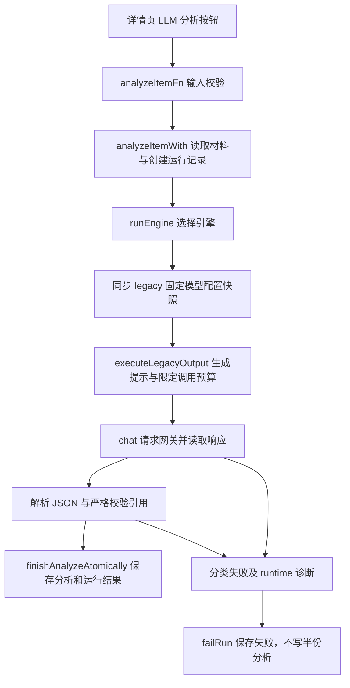

# A04 分析失败诊断与修复（2026-09-10）

## 结论与证据边界

已修复同步模型公共调用链把传输/响应异常吞成“分析失败”的问题。此前用户那次异常没有保存原始原因，不能断言是超时、网络或格式问题。

本次在改变业务行为前，对同一条目 `1a203103-fe5a-43b0-ab42-ce3e8a9226d4` 做了一次受控真实调用，32.414 秒成功：run_id `b8ff0cdf-fd11-4078-b7ed-4a88034a7f64`，analysis_id `41727e21-9788-4c51-97ca-6662d5dce238`。随后只读检查确认知识层显示摘要、洞察、标签及 gpt-5.6-luna，刷新后内容相同，无页面异常。说明故障并非每次必现；不能把本次成功归功于随后加入的诊断代码。没有继续重复生成。

## 实际数据流与代码块

以下路径均相对于正在运行的 `.worktrees/local-model-settings`，分支 `comet/local-model-settings`。

| 文件 / 代码块 | 职责 |
| --- | --- |
| `src/routes/inbox.$itemId.tsx` useMutation | 用户发起一次请求、显示进行中、完成后刷新条目查询。 |
| `src/lib/server/fns.ts` analyzeItemFn | 服务端输入校验与入口。 |
| `src/lib/server/analyze.ts` analyzeItemWith / runEngine / chat | 读取材料、运行管理、引擎选择、配置快照、网关 HTTP 与响应读取。 |
| `src/lib/server/legacy-output.ts` executeLegacyOutput / modelCallFailure | 有界输出修正、失败分类、调用次数与阶段耗时。 |
| `src/lib/server/agent-context.ts` validateCitations | 严格检查 evidence_id 与连续原文引用，不放宽来源规则。 |
| `src/lib/server/agent-runs.ts` finishAnalyzeAtomically / failRun | 原子保存成功结果；失败诊断写入 ai_runs.response_json.runtime。 |

当前同步 legacy 路径不经过异步 Eino worker；本次不代表异步服务验收通过。

## 修复内容

- 在 fetch、响应 JSON 读取及 content 类型边界分别处理错误，返回 model_timeout、model_network_error、model_http_error 或 model_response_invalid，而不是通用“分析失败”。
- 超时和连接中断保留 outcome_unknown，明确远端是否完成未知，不自动重复传输请求。
- 每次尝试记录 model_calls、阶段、错误类别与 duration_ms；严格校验失败也保留 runtime。分析、问答、简报共用该实现。
- 不记录 API Key、原始上游响应或异常中的敏感文字；HTTP 错误仅显示状态码。
- 保留原40秒请求截止时间、输出预算与最多两次格式修正规则，没有通过提高预算或放松引用校验掩盖问题。

## 验证

先添加失败测试，确认旧实现吞掉 TimeoutError / 返回 outcome_unknown 通用错误，再修改生产代码。回归覆盖超时、网络中断、非法 JSON、非字符串 content，验证三个同步入口均分类失败、每次只调用一次、ai_runs 有诊断，analyses 和 knowledge_notes 不出现半份结果。

- `npm run test:manual-fixes`：30项通过。
- `npm run typecheck`、`npm run build`：通过。
- 生产知识库桌面与390×844手机冒烟：无页面/控制台错误、无横向溢出，与此前生产基线无差异。证据在工作区 `screenshots/a04-diagnostics-built.json`。
- 当前开发实例真实分析只读刷新检查：结果保留，无页面错误；未重启8182服务，未证明跨服务重启持久化。

后续若再次失败，可通过运行记录中的错误类别、阶段、耗时与调用次数继续定位上游；本次不能证明网关稳定性，也未复测 A17 问答或 A09 简报真实生成。
