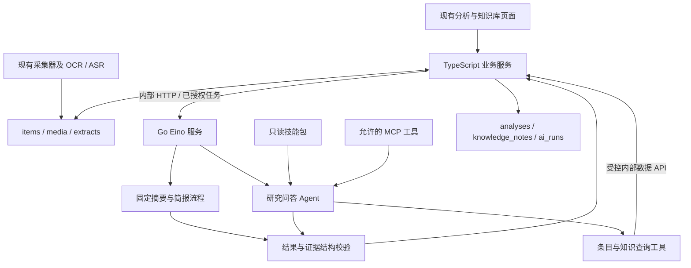

# 织识 Loom：LLM 现状与 Eino Agent 架构建议

日期：2026-09-07。状态：已完成代码调研，建议已确认进入详细设计；尚未实施。

配套文档：[详细实现方案](2026-09-07-eino-agent-implementation-plan.md)。本文记录架构判断和边界，实施步骤以配套方案为准。

## 1. 结论

可以引入 CloudWeGo Eino，支持后续 MCP 工具和 Agent Skills 扩展。推荐保留现有 TypeScript 数据与业务层，新增独立 Go 分析服务，以内部 HTTP 接入。先兼容现有分析、简报、问答入口，再将研究问答升级为具备工具调用能力的 Agent。

遵循 ponytail：保留采集器、媒体存储、OCR/ASR、数据库访问及页面；不为简单摘要启动复杂 Agent；优先使用 Eino 已有的 ChatModel、ADK、MCP 适配和 Skill Middleware，不自建通用插件平台。

## 2. 当前代码事实

以下是静态代码检查结果，不代表已经验证当前部署的密钥、模型可用性或付费调用。

| 能力 | 当前实现 | 代码位置 |
| --- | --- | --- |
| 信源、关键词采集 | 定时或手动调用采集器，归一化后入库；按信源与 external_id 去重 | [scheduler.ts](../../src/lib/server/scheduler.ts) |
| 媒体处理 | 媒体入库；图片 OCR、音视频 ASR；文本追加到 items.body | [extract.ts](../../src/lib/server/extract.ts)、[extract-targets.ts](../../src/lib/server/extract-targets.ts) |
| 自动提取 | runProductionTick 受 EXTRACT_AUTO 和时间预算控制；默认关闭自动 OCR/ASR | [nodes.ts](../../src/lib/server/nodes.ts)、[config.ts](../../src/lib/server/config.ts) |
| 单条分析 | 正文前 2,800 个 JS 字符单次请求，输出 summary/topics/entities/insights/tags | [analyze.ts](../../src/lib/server/analyze.ts) 的 analyzeItem |
| 简报 | 最近 12 条原始内容，每条正文前 280 个 JS 字符；输出固定章节 | 同文件 generateBriefing |
| 问答 | 用完整问题作 ILIKE 子串检索，最多 8 条，每条正文前 500 个 JS 字符；零匹配则取最新 8 条 | 同文件 askKnowledge |
| 调用入口 | 三个 createServerFn 由页面操作触发 | [fns.ts](../../src/lib/server/fns.ts)、[knowledge.tsx](../../src/routes/knowledge.tsx) |
| 分析持久化 | analyses 保存单条结果；knowledge_notes 保存简报与回答 | [0002_schema.sql](../../migrations/0002_schema.sql) |
| 数据库 | DATABASE_URL 存在时使用 pg；否则使用进程内 PGlite | [db.ts](../../src/lib/db.ts) |

### 2.1 模型调用

analyze.ts 的 chat() 使用服务端 XAI_API_KEY，直接 fetch xAI /v1/chat/completions。代码模型名为 grok-4.5，temperature=0.3，超时 45 秒；单条分析、简报、问答的 max_tokens 分别为 700、1100、800。

一次调用仅包含 system 和 user 消息。没有 tools、工具执行循环、跨轮会话记忆、Agent checkpoint 或运行事件持久化。

### 2.2 当前系统与完整 Agent 的差距

1. 行业分析依赖手动触发；采集和 OCR/ASR 自动运行不等于自动行业分析。
2. 简报、问答只查 items，没有复用 analyses 和历史 knowledge_notes。
3. 问答是简单的检索增强生成；没有语义检索、重排、查询改写或多轮证据补充。
4. citations 是输入材料列表，尚未逐条验证回答中的引用与原文关系。
5. 单条 JSON 依赖提示词，解析失败会把原始输出写成 summary；缺少严格结构校验。
6. 没有分析任务的幂等控制、完整运行账本或模型用量记录。OCR/ASR 的 extract_jobs 已有领取、重试和 fencing 思路，但不能把它当成分析运行表。
7. 没有在分析链接入 MCP 或 Skills。模板中的 app-data MCP 类型不是已接通的 Agent 工具。
8. 原文截断可能丢失后半段内容；OCR 追加文字也可能在截断范围之外。

## 3. Eino 的适用范围

Eino ADK 的 ChatModelAgent 可执行模型决策、工具调用、工具结果反馈的循环；固定任务仍可使用 ChatModel 或确定性编排。[官方 ADK 说明](https://www.cloudwego.io/docs/eino/core_modules/eino_adk/agent_preview/)

Eino MCP 适配器可将已初始化 MCP 客户端发现的工具转为 Eino Tools。它不自动承担所有 MCP Resources、Prompts、OAuth、多租户授权或第三方工具运行环境的集成。[工具接入文档](https://www.cloudwego.io/docs/eino/core_modules/components/tools_node_guide/how_to_create_a_tool/)

Skill Middleware 提供技能发现、按需加载 SKILL.md；技能可以携带参考资料和脚本，但脚本执行还需要运行环境与权限。第一版采用 inline 技能，不开启 fork、模型覆盖或任意命令执行。[Skill 文档](https://www.cloudwego.io/docs/eino/core_modules/eino_adk/eino_adk_chatmodelagentmiddleware/middleware_skill/)

Skill 属于指令与方法，Tool 属于可调用能力。强制校验、预算、保存和权限由业务代码负责，不能依靠 Skill 提示词保证。[官方 FAQ](https://www.cloudwego.io/docs/eino/faq/)

## 4. 建议架构

### 4.1 职责归属

| 部分 | 负责 | 不负责 |
| --- | --- | --- |
| TypeScript 业务层 | 输入校验、数据读取、执行授权、运行幂等、结果引用验证、原子保存 | 重新实现 Eino Agent 循环 |
| Go / Eino | 模型调用、固定工作流、Agent 循环、技能加载、MCP 工具使用、执行预算 | 直接连接 PGlite、复制现有 ORM/SQL 层 |
| 现有采集与媒体层 | 数据获取、去重、媒体提取 | 由 Agent 任意重配采集源或触发无预算采集 |
| Skill | 行业分析方法、证据要求、报告格式 | 作为可信权限策略或自动安装脚本依赖 |
| MCP | 提供明确允许的外部工具 | 默认授权所有工具或全协议能力 |

### 4.2 三种业务模式

- 单条分析：固定输入、固定 JSON 输出。程序组织正文和 OCR 材料；超长材料需分段或明确标记部分覆盖，不能静默只分析开头。
- 简报：程序选择时间范围与材料；可复用有效且未过期的 analyses。摘要作为二级材料，重要结论仍引用原始条目。
- 研究问答：Agent 可 search_items、get_item、get_analysis，必要时调用允许的外部 MCP 工具；缺乏证据时返回明确的不充分结论。

### 4.3 最小扩展边界

工具入口优先采用 Eino 自带 Tool 接口。业务端先暴露三种只读能力；Go 端将它们封装为工具。MCP 从静态配置读取服务、允许工具及凭证引用；Skills 从项目独立目录读取，不能直接把开发助手使用的 .agents/skills 全量挂入运行时。

新增最小 ai_runs 运行账本，关联既有结果，记录模型、提示词与技能版本、用量、工具事件摘要、错误和幂等信息。后续长任务需要队列或 checkpoint 时再扩展；第一版同步超时不能伪装成持久后台任务。

## 5. 实施顺序

| 阶段 | 内容 | 完成条件 |
| --- | --- | --- |
| P0 | 锁定 API 契约、依赖版本与模型兼容性验证方法 | Go 编译级兼容性探针和契约检查可运行 |
| P1 | 新增 Eino 服务，接管三个入口，完善校验、运行记录与回滚 | 三种功能在 legacy/eino 模式均能验证；失败不写伪结果 |
| P2 | 研究问答工具循环、一个 MCP 集成路径、受控 Skills | 可查内部条目、加载技能、调用允许的外部工具并返回可追溯引用 |
| P3，按需求启用 | 自动分析、长任务与恢复 | 单独预算、持久任务状态和故障恢复验证通过 |

P1 与 P2 是本次方案的完整交付范围；P3 提供后续实施入口，默认不启用。第一版无需 Redis、Kafka、向量数据库、可视化编排器、多 Agent 群或插件市场。

## 6. 必须保留的边界

- 服务间凭证与浏览器调用资格是两件事。当前应用无登录，内部 token 不会使公开页面自动具备用户隔离。第一版限受控部署与已授权共享语料；不增加假用户或无效的 authMiddleware。
- Go 服务独立部署。Compose 可增加内部服务；Vercel 上的 TypeScript 应用需调用外部 Go 服务，不能假设部署会自动运行常驻 Go worker。
- 模型适配器支持可配置 BaseURL 不等于已经验证 xAI 的工具调用、结构化输出和 usage 行为。依赖与模型必须经过专项兼容性验收。
- 网络超时后，不一定知道供应商是否已收费。不能自动切旧模型重复执行；回滚开关只影响后续新任务。
- 引用 ID 与片段存在性可程序校验，但不能声称已经机械证明每项观点在语义上成立。
- 自动分析需独立开关、调度和预算；不能复用 EXTRACT_AUTO 偷偷扩大自动付费范围。

## 7. 本轮保存范围

仅新增架构文档和详细实施计划；不修改业务逻辑、不应用迁移、不安装 Eino、不创建实际运行时技能、不调用付费模型、不调整现有部署。

本项目 Git 元数据在 .repo；编写文档时观察到 restart.bat 已有本地修改，应保留，后续不得将该变更误并入 Agent 功能提交。
