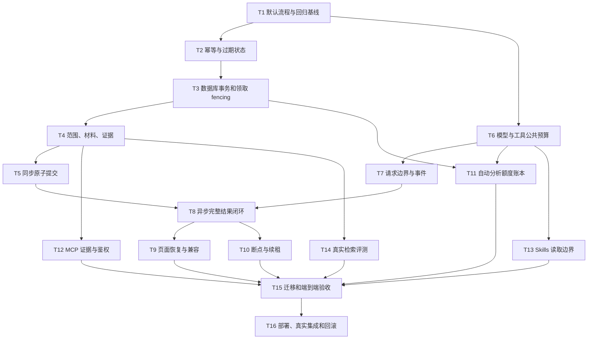

# Eino Agent 补强 Implementation Plan

> **For Claude:** REQUIRED SUB-SKILL: Use superpowers:executing-plans to implement this plan task-by-task.

**Goal:** 在现有 Eino 集成上修复已复现缺陷，使同步分析、研究证据、异步任务、MCP/Skills 与成本控制形成可验证的完整链路，再按门禁逐项开放能力。

**Architecture:** 保持 TypeScript 负责业务授权、材料快照、运行/任务账本和最终保存，Go Eino 负责有界模型及工具执行。复用现有接口、表和组件；同步与 Worker 共享执行边界，所有成功结果共享业务校验/提交入口。长任务继续使用已有队列和 Eino checkpoint，不增加第二套 Agent 框架、消息队列或通用插件平台。

**Tech Stack:** 当前项目锁定的 Go/Eino/Eino ADK/eino-ext、TypeScript/Zod、React/TanStack、pg/PGlite、Node test、Go test、已有浏览器验收工具、Docker Compose。优先使用已安装依赖；本文接口为项目业务设计，SDK 方法签名以当前 go.mod 实际编译结果为准。

---

## 0. 实施边界与依据

依据：[原架构](2026-09-07-eino-agent-architecture.md)、[原 20 项实施方案](2026-09-07-eino-agent-implementation-plan.md)、[本轮核验报告](2026-09-08-eino-agent-review.md)。本计划是对原方案的整改增量；原方案中的契约、数值上限和验收要求在没有明确修改说明时继续有效。

评审基线为 `76b6da1ac8a8d6d6c6a4b30e7f0309c9e18fd8b9`。本文尚未执行，不能把计划中的接口、测试、迁移或命令写成已完成事实。本轮仅保存文档和验证材料。

实施遵循 ponytail：保留有效实现，修共享调用点，删除复制的假 E2E 逻辑；新增事务能力只为已经复现的原子性问题服务。不得顺便重写采集、账号、提取或页面设计。不得覆盖工作区已有 `restart.bat` 修改。不要为“拓展性”先加入动态代码执行、任意 shell、自动安装 Skills 或全开放 MCP。

测试默认用 fake 模型/MCP 和隔离数据库，不消费真实模型额度。生产配置、真实供应商和外部服务验收独立于离线测试；没有凭证/授权时准确保留“待验证”。这里没有授权自动发布、推送或启用自动付费调度。

## 1. 固定目标契约与状态关系

### 1.1 能力开关

`AI_ENGINE=legacy` 保持默认，并覆盖单条分析、简报、研究全部新请求。新增 `AGENT_ASYNC_RESEARCH_ENABLED=false` 作为异步研究的明确能力门禁，服务端必须执行；前端展示服务端解析后的能力。现有 `AUTO_ANALYZE=false` 保持默认。MCP 可用工具集合为空表示零工具；Skills 只加载受控部署目录。

异步请求只在 `engine=eino && asyncEnabled && worker 配置完整` 时接收，否则返回明确的 capability_unavailable；旧式研究按钮默认同步，不能自动转换成付费排队任务。关闭开关应停止新入队/新领取，已有运行按已保存 provider 和策略完成或被明确取消，不在另一引擎隐式重跑。

### 1.2 统一成功提交

所有入口遵守这一顺序：

```text
可信请求校验 → 请求幂等/冲突判定 → 首次材料与权限快照
  → 受预算约束的模型/工具执行 → 结构校验
  → 从本次 run 的服务器证据收据校验引用
  → 原子复核 claim、租约、材料版本
  → 业务结果 + ai_run +（若有）ai_job 一次事务提交
```

`job=succeeded` 的不变量：关联 run 已 succeeded，response_json 已保存，关联 answer/analysis 已存在；重复 complete 返回同一业务对象，不再次插入。研究/简报保存“此次查询的历史材料快照”；单条分析只有当前材料仍与快照一致时才可把 item 标记 analyzed。

### 1.3 状态与恢复

| 场景 | 要求 |
|---|---|
| 相同 request_id、相同规范化输入 | 重放已有结果或当前状态；不重新付费 |
| 相同 request_id、不同输入 | 409 request_conflict；不能创建第二个 job |
| 过期，确认尚未开始模型/外部调用 | 可按已保存策略安全重排，创建新 claim generation |
| 调用已发出，结果不确定 | outcome_unknown；禁止自动整次重跑 |
| 旧 token / 已过期 lease | 完成、续租、checkpoint 写入均拒绝 |
| 有兼容 checkpoint 且恢复点可安全继续 | 新 generation 恢复剩余步骤，已完成调用不得被无记录重放 |
| checkpoint 版本不兼容 | 可见的 version_mismatch；不偷偷从头执行 |

`expires_at` 是整次允许执行的上限，`lease_until` 是当前 worker 所有权到期时间；续租不得突破前者。事务等待后用实际数据库时间复核有效性，不能只用事务开始时间证明未过期。

## 2. 依赖与放行顺序



执行时先顺序完成共享契约和事务基础。每个任务是一组小型红—绿循环；一个 Step 的测试清单可逐例执行，避免一口气写完整大模块。每项完成留下最小可执行检查和可独立评审的 diff；版本控制提交遵循执行会话授权，只暂存该任务文件，不使用 `git add .`，不自动 push。

## 3. 文件级任务

### Task 1：恢复默认 legacy 与同步研究入口

**对应发现：** A01/A02。**依赖：** 无。

**Files:**

- Modify: `src/lib/server/analyze.ts`, `src/lib/server/analyze.test.ts`, `src/routes/knowledge.tsx`。
- Test: `validation/agent/review-2026-09-08/repro.test.ts` R01；后续 UI 验证归 Task 9/15。

**Step 1 — 固定反例。** 运行 R01，确认提示要求的平铺 JSON 被拒绝；将同一行为加入现有 analyze.test，fake fetch 必须返回旧式模型输出，不直接构造新 ExecuteResponse。

**Step 2 — 修唯一适配边界。** 在 executeLegacy 按 mode 包装，不改公共契约以迎合错误实现。单条结果的目标形状为：

```typescript
const { summary, topics, entities, insights, tags, citations, insufficient_evidence } = parsed;
const result = {
  analysis: { summary, topics, entities, insights, tags },
  citations,
  insufficient_evidence,
};
```

继续用现有 schema 验证必填字段/长度/类型；不要靠 `as`、空串或空数组把非法模型输出变成功。

**Step 3 — 恢复兼容默认。** knowledge 页面停止无条件 async:true；服务端默认同步。在 Task 8 接通异步之前，异步能力保持关闭。验证 briefing 无参数和 ask 旧参数形式仍可调用，所有模式遵循同一 engine 配置。

**Step 4 — 收敛失败出口。** 在已领取 run 的边界捕获传输/解析/保存异常，记录可见错误或 outcome_unknown；保持禁止隐式 fallback。不要把“收到响应但解析失败”与“请求是否执行未知”混成相同重试策略。

**Step 5 — 验证。** `node --experimental-strip-types --test --test-name-pattern=R01 validation/agent/review-2026-09-08/repro.test.ts` 与 `node --experimental-strip-types --test src/lib/server/analyze.test.ts` 应通过。验证三种模式 legacy/eino 的结果兼容，fake 计数证明无双请求。

### Task 2：稳定幂等身份并收敛过期运行

**对应发现：** A05。**依赖：** T1。

**Files:**

- Modify: `src/lib/server/analyze.ts`, `src/lib/server/agent-runs.ts`, `src/lib/server/agent-runs.test.ts`, `src/lib/server/analyze.test.ts`。
- Modify: `src/lib/server/agent-queue.ts`, `src/lib/server/agent-queue.test.ts`。
- Test: 本轮 R02/R07。

**Step 1 — 增加失败用例。** 覆盖成功后正文清空/删除、briefing 跨上海零点重试、request_id 换问题、同一 async request 换材料、模型抛错留下 running。

**Step 2 — 调整查找次序。** 校验客户端稳定输入后先查 request_id；已存在时使用其首次保存的归一化时间范围/材料快照核验身份，再重放结果或状态。首次请求才读取当前材料。显式用户输入改变仍报冲突，不能因为优先重放而忽略不同问题。

**Step 3 — 保存异步请求身份。** 对 async 入队使用稳定 request_id 唯一性，不能继续把 material_hash 放在唯一键中允许同请求产生第二任务；所需字段/索引统一在 T3 新迁移增加。旧 task 无稳定 id 的数据不猜测补成同一请求。

**Step 4 — 增加过期收敛入口。** beginRun 状态读取/现有调度入口调用同一小函数处理过期：有明确发送事实且未知结果转 outcome_unknown；只有确定未执行可重排。条件更新只终结匹配的过期 generation，不可覆盖刚完成成功的 run。

**Step 5 — 验证。** `node --experimental-strip-types --test src/lib/server/agent-runs.test.ts src/lib/server/analyze.test.ts`；R02/R07 应由失败变通过。补充时间注入测试，不等待真实午夜；检查重放时模型计数不增加。

### Task 3：增加最小事务能力，修复领取和租约 fencing

**对应发现：** A04/A05/A08。**依赖：** T2。

**Files:**

- Modify: `src/lib/db.ts`, `src/lib/server/agent-queue.ts`, `src/lib/server/agent-runs.ts`。
- Create: `migrations/0014_agent_integrity.sql`（执行前确认编号仍空闲，若已占用顺延；禁止修改已应用的 0011—0013）。
- Create: `src/lib/server/agent-integrity.test.ts`。
- Test: `validation/agent/review-2026-09-08/postgres-race.test.ts` PG01、R06。

**Step 1 — 定义有限事务接口。** 当前 Sql.query 使用 pg pool.query，各次调用不保证同连接；增加 `transaction<T>(fn: (tx: Queryable) => Promise<T>): Promise<T>`。pg 实现为获取一个 client → BEGIN → 回调 → COMMIT，异常 ROLLBACK，finally release；PGlite 使用其原生 transaction 回调。保留现有 tagged-template/query 接口，不另造 ORM。

**Step 2 — 先测事务语义。** 新用例验证中途异常全部回滚、连接释放、提交异常不回报成功；与真实 pg 多连接执行相同语义。不得在原 pool.query 接口上分散发 BEGIN/COMMIT。

**Step 3 — 修领取语句。** 使用同一事务行锁，或单语句锁定候选后条件更新。保留现有 kind/排序/next_attempt_at 条件，关键结构为：

```sql
WITH candidate AS (
  SELECT id FROM ai_jobs
  WHERE status = 'queued' AND next_attempt_at <= now()
    AND CASE WHEN $3 = 'research' THEN item_id LIKE 'research:%'
             ELSE item_id NOT LIKE 'research:%' END
  ORDER BY created_at, id
  FOR UPDATE SKIP LOCKED
  LIMIT 1
)
UPDATE ai_jobs AS j
SET status = 'running', attempts = attempts + 1, claim_token = $1,
    lease_until = now() + ($2::integer * interval '1 second'), updated_at = now()
FROM candidate AS c
WHERE j.id = c.id AND j.status = 'queued'
RETURNING j.*;
```

**Step 4 — 固定写入所有权。** complete/renew/checkpoint 共享同一语义：job 与 run 关联、当前 token、running、未到期同时成立。事务按固定顺序锁 job → run → item/依赖源行，拿锁后用数据库当前实际时间复核租约；不允许提交条件只查 id。

**Step 5 — 加迁移并验证。** 增加稳定 request_id 唯一索引、必要的 job↔run/claim generation 字段及重复结果约束；上线前检测已有冲突记录，不静默删除。PG01 必须只得到一个胜者，R06 必须拒绝过期完成。测试两个 job 可被两个 worker 分别领取，不能为修复重复领取而引入全表串行锁。

### Task 4：统一材料范围、快照和证据收据

**对应发现：** A03/A06/A09。**依赖：** T3。

**Files:**

- Modify: `src/lib/server/agent-context.ts`, `src/lib/server/agent-data.ts`, `src/lib/server/agent-runs.ts`, `src/lib/server/analyze.ts`。
- Modify: `src/routes/api/internal/agent-data.ts`。
- Modify: `workers/agent/internal/agent/tools.go`, `workers/agent/internal/agent/contract.go`。
- Test: `src/lib/server/agent-context.test.ts`, `src/lib/server/agent-data.test.ts`；R03/R04。

**Step 1 — 先补范围用例。** search_items 多个 term＋日期、get_item/get_analysis 指定范围外 id、旧分析 hash、跨 run token/收据、参数试图扩范围，全部应拒绝或过滤。保存的 run 范围是唯一授权来源。

**Step 2 — 修共享数据选择。** 把 OR 条件括起来后再 AND 范围；所有动作复用范围谓词及参数校验。offset/limit 为有界整数；未知 action/字段按契约拒绝。数据授权不应交给模型提示保证。

**Step 3 — 统一 materialFingerprint 和 mapItem。** 使用原方案定义的全部材料字段，包括正文、标题、来源名称、发布时间及影响材料语义的提取状态。分析/自动队列/内部取数引用同一函数，不复制字段列表。total sources≤12、总量≤24000、片段长度与 coverage 按原约束；截取前先分配全局预算，不能先超额生成再交 schema 报错。

**Step 4 — 固定收据身份。** 每份收据绑定 run_id、材料版本/hash、片段区间、实际正文 hash、来源元数据。内部 ID 使用不含歧义的格式，例如 `item:<id>:<materialHash>:<start>:<end>`；MCP 使用 run/调用序号/结果索引。不要让种子 index 与字节/字符 offset 共用含义。明确 offset 单位为 Unicode 字符还是 JS UTF-16，并通过中英文/emoji 跨语言用例对齐。

**Step 5 — 接通收据与最终验证。** tool 返回给模型的 payload 和服务器保存的收据共享同一 ID；Go 同时解析单条和搜索数组结果。最终 validator 从 run 持久化收据构造允许集合，核对 quote 区间及来源，不把模型自报 evidence 当可信材料。设置收据数量及总字节上限；部分尾段仍保持 partial。

**Step 6 — 验证。** `node --experimental-strip-types --test src/lib/server/agent-context.test.ts src/lib/server/agent-data.test.ts`；R03/R04 应通过。额外验证 16 候选/超 24000 字符/未完成 OCR、同工具重复取同条不同片段、跨运行伪造引用；无材料保持明确不足，不用无关最新条目凑答案。

### Task 5：统一同步与后续异步的原子结果提交

**对应发现：** A04/A05/A03。**依赖：** T3/T4。

**Files:**

- Modify: `src/lib/server/agent-runs.ts`, `src/lib/server/analyze.ts`, `src/lib/server/agent-runs.test.ts`。
- Create: `src/lib/server/agent-completion.ts`, `src/lib/server/agent-completion.test.ts`（只承载三种操作共用的验证/事务入口）。
- Test: PG02、R09。

**Step 1 — 先固化竞争用例。** 单条分析提交时正文并发更新、来源名称/发布时间并发更新、相同 run 双完成、完成与失败竞争、业务 INSERT 故意失败均不得产生半成功。

**Step 2 — 使用 T3 事务。** 锁定当前 run 及当前材料依赖行后，读取最新值计算 T4 同一指纹，与执行快照比较；不能继续依赖先前 SQL 语句快照中的 matched CTE。来源名称来自关联行时也要保证其一致性，或引入经过所有写入口维护的材料版本；不得只修 body。

**Step 3 — 实现统一 completeValidatedRun。** 其输入仅为已认证 run/claim 和待校验 ExecuteResponse；内部核对 schema/run_id/mode/provider、运行策略、证据及当前状态，再写业务对象和 run。不得由 Worker 自报 status 绕过校验。同步研究/简报保存快照引用，单条分析检查当前材料。

**Step 4 — 支持安全重复完成。** 相同成功结果返回已保存业务对象，重复消息不重复插入；同 token 不同结果或不同关联 job 拒绝。失败/未知不插业务成功行，保存实际可知 usage；事务失败保证 run 不提前 succeeded。

**Step 5 — 验证。** `node --experimental-strip-types --test src/lib/server/agent-completion.test.ts src/lib/server/agent-runs.test.ts`，并运行隔离 PG02。要求旧材料提交得到 input_changed，新正文不能被标 analyzed，source_name 变化的 R09 同样通过。

### Task 6：所有模型、工具与修复共享真实预算

**对应发现：** B01/B02/B06。**依赖：** T1。

**Files:**

- Modify: `workers/agent/internal/agent/model.go`, `research.go`, `workflow.go`, `tools.go`。
- Modify: `workers/agent/internal/agent/research_test.go`, `workflow_test.go`。
- Create: `workers/agent/internal/agent/budget_test.go`。
- Test: 将 Go overlay 预算反例迁入正式包测试。

**Step 1 — 先检查线上请求。** httptest 模型模拟一次工具调用＋一次最终回答，策略 model_calls=1 时计数最多为 1；max_output 参数必须出现在实际请求 JSON。usage 有值与无值分别断言，不能只读业务计数器。

**Step 2 — 实现唯一模型包装。** 替换未使用的 countedModel 壳，使固定流程、ADK Generate/Stream、BindTools 后返回实例和 repair 都共享同一个 run budget。每次真正发送前原子预占额度；超限零新增请求。检查锁定 SDK 自动重试设置，关闭或把每次网络尝试纳入预算；不能只限制高层 Generate 次数。

**Step 3 — 传递实际输出限制。** 使用锁定 adapter 支持的字段，将 policy 输出上限放进供应商请求；测试断言实际 wire JSON。模型不支持必要限制时拒绝启用该模式，不用 max_iterations 冒充模型 token 限制。

**Step 4 — 合并工具计数。** internal/MCP/skill 统一预占 tool budget，模型调用和工具调用分别累计；并行使用同步保护。技能加载不能绕过总工具数/内容字节限额。修复调用移除额外 takeModel，只通过公共模型入口一次扣减。

**Step 5 — 对齐提示、修复输入和 runtime。** research 允许执行已暴露的只读工具，固定分析不暴露工具；移除互相矛盾的 Do not call tools。repair 输入必须有有界的原输出、mode 对应目标 schema 和结构错误，并保持原证据约束；用测试检查第二次实际请求包含这些内容，不能只预设第二个回答正确。累计实际成功/失败尝试及 token usage，未知保留 null，达到上限返回明确 budget_exceeded 和已经发生的用量。

**Step 6 — 验证。** `go -C workers/agent test ./internal/agent -run 'Budget|Research|Workflow' -count=1`。补充预算 0/1/N、并行工具、一次合法 repair、Stream、工具绑定后调用、SDK 重试场景；本轮预算探针应转绿。

### Task 7：统一入口 deadline、响应体限额和事件收敛

**对应发现：** B05/B06。**依赖：** T6。

**Files:**

- Modify: `src/lib/server/agent-client.ts`, `src/lib/server/agent-client.test.ts`。
- Modify: `workers/agent/internal/agent/server.go`, `worker.go`, `tools.go`, `research.go`。
- Modify: `workers/agent/internal/agent/server_test.go`, `worker_test.go`。

**Step 1 — 先运行 R08。** 增加先返回 headers 再永久悬挂 body、分块超上限、无 Content-Length、非 2xx JSON/HTML 用例。

**Step 2 — 有界读取。** AbortController 生命周期覆盖 fetch、读取、解码、schema 校验；finally 最后清 timer。用 ReadableStream reader 累计字节，超过配置上限立刻 cancel/abort；不能先 arrayBuffer 再判长度。内外部 HTTP 请求体与工具响应也使用同原则。

**Step 3 — 复用执行边界。** HTTP 与 Worker 调用同一个受控执行函数，在该函数中获取服务级 semaphore、计算 policy deadline 与服务最大值的交集、创建 context 并释放资源。Worker 不得拿 Background 直接执行无限长循环；取消传播到模型和工具。

**Step 4 — 有界事件。** 用一个同步保护的记录器记录模型/工具/修复/保存等关键事件，截断日志按字节及条数限制；不记密钥/完整提示/未脱敏工具内容。将已有 runtime events 持久化到对应 run，避免只在返回值存在。

**Step 5 — 验证。** `node --experimental-strip-types --test src/lib/server/agent-client.test.ts` 与 `go -C workers/agent test ./internal/agent -run 'Server|Worker|Budget' -count=1`。R08 应通过；Linux/支持 CGO 的环境执行 `go -C workers/agent test -race ./... -count=1`，无法编译时仍列待验证，不能当 PASS。

### Task 8：让异步研究领取、取数、结果和 job 真正闭环

**对应发现：** A02。**依赖：** T2—T7。

**Files:**

- Modify: `src/lib/server/agent-jobs.ts`, `agent-queue.ts`, `agent-completion.ts`, `analyze.ts`。
- Modify: `src/routes/api/internal/agent-jobs.ts`。
- Modify: `workers/agent/internal/agent/worker.go`, `worker_test.go`。
- Create: `src/lib/server/agent-jobs.test.ts`。

**Step 1 — 将错误探针改为业务断言。** 增加真实 handler claim→data→complete 链，要求 data=200、run=succeeded、job=succeeded、answer 行=1、response_json/usage/引用存在。以 `review-spec-worker.mjs` 为输入，不保留“错误现象即 PASS”的最终验收方式。

**Step 2 — 严格内部 API。** 为 claim/complete/renew/checkpoint 动作定义 Zod 输入和对应 Go 结构；拒绝未知 status、超长 payload、错误 run/job/token 关联，不能用 String/Number 强制转换把错误输入变成默认值。

**Step 3 — 原子领取与运行。** 在同一事务关联 job 和唯一 run；来源为提交时保存的 request/provider/policy/范围/快照。生成一次性运行取数 token，仅存 hash，领取响应把原值给当前 worker；恢复领取轮换 token，使旧 worker 不能继续取数。不得日志输出原 token。

**Step 4 — 使用完整 ExecuteRequest。** Worker 取得 sources、data_access_token、data endpoint、模型策略及 deadline；经 T7 统一边界执行。完成 POST 的 response 必须走 T5 的校验/保存，job 在同一事务结束；HTTP 409/5xx 必须处理，不能丢弃状态。

**Step 5 — 处理消息重复和未知。** 已保存成功但 complete 响应丢失时允许同一结果重传；只重传完成消息，不重新调用模型。执行结果未知不写 succeeded，run/job 状态一致。定义 shutdown 和当前任务取消行为。

**Step 6 — 验证。** `node --experimental-strip-types --test src/lib/server/agent-jobs.test.ts` 与 `go -C workers/agent test ./internal/agent -run Worker -count=1`。至少验证正常完成、重复 complete、伪造引用、跨 job token、令牌轮换、complete 响应丢失；数据库中一个请求只有一个业务结果。

### Task 9：页面能力门禁、刷新恢复和错误可恢复性

**对应发现：** A02/A03。**依赖：** T8。

**Files:**

- Modify: `src/routes/knowledge.tsx`, `src/lib/server/analyze.ts`, `src/lib/server/queries.ts`。
- Test: `scripts/agent-e2e.mjs`（T15 完成真实浏览器脚本）。

**Step 1 — 服务端能力决定入口。** 返回必要的 engine/async 能力信息，页面只在已开放时显示长任务入口；不得把密钥/内部 URL 放浏览器。legacy 保留旧式同步体验。

**Step 2 — 保存可恢复身份。** 用 URL search 参数保存 jobId，初始化校验格式并通过服务端查询状态；在有现成身份体系的部署上继续做访问范围检查。刷新恢复的是服务器任务，不保存模型响应或服务 token 到 localStorage。

**Step 3 — 明确停止条件。** succeeded 拉取已保存答案；failed/outcome_unknown 显示原因并允许用户发起新请求；not_found/无权访问停止轮询。网络暂断按有界退避重试，超过页面等待上限停止主动轮询并保留任务链接，刷新可继续查状态。

**Step 4 — 统一引用呈现。** 当前与历史答案都读取持久化引用，显示内部条目/外部来源、片段、partial/材料不足；外链仅允许 http/https。失败后解除提交按钮的禁用状态，清理过期 requestId，避免新问题复用旧请求身份。

**Step 5 — 验证。** T15 的浏览器用例覆盖同步回答、异步成功、失败后再次提问、刷新、重新打开链接、错误 jobId、引用点击及历史笔记。交互行为通过后才恢复“刷新后可继续”的产品文案。

### Task 10：接入 Eino checkpoint 与有边界的任务恢复

**对应发现：** A08/A05。**依赖：** T8。

**Files:**

- Modify: `workers/agent/internal/agent/research.go`, `worker.go`, `worker_test.go`。
- Modify: `src/lib/server/agent-checkpoints.ts`, `agent-checkpoints.test.ts`, `agent-jobs.ts`, `agent-queue.ts`。
- Modify: `migrations/0014_agent_integrity.sql`，若已应用则新增后续迁移。

**Step 1 — 锁定 SDK 实际恢复流程。** 为当前版本建立小型 Runner checkpoint/interrupt/resume 编译测试；确认 Store 构造和恢复入口后把现有 httpStore 接入，禁止仅定义类型即标完成。

**Step 2 — 原子保存 checkpoint。** T3 事务锁定当前 job/run，验证 token/lease 后写。sequence 必须单调递增；重复相同 sequence＋payload 可幂等，相同 sequence 不同 payload 拒绝。通过 RETURNING 判定是否真的写入，校验 schema/runtime/policy/model/skill 版本及 payload≤256KiB。

**Step 3 — 接入续租。** worker 在健康执行期间提前续租（例如 60s lease 每 20s，具体随配置），续租失败立即取消执行；续租不能突破 run 总上限，停止进程不会永久保留所有权。写入/完成锁等待后再次按实际时间验有效期。

**Step 4 — 明确恢复判定。** 新 worker 获取新 claim generation；可证明安全的 checkpoint 继续剩余步骤，未知外部调用不自动重放。checkpoint 记录完成调用收据与预算余额，恢复后继续累计预算，不能重置为满额。httpStore 的 409/错误必须传播，不能伪装未找到。

**Step 5 — 进程级故障验证。** 在 fake 模型完成一个步骤、checkpoint 落库后终止 worker 进程，启动另一进程恢复，断言旧步骤模型计数不增加、剩余步骤完成、旧 token 被拒绝。补充 checkpoint 之前/之后响应丢失、版本升级、payload 超大、续租超时。

**Step 6 — 验证。** `node --experimental-strip-types --test src/lib/server/agent-checkpoints.test.ts src/lib/server/agent-jobs.test.ts` 与 `go -C workers/agent test ./internal/agent -run 'Worker|Checkpoint|Resume' -count=1`。最终进程故障用例由 T15 的集成 harness 执行，单测替代不了 kill/restart 证据。

### Task 11：自动分析准入、预算预占与幂等结算

**对应发现：** A07。**依赖：** T3/T5/T6。

**Files:**

- Modify: `src/lib/server/agent-queue.ts`, `agent-queue.test.ts`, `src/lib/server/cron.ts`。
- Modify: `src/lib/server/agent-completion.ts`。
- Create: `migrations/0015_agent_budget_reservations.sql`（按实际空闲编号）。
- Create: `src/lib/server/agent-budget.test.ts`。

**Step 1 — 固定最重要的拒绝用例。** R05，首次/已有预算行，次数 0、金额 0、并发争抢最后额度、非法/缺失价格、跨日排队。期望无 job、无错误预占、零模型请求。

**Step 2 — 设计最小 reservation 账本。** 每项关联唯一 job/request，记录预算日期、price_version、模型、预估上限、状态 reserved/settled/released/unknown、实际 usage/费用及幂等键。原有按日汇总保留，明细用于幂等结算；唯一约束保证同 job 不重复预占。

**Step 3 — 原子准入。** 同一事务创建/锁定每日汇总，统一验证次数和金额，再插 reservation 与 job；首次 INSERT 和后续 UPDATE 用同一限额逻辑。事务失败全部回滚，不靠补偿释放修复常规中断窗口。

**Step 4 — 用可证明上界替代常量。** 依据已配置版本价格、输入 token 上界、每次输出上限、模型总调用上限计算最大费用，并与 T6 实际限制一致。缺少 tokenizer 时可用有证据的保守界，无法保证则拒绝自动计费模式；不能随意设 worstCost=1。

**Step 5 — 执行日与结算。** 排队跨日时执行前在事务中重新检查/转移到执行日额度，防止旧日额度在新日集中消费。成功按真实 usage 幂等结算；未知用量保留预占/unknown，不能当 0 释放；确定未发送可释放。重试不产生重复预占或绕过当日上限。

**Step 6 — 业务就绪筛选。** 沿现有提取状态判断材料真正可用，含“应提取但任务尚未创建”；有效旧分析必须对应当前指纹。对 analyzed 条目正文更新的重分析采用同一材料规则，避免状态筛选永久漏掉。mapItem 来源使用 T4 共享映射。

**Step 7 — 验证。** `node --experimental-strip-types --test src/lib/server/agent-budget.test.ts src/lib/server/agent-queue.test.ts`，隔离 PG 双连接争最后额度；R05 应通过。AUTO_ANALYZE 仍默认关闭，待 T16 明确开放。

### Task 12：完成 MCP 鉴权、外部证据与连接生命周期

**对应发现：** B03/A03。**依赖：** T4/T6/T7。

**Files:**

- Modify: `workers/agent/internal/agent/mcp.go`, `mcp_test.go`, `config.go`。
- Modify: `src/lib/server/agent-data.ts`, `agent-completion.ts`，复用可信内部接口记录 MCP 收据。
- Modify: `docs/operations/agent-service.md`。

**Step 1 — 建本地 fake MCP 服务。** 使用锁定客户端实际支持的 Streamable HTTP 跑初始化、list_tools、call_tool，不只测试工具名函数。覆盖空名单、重复名、401、超时和多次调用。

**Step 2 — 落实 TokenEnv。** 启动时从服务器环境解析配置引用；缺失必需 token 报明确配置错误。凭据按当前 SDK 的请求 header 机制传输；跨源重定向拒绝，日志脱敏。只允许部署配置中的 endpoint，不接受模型指定 URL 扩展服务器。

**Step 3 — 有界调用及关闭。** 调用经过 T6/T7 限制；限制返回字节、内容块数量和单块大小；每次运行资源结束时关闭 client，或做有明确所有权的生命周期复用，避免无界连接增长。

**Step 4 — 服务器收据。** 给每次 call 的每个可用文本片段生成唯一 ID，先经已认证的内部 evidence 动作保存到对应 run，工具输出把该 ID 和允许的元数据给模型。工具返回本身仍是不可信材料；不从任意 JSON 字段推断可信来源 URL。由适配器规定支持的来源字段，无法取得 URL 时诚实显示服务/工具来源，不制造链接。

**Step 5 — 验证。** `go -C workers/agent test ./internal/agent -run MCP -count=1`；TS 测试有效 MCP 引用可保存、伪造 receipt 拒绝、重复同工具无 ID 冲突、外部引用可从历史答案恢复。真实 MCP smoke 留 T16，不宣称 Resources/Prompts/OAuth 已实现。

### Task 13：修复 Skills 路径边界并纳入运行治理

**对应发现：** B04/B01。**依赖：** T6/T7。

**Files:**

- Modify: `workers/agent/internal/agent/skills.go`, `skills_test.go`, `research.go`。
- Modify: `docs/operations/agent-service.md`。
- Test: 将本轮 SkillRoot 探针迁入 skills_test.go。

**Step 1 — 先测读取边界。** 绝对根外路径、`../`、同名前缀目录、嵌套 symlink、SKILL.md symlink、Windows junction/不同盘符、合法根内引用、超过 32KiB 都有用例；平台不支持创建 symlink 的测试标明 skip 并在 Linux 补跑。

**Step 2 — 把 root 用在真实入口。** root 启动时绝对化，Read/GlobInfo 解析请求后计算 filepath.Rel，拒绝绝对 rel、`..` 或以 `../` 开头；结合 Lstat/EvalSymlinks 验证最终路径仍在 root。前缀比较不能代替路径归属判断。部署使用只读、不可被运行中模型修改的技能目录，以减小检查/读取之间变化窗口。

**Step 3 — 有界读取并传播错误。** 文件先有界读 MAX+1 再判大，避免 ReadFile 全量读后限制；不要丢弃 Walk 错误。不支持的写入/执行动作明确返回权限/能力错误，不能返回空成功假装执行过。

**Step 4 — 保持 Skills 最小语义。** SKILL.md 是受控指令包，不是自动执行脚本授权。只读引用资源同样经过边界；涉及 shell/fork 等能力的包标不支持。按实际调用登记 used_skill_versions，available 清单可独立存元数据；加载计入 T6 工具/上下文限额。

**Step 5 — 验证。** `go -C workers/agent test ./internal/agent -run Skill -count=1`；根外探针转绿、正常技能仍可按需加载、无写文件或启动进程副作用。不要扩大结论为任意第三方技能已兼容。

### Task 14：把检索评测接到真实候选与材料选择链

**对应发现：** A09/A10。**依赖：** T4。

**Files:**

- Modify: `scripts/agent-retrieval-eval.mjs`, `validation/agent/retrieval-cases.json`。
- Modify only if justified: `src/lib/server/agent-context.ts`, `agent-data.ts`。
- Create: `validation/agent/retrieval-eval-after-remediation.json`。

**Step 1 — 保留原结果作为基线。** 不覆盖旧的 2026-09-07 评测冒充同一实验；明确原 16 条材料/22 问题的小样本范围。

**Step 2 — 建代表性离线语料。** 至少覆盖候选数超过实际 SQL 上限、正文超 24000、命中在末尾、中文分词、多词 OR、时间边界、无关/重复条目和无答案。给每问标注相关条目与支持答案的片段区间，不要求付费模型标注。

**Step 3 — 调生产检索函数。** 向隔离数据库导入语料，通过实际 search SQL、候选限制、rank 和材料选择生成输入；旧/新策略使用相同查询/材料预算。禁止再复制一份排序函数当验收对象。

**Step 4 — 输出可解释指标。** 保存候选 recall@k、最终片段覆盖率、无答案误取率、截断比例、返回字节与离线耗时；区分检索质量和模型答案质量。改进必须满足先约定的阈值（至少关键场景不退化、范围越界为零），不为提高小样本分数临时放宽条件。

**Step 5 — 验证。** `node scripts/agent-retrieval-eval.mjs` 改造后输出版本/语料 hash/真实检索配置/结果；新增正常测试防回归。仅在证据表明必要时再考虑索引/分块/向量能力，不预先引入新数据库。

### Task 15：补齐真实端到端、跨语言、迁移和并发验收

**对应发现：** A10；也是所有修复的最终门禁。**依赖：** T1—T14。

**Files:**

- Replace implementation: `scripts/agent-e2e.mjs`。
- Modify: `scripts/agent-contract-check.mjs`, `package.json`。
- Create: `scripts/agent-integration-harness.mjs`（仅管理隔离依赖和 fixture，不复制业务实现）。
- Create: `validation/agent/acceptance-after-remediation.md`。
- Reuse: 本轮回归/PG 用例；验证后迁入正式测试位置并保留原证据归档。

**Step 1 — 纳入有意义回归。** package test 或专门 agent test 命令必须实际执行新增边界测试；测试枚举不能遗漏新文件。跨语言运行同一 payload 经真实 TS→Go→TS 边界，补 missing/null、未知字段、错误 mode、最大 sources、超长内容和伪造引用。

**Step 2 — 真实应用链假供应商。** harness 启动独立 DB、假模型/MCP、当前 Go worker 与当前应用；浏览器访问真实应用路由，不用手写 rendered 字符串。禁止使用或重启现有业务数据库/容器；随机测试端口、清理仅限本次创建资源。测试目标防误用检查要保留且覆盖所有写操作。

**Step 3 — 端到端用例。** 单条分析、简报、同步/异步研究、新内部/MCP 证据、技能加载、重复请求、失败重试、worker 宕机/恢复、结果未知、刷新恢复和引用跳转。检查页面文本＋数据库不变量＋fake 网络计数，不能仅断言 HTTP 200。

**Step 4 — 真实数据库门禁。** PG 至少双连接运行 PG01/PG02 和预算/checkpoint/完成竞争；PGlite 跑同语义兼容测试。旧库含 analyses/knowledge_notes 且 run_id=null 的迁移验证：应用前后原行不丢失、索引约束可成立、迁移重跑安全、失败可回滚。不要在生产执行迁移测试。

**Step 5 — 完整项目验收。** 在隔离配置指向测试库后运行完整 `npm run build`（含 db:migrate 和资产复制），不能只跑 vite build；`npm run typecheck`、`npm test`、`go -C workers/agent test ./... -count=1`、`go -C workers/agent vet ./...`。在支持环境运行 race。通过现有启动契约启动 dev，跑 `node scripts/browser-smoke.mjs` 并视觉检查桌面/手机截图；build 后 `npm run preview:restart`，按 smoke 脚本现有参数指定 built 目标和 dev baseline 再验。具体 CLI 参数先读取当前脚本，不凭记忆新增无效参数。

**Step 6 — 留下验收档案。** 记录 commit、配置模式、命令、退出码、截图、测试计数、pg 并发与故障注入证据；新增复现 R01—R09、PG01—PG02、Go 两探针应全绿。若任何检查跳过，注明原因和未证明能力，禁止把 skipped 算 passed。

### Task 16：部署能力门禁、真实集成与回滚演练

**对应发现：** 原 Tasks 15/17 未完成。**依赖：** T15。

**Files:**

- Modify as needed: `workers/agent/Dockerfile`, `workers/agent/cmd/agent/main.go`, `workers/agent/internal/agent/config.go`。
- Modify: `docker-compose.yml`。
- Modify: `docs/operations/agent-service.md`, `validation/agent/acceptance-after-remediation.md`。
- Modify only when startup contract changes: `startup.sh`；保留既有入口，不覆盖用户 restart.bat。

**Step 1 — 校验配置闭环。** 所有开关默认关闭高成本/未验证能力；缺 model key、service token、worker URL、MCP token 等必要配置时报告可操作错误。区分 liveness 与 readiness：进程活着不能代表可以分析；不要求每次健康检查调用收费模型。

**Step 2 — 镜像和启动。** 校验端口随配置一致、只读技能目录、非 root、凭据仅服务端、agent 不向公网直接暴露、worker 与 HTTP 共用上限。隔离启动 app/core/extractor/agent，确认 Go 不可用时采集与浏览仍正常。

**Step 3 — 真实模型小额 smoke。** 在执行会话获得可用凭证和既有/明确额度授权后，用最小样本验证三模式、tool calling、结构输出、usage 与 max output；记录请求次数和真实用量。不要在文档保存密钥/完整敏感材料。授权缺失时保持待验证，不影响完成离线修复。

**Step 4 — 真实 MCP 与 Skills。** 对明确配置的只读 MCP 验证认证、名单、超时、外部引用；对部署技能包验证按需加载及版本记录。只有实测 transport/服务可以标已支持，不能写“任意 MCP/Skill 均可接入”。

**Step 5 — 回滚演练。** legacy→eino→legacy，验证全部新请求遵循当前配置，历史笔记/分析仍能读；异步已在途任务不切换引擎重新执行；停止新领取时已有 job 状态有明确归宿。模拟 agent 挂掉、complete 网络丢失、供应商429/超时。数据库采用兼容的前向修复，不删除历史运行数据来“回滚”。

**Step 6 — 更新真实完成状态。** 原20任务逐项附证据后才改完成标记。离线验收通过可标“代码修复完成，真实集成待验证”；生产放行必须有真实模型/MCP（启用时）和回滚记录。正式发布/付费自动调度启用作为后续明确操作，不能由写完本计划隐含执行。

## 4. 最终完成定义

| 交付能力 | 必须满足的可观察条件 |
|---|---|
| 兼容默认 | legacy 三模式可用，eino 开关覆盖全部新入口，无隐式双调用 |
| 可信结果 | 新内部/MCP 证据能引用，伪证据拒绝；单条旧材料不能标记新正文已分析 |
| 并发与幂等 | 一个 request 一个有效执行身份/业务结果，pg 多连接无双领取/旧 claim 写入 |
| 运行预算 | fake wire 调用数及 max output 受限；恢复/修复/并行工具不重置或绕过预算 |
| 数据范围 | 所有动作只读取 run 授权范围，材料/响应/收据均有尺寸上限 |
| 异步 | complete 保存 run＋job＋answer，刷新能恢复，失败可再次提交 |
| 恢复 | 真实进程中断后从兼容 checkpoint 继续，未知调用不被盲目重放 |
| 自动分析 | 0 额度零入队，预占/入队原子，跨日/重复/未知用量有账可查 |
| MCP/Skills | 鉴权实际生效、收据唯一、路径根边界成立，无默认任意执行能力 |
| 验收 | 新旧测试＋pg竞争＋完整 build＋dev/built 浏览器通过；真实集成状态单列 |

不建议先估算一个固定“完成百分比”。当前缺陷跨越用户结果、计费和数据一致性，即使多数文件已写出，关键不变量未满足也无法放行。实施进度按上表及16项任务的证据管理，每次交付注明已通过、未通过、未运行。
