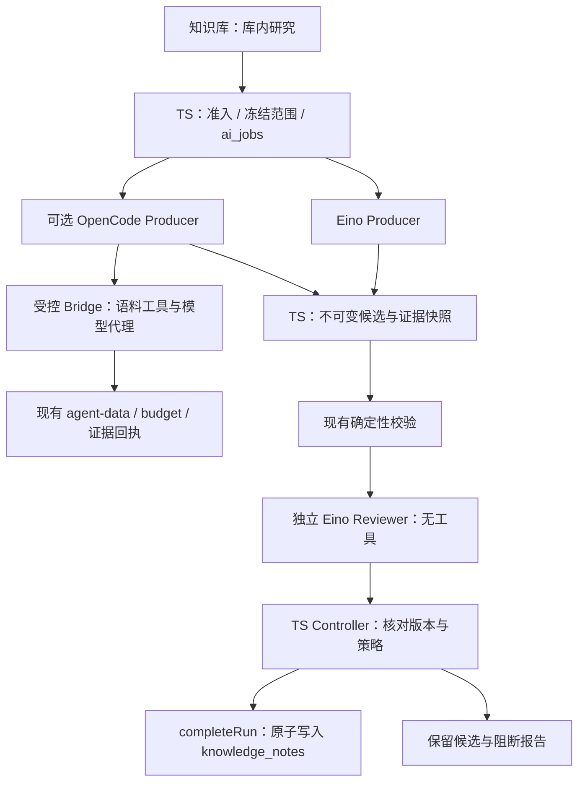

# WeaveSense 智能体能力增强与可选 OpenCode 集成 Implementation Plan

> **For Claude:** REQUIRED SUB-SKILL: Use superpowers:executing-plans to implement this plan task-by-task.

**Goal:** 先修复现有 Agent 执行边界并验证独立审核的收益，再以受控、可回滚的 OpenCode 研究执行器提升复杂库内研究能力，避免为已有 Skill/MCP 能力重复建设平台。

**Architecture:** 保留 React/TanStack、TypeScript 业务控制层、SQL 账本和 Go/Eino。独立审核、证据与发布规则由 WeaveSense 持有；仅异步 corpus research 可选择 OpenCode，其他路径保持现有实现。先做离线 A/B/C 对照，通过收益门槛后才实施生产适配、隔离与逐调用预算；不预建插件市场和通用工作流引擎。

**Tech Stack:** 现有 TypeScript、Zod、Node 22、React、TanStack、PostgreSQL/PGlite；现有 Go 模块及 Eino v0.9.19、mcp-go v0.43.0；Node 原生测试、Go testing、现有 Playwright。OpenCode 使用实施时锁定的二进制/镜像及 HTTP 合同，不新增 JS SDK、消息队列、ORM 或数据库。

---

## 1. 决策：必要的是能力建设，OpenCode 是可选手段

**原方案不是必须整体实施；可保留为远期边界清单。推荐实施本计划的第一阶段，OpenCode 生产集成以对照结果为条件。**

| 用户希望的提升 | 现有基础 | 真正需要增加 | 是否需要 OpenCode |
|---|---|---|---|
| 安装更多领域规则、增加只读资料工具 | 生产 Skill 加载、资源读取、MCP HTTP 已有 | 业务包、白名单、必要的合同测试 | 否 |
| 研究少出错、识别证据不支持结论 | 精确引用校验已有 | 独立上下文审核、定位缺陷、发布门禁 | 否，先在 Eino 上验证 |
| 长任务更可靠 | 租约、幂等、checkpoint、回执已有 | 修复 deadline 生命周期；未知结果对账 | 否 |
| 更灵活的多步探索、会话与工具编排 | Eino 有界研究循环已有 | 可选另一执行器并作同条件比较 | OpenCode 有候选价值，尚未证明优于 Eino |
| 可修改、可审阅、可恢复的阶段报告 | 最终 knowledge_notes 已有 | 不可变草稿与审核绑定；有需求再加阶段任务 | 否，属于宿主业务能力 |
| 通用插件安装、任意代码/浏览器操作 | 当前并非产品承诺 | 另立产品需求与隔离方案 | 本期不做 |

不能把“多了一个运行时”“回答更长”“模型自评分更高”当成智能体能力提升。本项目的核心价值仍是资料采集、证据检索、跨源分析和可追溯知识沉淀。OpenCode 主要提供执行机制的复用机会；领域判断、证据质量、受控自主性来自任务设计和宿主规则。

### 1.1 本轮证据与限制

> 本节记录拟定计划时的历史状态。后续用户已授权完整实施；实施记录与最新验证见 `validation/agent/opencode/baseline.md`、`decision.md` 和 `docs/operations/opencode-research.md`。历史“停止实施”以及当时未通过的检查不代表当前执行状态；真实模型质量与正式采用仍受下文评测门槛约束。

- 核查日期：2026-10-07；当前 checkout HEAD：`24d899023db08c8ea2e739b9c77a150743cc8bf6`，与原报告所列 HEAD 相同。相同 HEAD 不等于归档字节完全相同。
- 实际读取了当前关键 TS/Go 源码、迁移、测试入口及两份报告；两条只读审查分别核查 Go 运行链和 MiniMax 借鉴边界。
- 基线核查时 Node 为 `v22.22.3`，Go 为 `go1.25.7 windows/amd64`；随后已安装锁文件中的既有依赖，并运行部分验证。Go 基线通过；期限/队列/客户端定向 TS 验证 21 项通过，Skill 快照所在 Go 模块测试通过；审核合同与离线计分器定向 11 项通过。它们证明局部机制，不证明整套集成或真实模型质量提升。
- 当前工作树已存在期限、Skill 快照、审核合同、离线评测和 OpenCode 探针等未提交试验改动；不能把这些视为本计划全部完成。锁文件还包含既有传递依赖的补全。本次交付是必要性结论与这份实施计划；停止进一步业务实施，保留既有改动供后续审阅，不自动回滚或提交输入报告。后续执行先核对 `git status` 和测试证据，再从未完成步骤继续，不能重复覆盖已有代码。
- 实际 OpenCode 初探：已安装 `1.3.13`、包声明 MIT；隔离 cwd/HOME/XDG 下服务启动，health 版本正确，缺 Basic Auth 为 401，`/doc` 返回 JSON OpenAPI `3.1.1`。探针误断言 `3.1.0` 后退出，尚未验证异步研究、MCP 或工具权限；模型调用为 0。不能将本机版本直接视为生产镜像已锁定或 Task 5 已通过。
- 全量 typecheck/lint 尚未通过：已发现 Telegram 测试类型问题与本地工具目录被 ESLint 扫描等基线问题；探针单元测试有一项 SHA 夹具常量错误。应用构建、浏览器验收、生产隔离、真实模型 A/B/C 对照均未完成。后续先分类修复或隔离验证环境问题，不能以定向测试替代完整门槛。
- 原报告引用的 `examples/runtime-adapter.ts`、扩展 Schema 等并非本计划的必要前置；不能假定随报告文字一起交付了可执行代码。
- 下文文件名、迁移号、配置名中标注“新增”的均为设计，不能解读为已实现。迁移号基于当前最新 `0021_stage_windows.sql`，实施前重新检查冲突。

### 1.2 当前代码证据索引

| 已核查位置（基线行号，工作树修改后可能移动） | 结论及其影响 |
|---|---|
| `workers/agent/internal/agent/research.go:71`、`:86` | Eino Agent、Runner、checkpoint 已实际调用，无需重建工具循环 |
| `workers/agent/internal/agent/skills.go:49`、`:120`、`:167`、`:225` | 路径限制、包哈希、Skill 中间件、资源读取已存在；正常运行读取可变目录，不等于不可变快照 |
| `workers/agent/internal/agent/mcp.go:57`、`:104`、`:180` | 已接 Streamable HTTP、过滤工具、记录开始；不是仅依赖声明 |
| `src/lib/server/agent-data.ts:54`、`:67` | 模型回执入口与应用侧 MCP 白名单可复用 |
| `src/lib/server/agent-context.ts:293` | 校验 ID 与 quote 子串，不验证推理是否成立 |
| `src/lib/server/legacy-output.ts:57` | 已有有界格式/引用修复；语义修订不能再复制一套通用重试框架 |
| `workers/agent/internal/agent/config.go:16`、`server.go:93` | Go 执行硬上限 40 秒 |
| `src/lib/server/agent-client.ts:8`、`analyze.ts:85` | HTTP 默认 45 秒与 native 模型 120 秒不是同一种期限 |
| `src/lib/server/agent-queue.ts:186`、`agent-jobs.ts:63`、`:86` | 入队写 policy deadline，认领新建 expires_at 却返回旧 policy；排队后可能立即过期 |
| `workers/agent/internal/agent/workflow.go:54`、`:64` | 固定 Skill 读取/版本错误被忽略 |
| `src/lib/server/agent-queue.ts:136`、`:196` | claim 只按 kind；关闭异步能力会取消全部未认领 research |
| `src/lib/server/agent-jobs.ts:25`、`:51`、`:53` | 过期扫描未分 provider；先认领后判断 Eino，会误处理其他运行时任务 |
| `src/lib/server/agent-runs.ts:10`、`migrations/0011_ai_runs.sql:5` | 类型及 DB provider 限制均需兼容迁移 |
| `src/lib/server/agent-budget.ts:22`、`:54`、`:77` | 可复用逐调用准入/结算；已有回执不代表第三方运行时无法绕过供应商直连 |
| `workers/agent/internal/agent/receipts.go:28` | 缺少 DataURL/run token 会跳过回执；新受控路径必须 fail closed |
| `src/lib/server/agent-completion.ts:25`、`agent-jobs.ts:127`、`agent-runs.ts:276` | 原子完成已有；异步/同步两条写笔记路径都必须受新审核策略约束 |
| `src/lib/server/agent-transaction.ts:22` | 已有 job → run → item → source → budget 锁顺序，新增锁不能倒置 |
| `src/lib/server/config.ts:28`、`:36`；`fns.ts:428`、`:446`、`:470` | 引擎配置、能力显示与取消逻辑都要一起检查 |
| `docker-compose.yml:154`、`:226` | Go 是可选 profile；默认 legacy、异步关闭，不能假定线上已启用 Eino |

### 1.3 MiniMax：借边界和合同，不照搬产品栈

依据仓库中的 `MiniMax-Design-技术架构与复现分析报告-v2.md`：

1. §3（60–92 行）：宿主/Gateway 持有状态，OpenCode 负责执行，MCP 调用业务能力。映射为当前 TS 服务 + 可选 OpenCode + 受控语料桥，无需 Electron/NestJS/SQLite。
2. §5（133–151 行）：职责分工、先物化文档再登记计划、阶段结果待审值得参考。第一期角色是不同调用上下文，不要求多进程“Agent 团队”。
3. §8.1（246–254 行）：程序门禁适合迁移；保存成功与质量通过必须分开。
4. §8.2（258–276 行）：BenchmarkSupervisor 是测试推进机制，不能当成业务语义审查器。
5. **§11（342–357 行）的 Producer/Validator/Reviewer/Controller 是报告建议新增架构；§15（504–507 行）明确尚未实现。** 不能据此宣称 MiniMax 或 OpenCode 自带完整审核闭环。
6. 该报告是本次使用的二手静态证据；本轮没有运行 MiniMax 或复核其安装包。

### 1.4 相对原方案的删减

本期不建统一 RuntimeAdapter 家族、不改造 legacy 单条分析/简报、不建 Registry/签名链/依赖解析器、不建通用 Outbox、不开放 stdio 扩展、shell、浏览器、任意文件系统和联网研究，不复制采集器或检索器。

保留不能删的边界：provider 隔离、运行授权、逐调用预算、未知结果对账、输入与审核版本绑定、原子发布、配置/HOME 隔离、网络出口限制。代码少不能以这些边界缺失为代价。

## 2. 范围、阶段和停止条件

| 阶段 | 任务 | 可独立交付成果 | 是否依赖 OpenCode |
|---|---|---|---|
| A：基线修复 | 1–3 | 有证据的现状、明确期限、可靠 Skill | 否 |
| B：能力实验 | 4–6 | 缺陷集、评测规则；可选 OpenCode 离线合同探针；真实结果在受控执行链就绪后补齐 | 仅 C 组需要 |
| C：生产研究闭环 | 7–10、14–16 | 草稿/审核门禁、预算、Eino 可用；OpenCode 可保持关闭 | 否 |
| D：可选执行器 | 8、11–13、17 | 受限 OpenCode 异步研究、恢复与回滚 | 是，先过离线可行性门槛，正式启用前过真实收益门槛 |

执行分支：先 A，再 Task 4 冻结评测规则；Eino 的 C 阶段先以关闭/影子模式完成最小受控实现，再实测 B−A 决定是否启用 enforce。OpenCode 的 Task 5 与 Eino 增强独立，二进制缺失不阻塞 Eino-only。Task 6 分两次决策：离线可行性允许开发关闭状态的试点；可信预算和隔离就绪后，真实 C−B 收益才允许正式启用。没有真实结果时只记录“待验证”，不能把 fake 测试当效果提升。

若 OpenCode 不达标，交付 Eino 增强版就是完成，不将“必须引入新技术”设为目标。本期选择以质量/成本收益为正式采用门槛；如果将来选择“维护成本下降”作为替代理由，必须另行预先定义相同任务的实现工时、持续运维成本和维护周期，不在实验结束后临时更换胜出标准。

本期完整产品路径：**用户提交库内问题 → 冻结策略并入队 → 受预算的研究 → 保存候选 → 独立审核 → 原子发布或明确阻断 → 展示可信状态与原因。** 自动语义回修首期为 0 次；用户可基于问题开启新的、明确计费的尝试。避免在验证审核有效性前叠加循环成本。

### 2.1 投入优先级与可获得的提升

1. **立即值得做：期限和 Skill 可靠性。** 它们修复可复现的执行缺陷，减少排队后立刻超时、缺规则仍发送模型等问题；无需先证明 OpenCode 更优。
2. **优先验证：独立审核与可信发布。** 新增一次隔离的审核调用，用固定候选和完整授权证据检查结论支撑、范围、冲突、来源独立性及不确定性。收益候选是减少错误知识沉淀；代价是额外延迟、token 和误阻断，所以先 shadow、再凭 B−A 结果决定 enforce。
3. **条件投入：OpenCode。** 有机会复用会话、事件与多步编排，改善复杂研究完成率；但新增进程、协议锁、模型代理、网络隔离与恢复运维。当前库内任务能由 Eino 完成时，新增运行时本身不构成收益证据。

首期不承诺扩大外部知识覆盖或无限延长自主任务。可编辑阶段报告、跨会话研究、人工审批和多 Agent 协作属于 §5 的后续范围：完整列出触发条件与验收，并不等于现在全建。

## 3. 固定合同与数据流



### 3.1 产品和运行标识

- `AI_ENGINE` 继续只控制现有 legacy/Eino 同步路径；不把它直接改成三选一。
- 新增 `AGENT_RESEARCH_RUNTIME=eino|opencode`，只控制新建异步研究。每个 job 保存解析后的 provider，任务运行中不读取最新环境变量替换它。
- 新增 `AGENT_RESEARCH_REVIEW=off|shadow|enforce`，冻结进 job；shadow 的报告只用于观测，不宣称已通过审核。生产 enforce 不允许临时关闭开关绕过已冻结的审核要求。
- `request_id` 对完整用户意图幂等；job 是一条有界研究工作；run 是其执行账本；OpenCode session/instance 与 run 单独绑定。无须现在再引入通用 task/stage 表。
- request hash 覆盖问题、corpus 范围、provider、review policy、模型 profile、Skill snapshot digest。相同 request_id 不同意图返回 conflict。
- 一个研究 run 可包含 Producer 与 Reviewer 调用；Reviewer 固定由可信 Go 路径执行，不复用 Producer 的会话和工具权限，全部计入同一预算。
- 旧作业没有 review policy 时按旧合同处理；新 enforce 作业不允许走旧 complete 分支直接发布。

### 3.2 候选与审核合同

新增 `src/lib/agent-review-contract.ts`。下面是完整的最小报告 Schema，可直接作为实现起点；实际业务错误码映射在任务 4 补齐。

```ts
import { z } from "zod";

const digest = z.string().regex(/^[a-f0-9]{64}$/);
const checkIds = ["support", "scope", "conflicts", "source_independence", "uncertainty"] as const;
export const reviewReportSchema = z.object({
  schema_version: z.literal(1),
  run_id: z.uuid(),
  candidate_digest: digest,
  evidence_digest: digest,
  policy_digest: digest,
  checks: z.array(z.object({
    id: z.enum(checkIds),
    status: z.enum(["pass", "fail", "not_checked"]),
  }).strict()).length(checkIds.length),
  findings: z.array(z.object({
    code: z.string().min(1).max(64),
    severity: z.enum(["blocking", "advisory"]),
    claim: z.string().min(1).max(1000),
    evidence_ids: z.array(z.string().min(1).max(128)).max(20),
    reason: z.string().min(1).max(2000),
    suggestion: z.string().min(1).max(1000),
  }).strict()).max(20),
}).strict().superRefine((v, ctx) => {
  if (new Set(v.checks.map(c => c.id)).size !== checkIds.length) {
    ctx.addIssue({ code: "custom", message: "duplicate_review_check" });
  }
});
export type ReviewReport = z.infer<typeof reviewReportSchema>;

export function reviewBlocks(report: ReviewReport): boolean {
  return report.checks.some(c => c.status !== "pass") ||
    report.findings.some(f => f.severity === "blocking");
}
```

宿主计算而非模型决定以下内容：`candidate_digest=hashCanonical(AgentResult)`；`evidence_digest=hashCanonical(按 evidence_id 排序的完整已授权证据快照)`；`policy_digest=hashCanonical(冻结的审核规则和 Skill/model profile)`。Reviewer 回显摘要只是协议校验，服务端必须与已保存值比较。

报告合法还需：finding.claim 能定位于候选；非空 evidence_ids 必须来自快照；“材料不足”类允许空 evidence_ids，但须指出无法支持的候选结论。缺少检查、不合法 JSON、超时、指令型 XML、要求执行工具的内容均不能视作 pass。传入 zod 前限制响应字节数；不能只限制解析后的字符串。

Reviewer 无需证明“所有可能来源独立”，只判断候选是否夸大当前材料所能证明的独立性。材料不足时，合理表述不确定性可通过；无法执行检查时必须 not_checked，不能被迫编造 pass。

**审核传输合同：** TS 只处理短事务 `candidate → review_start → review_result → finalize`，不在作业接口里等待模型。`review_start` 幂等保存唯一 intent，返回宿主生成的 review_call_id、固定摘要和专用 reviewer grant；Eino Worker 直接调用 Go 的审核函数，OpenCode Worker 请求独立 `/v1/review`，两者均在调用期间持续续租。长审核 HTTP 使用专门 deadline，不使用现有 `postJobs` 的 8 秒短超时。`review_result` 重传相同结果可 ACK，不重跑模型；`review_status` 只读查询。start ACK 丢失能查回同一个 intent，结果丢失且无法证明未发送则 unknown。现有异步 Worker 与新 Worker 各测试一次审核耗时超过 8 秒的情况。

**恢复路由先看业务阶段：** 获得有效 claim 后先检查 candidate/review，再决定恢复路径：合法审核已保存只 finalize；候选已保存、审核确知未发送只审核；审核已发送但结果无法证明则 unknown；只有无候选才进入 Producer checkpoint/session 恢复。现有 `agent-jobs.ts` 用总模型调用数核对 Eino checkpoint，新增 Reviewer 后必须改为 Producer 角色调用数，不能因审核多一次调用而重新生成。过了最终 deadline 不再审核或发布，仍保留可查草稿与未知费用。

### 3.3 数据最小集

生产阶段只新增三张业务辅助表；模型与工具事实继续留在已有账本，不复制。

| 表/变更 | 核心字段与约束 | 用途 |
|---|---|---|
| `ai_jobs.runtime_provider` | `eino|opencode`；可证明的旧值回填；未知行阻止迁移完成 | 路由与恢复隔离 |
| `ai_research_candidates` | `run_id` PK/FK、result_json、evidence_json、三个 digest、frozen_policy、created_at；正文不可覆盖 | 被审核的真实快照；一 run 一候选 |
| `ai_research_reviews` | `run_id` PK/FK、candidate/evidence/policy digest、state、report_json、review_call_id、created_at/finished_at | 独立审核及崩溃对账 |
| `ai_runtime_bindings` | `run_id` PK/FK、provider/version/config digest、instance_id/epoch、session_id、dispatch_id/state、last_observed_at | OpenCode 提交与恢复，不放供应商密钥 |

首期候选上限沿用 AgentResult 正文 12000 code points，并对整包设 512 KiB 字节上限。快照只存实际授权并供审核的内容；超限显式拒绝/报告部分覆盖，不能无标志截断。存数据库无需新文件对象存储；OpenCode 本地状态是可恢复缓存，SQL 候选及回执为业务真相。

候选不可变：相同 run 重传同 digest 返回原记录，不同 digest 返回 `candidate_conflict`；不存在“覆盖后继续沿用旧审核”。首期不做原地编辑或多 revision，一个新尝试对应新 run。后续需要编辑再引入 revision，不能提前建一整套版本服务。

### 3.4 超时、租约、预算

必须分开配置并检查关系：

| 概念 | 起点与到期处理 |
|---|---|
| 排队 TTL | 入队时开始；超期且未发送任何调用，确定为 not_sent 后释放预算 |
| 执行 deadline | 首次认领时确定并持久化；恢复/续租不能重置 |
| 单次模型 timeout | 每次发送时，取剩余执行时间与单调用上限的较小者 |
| HTTP timeout | 同步执行请求大于执行上限+序列化余量；异步认领/续租/提交有短独立上限 |
| Worker lease | 心跳续租，永不超过执行 deadline；示例 60 秒 lease、15 秒心跳是拟议初值 |
| 审核预算 | 研究准入时预留，Producer 不能耗尽 Reviewer 的最低额度；首期同一模型/价格 profile |
| 审核时间 | 首次认领同时冻结 Producer 子期限、Reviewer 子期限与最终 run deadline；Producer 不能占用审核及持久化余量 |

先以测试配置检验关系，不承诺固定 120 秒足够完成所有研究。例：Producer 最多 6 次 + Reviewer 1 次时，策略总上限为 7；网关还须限制 Producer 最多 6，不能只放大总上限。

审核开启时可先试验总窗口 120 秒，其中 Producer 80 秒、Reviewer 30 秒、提交余量 10 秒；这些是待延迟分布校准的初值。所有绝对期限由首次 claim 的同一 DB 时钟生成并保存。Worker 用 Producer 子 context、代理用角色对应的期限约束真实发送；保留原 v1 envelope 时不塞入未知字段，新子期限放在受控 job 元数据。Task 2 仍保证全局 policy/run deadline 一致，子期限只收紧调用。恢复/续租不重置它们；Producer 到期时按是否已经形成有效候选、调用是否未知分类，不能自动以超时片段冒充完成报告。

现有 `enqueueResearchJob` 本身没有像自动分析那样建立日预算预留。生产研究增强必须补准入事务，不能因已有 `ai_budget_days` 就宣称研究已受人民币预算保护。复用 `admitBudgetDay/settleJobBudget`；按选定供应商可验证的输入/输出 token 上限与价格保守预留。无法建立可信上界或模型价格未知时禁用付费试点；usage 不明保留 unknown 和预留，不能记录零成本。

## 4. 实施任务

下面每个 Step 是一个短操作，目标 2–5 分钟；大任务按所列子范围逐个完成，不把整个 Task 当一次长提交。每个代码任务遵循 **失败测试 → 最小实现 → 定向通过 → Lore 提交**。未知协议形状先用探针固定，不能凭本计划示例猜测 SDK。

后续实施使用 @ponytail、@executing-plans；本文件由 @writing-plans 编写。执行技能名称以当时可用入口为准；不要因兼容说明中的 `superpowers:` 前缀另装插件。本计划的交付不构成完整实现或生产启用；已有试验的完成情况按 §1.1 与实际验证重新认定。

### Task 1：记录基线和可复现验证环境

**Files:**
- Create: `validation/agent/opencode/baseline.md`
- Read: `package.json`, `package-lock.json`, `workers/agent/go.mod`, `scripts/agent-integration-harness.mjs`
- Read: `docs/operations/agent-service.md`, `docs/operations/2026-10-05-agent-llm-handbyhand-test-guide.md`

1. 记录 HEAD、工作树差异、Node/Go 版本和现有部署开关；配置仅记有无与非秘密值，不打印 key/token。
2. 在实施用工作树用现有锁文件 `npm ci` 安装既有依赖；Go 按 go.mod 使用兼容版本。没有新依赖需求。
3. 顺序执行 `npm test`、`npm run agent:go`、`npm run typecheck`、`npm run lint`，分别保存摘要。预期退出 0；已有失败与新回归分开记录，不能篡改测试让基线看似通过。
4. 读取隔离 harness 后运行 `node scripts/agent-integration-harness.mjs --dev`。该命令使用 Docker 测试数据库和 fake 模型；确认 Docker 可用与隔离身份再运行，不指向现有业务库。预期现有同步/异步、恢复、引用案例通过。
5. 提交基线文档，意图行：`Establish evidence before changing research execution`。未执行项如实列 Not-tested。

### Task 2：修复期限生命周期和排队过期

**Files:**
- Modify: `src/lib/server/agent-queue.ts`, `src/lib/server/agent-jobs.ts`, `src/lib/server/agent-client.ts`, `src/lib/server/analyze.ts`
- Modify: `workers/agent/internal/agent/config.go`, `workers/agent/internal/agent/server.go`, `workers/agent/internal/agent/model.go`
- Modify: `docker-compose.yml`, `docs/operations/agent-service.md`
- Test: `src/lib/server/agent-queue.test.ts`, `src/lib/server/agent-jobs.test.ts`, `src/lib/server/agent-client.test.ts`
- Test: `workers/agent/internal/agent/server_test.go`, `workers/agent/internal/agent/worker_test.go`

1. 加失败测试：入队后推进测试时钟 90 秒仍在排队 TTL 内，认领获得完整执行窗口；已经认领的恢复不延长 deadline；超过排队 TTL 不调用模型。用测试时钟/固定 DB 时间，不真实等待 90 秒。
2. Run: `node --experimental-strip-types --test src/lib/server/agent-queue.test.ts src/lib/server/agent-jobs.test.ts src/lib/server/agent-client.test.ts`。预期新 deadline 用例失败。
3. 新任务保存 queue_expires_at 与 execution_timeout_ms；首次 claim 的同一事务生成唯一执行 deadline，写入 job.payload.policy 和 run.request_json.policy，expires_at 使用同一值。旧已运行 job 保留 deadline；旧未认领且无新期限字段按旧合同过期，不偷偷获得无限延长。
4. 将 Go 硬编码执行 timeout 改为经范围验证的配置；同步 HTTP/WriteTimeout 覆盖该上限，单模型调用从剩余时间取 min。复用已有 Abort/Context；测试负值、NaN、上下限、慢响应、租约失效。
5. 运行 Step 2 和 `go -C workers/agent test ./internal/agent -run 'Test.*(Deadline|Timeout|Worker|Bounded)' -count=1`；测试名需与新增用例匹配，确认非零执行数。提交 `Prevent queued research from inheriting an expired execution window`。

### Task 3：固定 Skill 失败明确化及运行快照

**Files:**
- Modify: `workers/agent/internal/agent/workflow.go`, `workers/agent/internal/agent/skills.go`, `workers/agent/internal/agent/server.go`
- Test: `workers/agent/internal/agent/workflow_test.go`, `workers/agent/internal/agent/skills_test.go`, `workers/agent/internal/agent/readiness_regression_test.go`
- Modify: `docker-compose.yml`, `docs/operations/agent-service.md`

1. 新增用例：SkillsDir 显式配置但必需包缺失、文件不可读或 hash 失败时，返回 `skill_unavailable` 且模型调用数为 0；未配置 SkillsDir 的旧兼容行为单独测试。
2. Run: `go -C workers/agent test ./internal/agent -run 'Test.*Skill' -count=1`，确认新增错误处理用例先红。
3. 处理 `loadFixedSkill` 与 `skillVersions` 的错误，禁止忽略；生产部署只读挂载固定镜像/内容寻址快照。复用已有哈希算法，不写第二套包解析器。请求记录 snapshot digest，普通升级只影响新任务。
4. readyz 返回配置、Skill、协议状态且不调用收费模型；显式兼容探针复用 `compatibility_test.go` 的 fake server。添加运行途中修改源目录不影响快照和未知包拒绝的测试。
5. 重跑 Step 2 及 readiness 定向测试，提交 `Keep research rules explicit and stable for each run`。

### Task 4：先证明独立审核有增益

**Files:**
- Create: `src/lib/agent-review-contract.ts`, `src/lib/server/agent-review.ts`, `src/lib/server/agent-review.test.ts`
- Create: `validation/agent/opencode/quality-cases.json`, `validation/agent/opencode/quality-policy.md`
- Create: `scripts/agent-quality-eval.mjs`, `scripts/agent-quality-eval.test.mjs`
- Read: `src/lib/server/agent-context.ts`, `src/lib/server/legacy-output.ts`

1. 先写不少于 12 个小型人工标注案例，包含：引文正确但结论反向、同文转载、日期/口径错配、冲突被忽略、截断后称完整、缺证高置信，以及对应合理回答/明确不确定性的负例。再补正常案例达到首轮至少 30 题；数字为拟议实验规模，非已有成绩。
2. 实现 §3.2 Schema 与纯判断函数，最小测试如下；首次运行应因模块/函数缺失失败，再实现。

```ts
import assert from "node:assert/strict";
import test from "node:test";
import { reviewBlocks, reviewReportSchema } from "../agent-review-contract.ts";

test("an unchecked required dimension cannot authorize publication", () => {
  const d = "a".repeat(64);
  const report = reviewReportSchema.parse({
    schema_version: 1,
    run_id: "00000000-0000-4000-8000-000000000001",
    candidate_digest: d, evidence_digest: d, policy_digest: d,
    checks: ["support", "scope", "conflicts", "source_independence", "uncertainty"]
      .map(id => ({ id, status: id === "support" ? "not_checked" : "pass" })),
    findings: [],
  });
  assert.equal(reviewBlocks(report), true);
});
```

3. `agent-review.ts` 实现绑定值和 evidence_ids 的纯校验；不加网络。运行 `node --experimental-strip-types --test src/lib/server/agent-review.test.ts`，预期 PASS。测试覆盖重复检查、陈旧摘要、伪造证据、非法输出、正常报告。
4. eval runner 先支持 `--offline`：输入候选和固定 reviewer 响应，验证计分器及失败分类。`--live` 必须显式启用、限制案例数和人民币预算；默认离线且不读取未指定的供应商凭据。live 不另写直连供应商客户端：A/B 使用 Tasks 7、9、10、14 的隔离测试实例，C 再接 Tasks 11–13；它们未就绪时返回 `live_runtime_not_ready`。审核调用上下文只有来源、问题、候选、审核规则，没有 Producer 历史。
5. Run: `node --test scripts/agent-quality-eval.test.mjs` 和 `node scripts/agent-quality-eval.mjs --offline`；预期每个注入缺陷得到标注的分类，正常案例不被机械规则错误拒绝。提交 `Measure evidence support independently from answer generation`。

### Task 5：锁定 OpenCode 合同，完成离线最小探针

**Files:**
- Create: `validation/agent/opencode/runtime-lock.json`, `validation/agent/opencode/openapi.snapshot.json`
- Create: `scripts/opencode-contract-probe.mjs`, `scripts/opencode-contract-probe.test.mjs`
- Create: `validation/agent/opencode/config.fixture.json`

1. 选择一个可取得、可校验的 OpenCode 版本，记录来源、version、二进制 SHA-256 或镜像 digest、license、配置摘要及 OpenAPI 摘要。不填 latest；本计划不虚构已经验证的版本号。
   当前 Windows `1.3.13` 二进制初探 SHA-256 为 `f8df4dff7402f192f57c0180c81dde9af166673bec37eaa4772e3f1819361c3e`，仅作本地线索。先修探针中 OpenAPI patch 版本断言和 SHA 测试夹具，再继续完整合同核查；Linux 生产镜像另行校验，不能沿用 Windows 二进制 hash。
2. 在隔离的临时目录使用 fake OpenAI 与 fake 语料 MCP，独立 HOME/XDG，默认拒绝权限；不以本仓库为 OpenCode cwd。只复制批准的研究 Skill 及测试资料。子进程环境采用白名单，仅携带 fake 凭据及必要系统变量，禁止继承真实供应商 key、DB 密码、应用 token、代理与登录态。用平台网络隔离只允许 fake 端点，验证环境哨兵不可见、非 fake 地址不可达；做不到时只能记录部分合同探针，不能宣布 offline 安全通过。
3. 探针检查 health/version、创建 session、异步提交、读取 message/status、abort、错误输出。用锁定版本导出的 spec 固定请求/响应 fixtures；OpenAPI 页面返回 HTML 时从其实际公开规范位置提取，不能直接保存 HTML 冒充 JSON。
4. Run: `node --test scripts/opencode-contract-probe.test.mjs`；再 `node scripts/opencode-contract-probe.mjs --offline`。预期真实锁定二进制与 fake 服务完成一次研究，非法工具不可执行；未安装二进制返回明确非零 `runtime_missing`，不得静默 skip 算通过。
5. 验证配置确实没有发现仓库 `.agents`、用户全局 Skill/插件/模型登录态。记录实际 MCP 工具名，必要时仅渲染研究 Skill 的工具映射并保存原始/渲染双摘要。提交 `Pin the runtime protocol before coupling it to research jobs`。

### Task 6：A/B/C 对照与继续/停止记录

**Files:**
- Modify: `scripts/agent-quality-eval.mjs`, `validation/agent/opencode/quality-policy.md`
- Create: `validation/agent/opencode/decision.md`

1. A=现有 Eino，B=Eino+固定 Reviewer，C=OpenCode+同一 Reviewer。三个组采用相同材料快照、模型版本、工具数据和结果 Schema；B/C 使用相同审核 policy。producer 与 reviewer 预算分项记录。
2. 在运行前冻结门槛：硬错误发布为 0；阻断缺陷召回建议 ≥90%、误阻断正常案例建议 ≤10%；这只是起始业务门槛，不是统计保证。报告每项分子/分母和不确定性，不靠单次 30 题宣称稳定提升。
3. 离线阶段只决定机制是否可测，不形成质量结论。按 Task 4 的依赖部署独立测试数据库、冻结语料、可信 ledger/grant 后才做有明确预算上限的 live；不使用生产库和长期供应商主密钥作为 runtime 凭据。建议同一批题多次重复，盲审配对结果；共同用户任务、来源、业务 Skill、模型/审核 profile 变化须重建基线。Eino/OpenCode 固有系统提示、压缩和上下文组织是被比较的运行时干预，记录摘要与差异，不要求两者内部 prompt 完全相同。
4. 统计任务接受率、证据支撑、冲突处理、调用量、token、实际/未知费用、p50/p95 延迟、恢复成功率、每份被接受报告成本。B−A 衡量审核，C−B 衡量运行时增量；再补“等总预算”结果，避免 B/C 仅靠更多花费取胜。
5. 填 decision.md 两个决策记录：`offline_feasible` 只允许开发 disabled pilot；`live_accepted` 才允许正式启用。B−A 的拟议门槛为阻断缺陷漏发率相对下降 ≥30%、正常任务接受率下降 ≤5 个百分点、每份接受报告成本 ≤1.5 倍，并同时满足 Step 2 的安全门槛；A 无缺陷样本时不得计算虚假的相对改善，应补有标注缺陷。C 相对 B 完成率提升 ≥10 个百分点且每份接受报告成本 ≤1.3 倍是 OpenCode 的拟议采用门槛。运行前冻结，不能测试后迎合某组调整；不满足则保留 Eino/off 或 shadow。提交 `Make runtime adoption depend on measured research value`。

### Task 7：加入最小草稿、审核及运行绑定迁移

**Files:**
- Create: `migrations/0022_research_review.sql`
- Create: `src/lib/server/agent-candidates.ts`, `src/lib/server/agent-candidates.test.ts`
- Create: `validation/agent/opencode/migrations.test.ts`
- Modify: `src/lib/server/agent-review.ts`, `src/lib/server/agent-queue.ts`, `src/lib/server/analyze.ts`, `src/lib/server/config.ts`
- Modify: `src/lib/server/agent-data.ts`, `src/lib/server/agent-runs.ts`, `src/lib/server/agent-context.ts`
- Test: `src/lib/server/agent-queue.test.ts`, `src/lib/server/analyze.test.ts`, `src/lib/server/agent-data.test.ts`

1. 用真实 PGlite 与隔离 PostgreSQL 测试迁移：旧 notes/runs 不丢失、重复应用由现有 migration runner 跳过、失败事务回滚。先写一 run 两种候选被拒绝及同字节重传幂等用例。Eino-only 也在此步骤测试/实现 review policy、scope、模型与 Skill snapshot 的冻结和 request hash；不能等到可跳过的 Task 8 才实现这些共同合同。
2. 按 §3.3 创建 candidates/reviews 两表；binding 表留 Task 8 的 OpenCode 迁移。review state 限定 `pending|running|completed|unknown|failed`，不把状态 `completed` 当作审核通过；通过与否由报告计算。补齐可信 evidence_json：item_id、完整 material_fingerprint、material_version、start/end、coverage、来源元数据及授权范围。seed 和工具回执都由服务端生成；扩展 `receiptsForRun` 保留这些字段，不能仅靠截断 evidence_id 哈希复验材料。旧回执无字段只允许旧任务兼容，不得填假值冒充 enforce 快照。
3. 最小不可变插入使用参数化 SQL：

```sql
insert into ai_research_candidates
  (run_id, result_json, evidence_json, candidate_digest,
   evidence_digest, policy_digest, frozen_policy)
values ($1, $2::jsonb, $3::jsonb, $4, $5, $6, $7::jsonb)
on conflict (run_id) do nothing;
```

插入后在同一事务读回并逐一核对摘要；应用重算所有摘要，不能信任请求值。拒绝超大输入和后续 update。新增锁排在 job/run/source 校验之后、budget 之前，所有入口使用同一顺序。
4. Run: `node --experimental-strip-types --test src/lib/server/agent-candidates.test.ts src/lib/server/agent-data.test.ts validation/agent/opencode/migrations.test.ts`。覆盖只读片段的 span/coverage 保留、正文不变但 material_version 改变、旧 metadata 缺失。迁移测试默认 PGlite；显式 `REVIEW_PG_PORT` 用现有测试库约定运行 PG，缺 PG 要报告未覆盖，发布门槛不能算通过。
5. 提交 `Preserve the exact research candidate that a review evaluates`；回滚仅关闭 review 新任务，保留表与审计，不删列、不回写旧笔记。

### Task 8：provider 迁移和全链路队列隔离

**Files:**
- Create: `migrations/0023_research_runtime.sql`
- Modify: `src/lib/server/agent-runs.ts`, `src/lib/server/agent-queue.ts`, `src/lib/server/agent-jobs.ts`, `src/lib/server/config.ts`
- Modify: `src/lib/server/analyze.ts`, `src/lib/server/fns.ts`, `src/lib/agent-contract.ts`
- Test: `src/lib/server/agent-queue.test.ts`, `src/lib/server/agent-jobs.test.ts`, `src/lib/server/analyze.test.ts`
- Modify: `validation/agent/opencode/migrations.test.ts`

本任务仅 OpenCode pilot 需要；Eino-only 仍须让 review policy 与请求幂等生效，但不提前扩展 provider。

1. 先测 Eino/OpenCode 同时 claim、过期扫描、功能关闭取消；同 request_id 变 provider/scope/review policy 必须 conflict。未知 provider 不得领取或自动归类。
2. 迁移扩展 ai_runs provider CHECK，ai_jobs 新增 nullable runtime_provider；先检查与 linked run/payload 冲突的数据，再回填：已关联 run 以经过一致性核验的 run.provider 为准；历史空 payload 的自动分析可证明为 Eino；明确 research/eino 回填；其余中止迁移并报告 ID。完成后设 NOT NULL/CHECK，建立 `(runtime_provider,status,next_attempt_at)` 索引；不改 0011 历史文件。
3. claim 与 expired recovery 的 SQL **领取前**增加 `runtime_provider = $provider`，并与 linked run.provider 核对。worker 身份由服务凭据/固定服务路由决定，不允许请求体自报 provider 获得另一队列。旧 Go claim 默认只代表 Eino。
4. `cancelQueuedResearchJobs(sql, provider)` 仅处理该运行时；删除状态查询触发全局取消的语义，改由明确的关闭策略处理。切换默认 runtime 只影响新任务，旧队列继续由所属 worker drain；关闭入队不等于关闭 worker。
5. 新增 binding 表及唯一 run_id；运行 Step 1 所在 TS 测试与双数据库迁移测试。提交 `Prevent workers and capability switches from crossing runtime ownership`。

### Task 9：研究准入、角色额度和不可绕过的调用账本

**Files:**
- Modify: `src/lib/server/agent-budget.ts`, `src/lib/server/agent-queue.ts`, `src/lib/server/agent-data.ts`
- Modify: `src/lib/server/agent-budget.test.ts`, `src/lib/server/agent-queue.test.ts`, `src/lib/server/agent-data.test.ts`
- Create: `migrations/0024_research_call_roles.sql`
- Modify: `workers/agent/internal/agent/receipts.go`
- Create: `workers/agent/internal/agent/receipts_test.go`

1. 先测并发研究在日预算只够一个时只有一个能入队，request replay 不重复预留，排队过期仅明确 not_sent 可释放，unknown 不退款，Producer 达上限后仍保留 Reviewer 配额；同时测 Producer 用尽自己的时间窗口后，合法候选仍有足够审核与持久化时间。
2. 复用 `admitBudgetDay` 和 reservation 表，把研究 job 插入及预算预留放同一事务；为 ai_model_calls 增加 `role`（旧行 producer）与 `request_digest` 可空旧兼容字段。现有 data_access_token 仅具 producer 权限，不能由 params.role 升级。`review_start` 用独立服务认证签发随机 reviewer grant，其 hash 保存 reviews 表并绑定 run/claim/review_call_id/TTL；专用 review receipt 路由验证该映射及 candidate 摘要，Reviewer grant 无语料检索/写 note 权限。轮换 claim/取消同时撤销 grant；OpenCode 看不到 Reviewer grant。
3. 扩展 `modelCallSchema/recordModelCall` 与调用端，锁 run 后按总上限及角色上限同时准入；同 call_id 不同摘要 conflict。新增发送准入的结果须区分 `send_once|already_started|completed|unknown`，不能把旧布尔型“幂等成功”误当“可以再发供应商请求”。review_call_id 由 TS 持久生成并传给 Go，替代该路径自行随机生成。只有首次原子领取发送权可发一次；领取后即崩溃按未知处理，宁可保守停止也不重复付费。started 后响应丢失为 unknown；没有已证明幂等的供应商能力时不自动重发。
4. 新的 governed research 若缺 DataURL、service token、run token 或价格 profile，模型发送前失败；旧离线测试显式使用 fake 模式，不能通过生产缺省绕过。每个成功结算依据可信调用账本，忽略 OpenCode 自报 tokens。
5. Run: `node --experimental-strip-types --test src/lib/server/agent-budget.test.ts src/lib/server/agent-queue.test.ts src/lib/server/agent-data.test.ts`；Go receipts 定向测试。提交 `Reserve research costs before any producer or reviewer request`。

### Task 10：独立 Reviewer 的可信执行入口

**Files:**
- Create: `workers/agent/internal/agent/review.go`, `workers/agent/internal/agent/review_test.go`
- Modify: `workers/agent/internal/agent/server.go`, `workers/agent/internal/agent/contract.go`, `workers/agent/internal/agent/model.go`
- Modify: `src/lib/server/agent-review.ts`, `src/lib/server/agent-review.test.ts`
- Create: `validation/agent/opencode/review-contract.json`

1. 用 §3.2 fixtures 在 TS/Go 两端测试 strict JSON；伪造摘要/extra fields/tool instructions 必须拒绝；fake model 验证消息中没有 Producer 历史与 tools。单独有界调用即可，不要求换供应商模型。
2. 新增服务令牌保护的 `/v1/review` 专用合同：run_id、review_call_id、reviewer_grant、固定 candidates/evidence/policy、调用 deadline。不把审核结果塞进现有 AgentResult；不改变 `/v1/execute` v1 Schema。请求摘要必须等于 grant 绑定摘要；数据从服务端候选快照生成，不能让调用者以同一 ID 替换正文。
3. 实现 §3.2 的短事务协议：TS 持久化 intent 后立即 ACK；由 Worker 在作业 HTTP 事务外执行 Go Reviewer 并持续续租。Go 用 Task 9 的 reviewer 发送准入和已有 budgetModel/receipts 发一次模型请求。审核失败不得隐式额外重试；根据明确尚未发送与未知结果分类处理。服务端不得启动无人持有 lease 的悬空 Promise 来代替 Worker。
4. 收到合法报告后短事务保存；与 `ai_model_calls` 的 completed 回执、review_call_id 和摘要核对。重启时 pending 且确知尚未发送可执行；running 且有 started/unknown 不重发，进入 unknown。模型调用已完成而报告未能持久化也不能凭 completed 使用量推定审核通过。实现 §3.2 恢复优先级：已保存审核不再走 Producer Resume，已有候选不再生成；grant 轮换不会失效历史合法审核事实，仍须重新核对当前 ownership、来源与冻结摘要后 finalize。
5. Run: `go -C workers/agent test ./internal/agent -run 'Test.*Review' -count=1` 和 Task 4 的 TS 测试。提交 `Review research in a bounded context without publishing authority`。

### Task 11：复用 Go MCP 依赖建立只读语料桥

**Files:**
- Create: `workers/agent/internal/opencode/bridge.go`, `workers/agent/internal/opencode/bridge_test.go`
- Modify: `src/lib/server/agent-data.ts`, `src/lib/server/agent-data.test.ts`
- Read: `workers/agent/internal/agent/tools.go`, `workers/agent/internal/agent/mcp.go`

仅 Task 6 记录 OpenCode `offline_feasible` 后开发，先接 fake 供应商；生产启用仍等待 live 门槛。沿用同一 Go module 的 mcp-go，不新建 Node MCP 实现或复制 JSON-RPC 协议解析器。

1. fake MCP 测试仅暴露 `search_items/get_item`，模型传另一个 run_id 无效；过期/取消 grant、未授权工具、超大参数、跨 run token 都失败。
2. bridge 持有应用 service token；OpenCode 只得到短期 opaque grant。grant → run/claim/instance/role 映射由宿主持有，请求体不能覆盖；只转发到现有 `handleAgentData`，不直接查数据库。
3. 当前数据接口已有 evidence 事件但它不等价于准确工具调用计数。新增可信内部 `tool_start/tool_complete` action（不暴露给 OpenCode）：每次 RPC 有稳定 call_id，记录 started，先核对 frozen max_tool_calls，再执行，重复 ID 必须核对参数摘要；不要把一次 search 返回的多条证据计作多次工具调用。
4. 补工具总数/结果字节数/时间范围/coverage 测试；证据 ID 和正文由应用产生，MCP bridge 不自行制造可信来源。首期无外部服务、stdio、写草稿工具；候选从结构化结果通道交付。
5. Run: `go -C workers/agent test ./internal/opencode -run TestBridge -count=1` 和 agent-data TS 测试；提交 `Reuse the corpus evidence boundary for the optional runtime`。

### Task 12：受控模型代理与固定沙箱

**Files:**
- Create: `workers/agent/internal/opencode/model_proxy.go`, `workers/agent/internal/opencode/model_proxy_test.go`
- Create: `workers/opencode-runtime/server.mjs`, `workers/opencode-runtime/server.test.mjs`, `workers/opencode-runtime/Dockerfile`
- Modify: `docker-compose.yml`, `scripts/service-env-least-privilege.test.mjs`
- Create: `validation/agent/opencode/isolation.test.mjs`

1. 模型代理先做 fake 供应商测试：超过请求体/输出/token/角色次数上限、未知 model/路由、用户提供上游 URL、redirect、凭据泄漏均拒绝；上游次数必须与准入次数一致。
2. 代理与语料桥共用一个可信 bridge 进程；供应商真实 key 只在该进程，OpenCode 使用假的/短期 run grant 作为模型认证。仅支持 Task 5 验证的一种 OpenAI-compatible 协议路径，不宣称全 provider 兼容。streaming 必须测试 UTF-8 分片、usage 尾包、断流、超时/取消；不强行把 SSE 当普通 JSON。
3. 每次真实请求先获得 DB started 准入，再发供应商；摘要/重试/辅助请求同样经过代理。默认模型和 small model 固定同一已定价 profile；禁用无必要插件/遥测/更新/共享/子 Agent，无法禁用的辅助请求计入同一限额。请求结束、断流和 usage 缺失遵守 unknown 语义。
4. 固定 Compose 两个额外服务：可信 bridge（可访问 app 与批准供应商）；非可信 runtime（只连接 internal runtime 网络）。runtime 使用固定镜像、非 root、read_only、cap_drop、no-new-privileges、pids/memory 上限，仅挂载空状态目录/批准 Skill，不挂宿主 HOME/仓库/Docker socket。网络白名单是实测边界，`internal: true` 不自动等于所有 host/link-local 地址都被阻止。
5. runtime wrapper 只提供固定 prepare/start/status/stop 操作；只允许启动镜像内 opencode 固定参数，不接受 shell/任意镜像/任意主机路径。每个任务独立 cwd/HOME/XDG 和新进程、并发 1；停止确认后方可复用槽位。父子进程树清理、stale instance epoch、恶意路径各有测试。Run: `node --test workers/opencode-runtime/server.test.mjs`、`go -C workers/agent test ./internal/opencode -run TestModelProxy -count=1`、隔离测试；提交 `Bound runtime access and charge every actual model request`。

说明：将权限、进程和网络测试拆为独立小提交。不能因为此处合并部署而把供应商主密钥注入 OpenCode 所在进程环境；同容器仅不同 env 也不足以当成强隔离。

### Task 13：OpenCode Worker、提交歧义和恢复

**Files:**
- Create: `workers/agent/cmd/opencode-worker/main.go`
- Create: `workers/agent/internal/opencode/client.go`, `workers/agent/internal/opencode/worker.go`
- Create: `workers/agent/internal/opencode/client_test.go`, `workers/agent/internal/opencode/worker_test.go`
- Modify: `src/lib/server/agent-jobs.ts`, `src/routes/api/internal/agent-jobs.ts`
- Create: `src/lib/server/agent-opencode-jobs.ts`, `src/lib/server/agent-opencode-jobs.test.ts`

1. 先使用 Task 5 的协议 fixtures 编写 client 测试；覆盖 401、版本不匹配、非法 session、非 JSON、响应超限、SSE 重复、断线、abort 确认。使用 Go net/http，不先抽象其他运行时。
2. 新内部固定 provider handler 认证 OpenCode worker；旧 Eino handler 保持旧 envelope。claim 与 run 绑定沿用 Task 8；prepare 后持久化 session_id/instance/epoch/version/config digest，再发送 prompt。
3. 提交状态持久化：`prepared → dispatching → submitted → candidate_saved`；发送异常进入 `dispatch_unknown`。崩溃发生在 dispatching 时也必须当未知。若锁定 API 支持 client messageID，保存它用于查询，但只有真实合同测试证明幂等才允许重发；dispatch_id 本身不构成远端幂等保证。
4. SSE 只更新观察状态；通过 session/message 查询和可信账本对账。只接受本 session 的终态结构化 AgentResult，最后文本“完成”或 session idle 都不能直接完成业务。已保存候选的 completion ACK 丢失只重传相同 payload，复用现有 Worker 的设计。
5. 失联先 revoke grant，调用 abort，再确认停止/杀本任务进程。旧 epoch/claim 回包不写；版本不一致不读取旧 OpenCode state；未决付费调用不自动创建新 session。Run: `go -C workers/agent test ./internal/opencode -count=1` 和 agent-opencode-jobs TS 测试；提交 `Reconcile uncertain submissions instead of generating duplicate research`。

### Task 14：在所有发布入口实施版本与审核门禁

**Files:**
- Modify: `src/lib/server/agent-completion.ts`, `src/lib/server/agent-runs.ts`, `src/lib/server/agent-jobs.ts`, `src/lib/server/agent-opencode-jobs.ts` (only pilot)
- Modify: `src/lib/server/analyze.ts`, `src/lib/server/agent-review.ts`, `workers/agent/internal/agent/worker.go`
- Test: `src/lib/server/agent-integrity.test.ts`, `src/lib/server/agent-jobs.test.ts`, `src/lib/server/analyze.test.ts`
- Create: `src/lib/server/agent-review-publication.test.ts`

1. 先写真实事务回归：审核 A 发布 B 被拒、审核后来源更新被拒、旧 claim 被拒、两个完成请求只插一 note、Producer 伪造 review pass 不被接受、事务回滚不留半个 note；审核已保存后 Worker 崩溃，恢复只发布一次，Producer/Reviewer 均不重跑。
2. 研究 Producer 成功后先经候选入口保存冻结结果，再由持续续租的 Worker 执行 Task 10；Eino governed worker 增加 candidate/review_start/review_result/finalize 路径。不要在当前 `handleAgentJobs` 的包裹事务里调用模型；旧无 review policy 作业仍按旧合同。给 8 秒以上审核、start ACK 丢失、result ACK 丢失各加测试，断言模型只调用一次。
3. 发布在 `completeRun` 的短事务中按冻结 policy 判断：off 旧规则；shadow 保留确定性规则且记录审核未作为门禁；enforce 要求确定性校验通过、合法且完整 review、三个摘要一致、当前材料版本匹配、无 blocking finding、ownership 有效。任何模型自报 verdict 不直接使用。
4. 发布前用 `validateCitations` 校验实际 result.citations；输入快照源集合须包含 seeds+所有被用到的可信 receipts。确定“按历史快照发布”还是“必须当前来源一致”的产品规则：首期选择后者；来源锁定并用现有 materialFingerprint 校验，再写 note。复用 `finishNoteAtomically` 与 async complete 两个入口共同调用的 guard，不在两个路径复制规则。
5. 确定性校验失败在任何模式均不发布。**enforce** 下语义失败保留 candidate/review，run/job 终态 failed + `review_blocked`；审核结果未知为 outcome_unknown，不发布、不自动重做。**shadow** 下语义 fail/not_checked/unknown 不阻断已通过确定性检查的候选，保存真实审核状态和实际/未知费用；但有效 lease、来源版本等共同安全规则仍必须满足。shadow 的质量状态与预算结算状态独立，run 可成功且账务 unknown。运行上列四个测试文件；提交 `Publish only the exact research version that passed its required checks`。

### Task 15：最小研究状态 UI 与可取消行为

**Files:**
- Modify: `src/routes/knowledge.tsx`, `src/lib/server/fns.ts`, `src/lib/agent-request.ts`, `src/lib/types.ts`
- Modify: `src/lib/server/config.ts`
- Create: `src/lib/server/agent-research-status.test.ts`
- Modify: `scripts/agent-integration-harness.mjs`

1. 先测状态 DTO：queued、researching、reviewing、published、blocked、outcome_unknown、cancel_requested；DTO 来自 SQL 事实，不能原样发送 runtime event/prompt/密钥给浏览器。普通结果保持旧形状兼容。
2. 用户只看到“普通问答/深入研究”及研究阶段、引用、审核发现、未发布草稿；运行时名称放诊断信息，不要求用户理解 Eino/OpenCode。按钮可用性按当前研究能力检查，不能只检查 AI_ENGINE=eino。
3. 在同一知识库页扩展现有 job 轮询，不新建 WebSocket/SSE 服务。draft 与 published 明确区分；not_checked/unknown 有真实说明；Reviewer 文本只作数据渲染，不解析命令/HTML。
4. cancel API 验证受信任访问边界、job/run/claim；先撤销 grant，再请求停止。UI 可立即显示取消请求已提交，确认前不能写“已停止且不会计费”。已发送调用可能已消耗费用，保持账本事实。
5. 在受控 dev/built harness 测试正常发布、阻断、刷新续看、取消与迟到结果，检查桌面和 390×844 截图/console。首期仅可信单知识库部署，公网多用户身份与行级隔离未实现时不得扩大部署。提交 `Expose research progress and review outcomes without confusing drafts with published notes`。

### Task 16：故障注入及完整回归

**Files:**
- Create: `scripts/agent-opencode-integration.mjs`, `validation/agent/opencode/faults.test.ts`
- Modify: `package.json` (only add test scripts, no dependencies)
- Modify: `scripts/agent-integration-harness.mjs`, `validation/agent/opencode/baseline.md`

1. 在 fake model/real test DB 下注入：started 后 kill、candidate 保存后断连接、review 完成后 DB 失败、发布 ACK 丢失、超过 lease、旧 epoch、模型断流。每例断言 note 数、真实上游调用数和 unknown 保留金额，不只断言 HTTP 状态。
2. Eino-only 必测来源变更、Skill 快照、review/预算/旧合同；仅在 D 阶段要求 Eino/OpenCode 抢占、关闭其中一个能力、provider 升级与沙箱测试。PG 跑真实并发锁测试，PGlite 跑迁移与事务兼容，不能把 PGlite 单进程测试当成 PG 并发证明。
3. 运行 `npm test`、`npm run agent:go`、`npm run typecheck`、`npm run lint`；新增脚本/测试显式加入 package.json，避免有测试文件但 CI 永远不执行。lint 失败需区分既有问题，新增代码不得增加错误。
4. `npm run build` **会触发 db:migrate**，必须先给它隔离测试数据库配置，不能直接对现有数据库运行。build 与 typecheck 可并行；源码稳定后做 dev/built browser smoke，截图保存 `screenshots/`。Windows 使用仓库现有脚本，不机械执行原 AGENTS 中 Linux `/workspace` 路径。
5. 保存非秘密结果摘要（版本、命令、退出码、用例计数、失败分类），提交 `Prove research safety under interrupted and repeated execution`。没有真实固定 OpenCode 与网络隔离证据，D 阶段只能标未完成；若决策为 Eino-only，OpenCode 用例标“不适用：未启用 D”，不阻塞已验证的 Eino 交付，也不把它算测试通过。

### Task 17：灰度、运维与回滚演练

**Files:**
- Modify: `docker-compose.yml`, `docs/operations/agent-service.md`
- Create: `docs/operations/opencode-research.md`
- Modify: `validation/agent/opencode/decision.md`, `validation/agent/opencode/runtime-lock.json`

1. 初始 Eino + review shadow；审核缺陷集达标后，仅新建深入研究启用 enforce。OpenCode 先受信任操作者、并发 1、固定语料范围/模型/预算；禁用自动回修与子 Agent fan-out。
2. 监测排队年龄、期限/租约失效、completed/unknown 模型调用、实际/预留/未知费用、review 阻断/误报、发布率、重复 note、每份接受报告成本；指标从已存在 DB/结构化日志导出，不为试点新建监控平台。
3. 演练关闭 OpenCode 新入队后 Eino 新任务仍可运行，旧 OpenCode 作业按其版本 drain/reconcile；不能改 provider 重新投递已发送任务。停进程前撤销 grant，保留候选/审核/账本。
4. 升级先做固定版本合同/配置/故障测试；旧状态不兼容时停用恢复并保留 unknown，明确新尝试是新工作而非“无损恢复”。不删增量表，不回滚已经发布的历史 note。
5. 文档列真实访问边界、部署版本、测试结果、待解决项；达到门槛才扩大范围。提交 `Keep the optional research runtime reversible in production`。

## 5. 未来扩展的明确触发条件

以下为有需求才启动的后续项目，不是本期漏项，也不应为了兑现“完整”而预建。

| 扩展 | 触发条件 | 最小下一步与验收 |
|---|---|---|
| 自动语义回修 | 人工标注证明 reviewer 定位与建议可靠，且 blocked 任务中存在足够可修缺陷 | 最多 1 次独立 Producer 修订 + 重审；先新增不可变 revision、总预算上限；旧审核失效、修订后新增错误计入评测 |
| 跨会话阶段研究/编辑 | 用户确需计划→章节→终稿、长期暂停、手动修改 | 引入 research task/current_revision + stage attempt 关联；waiting_user 释放 lease，继续时新 run；不能靠不断延长本期 run |
| 人审审批 | 新增外部写入/付费工具或人工发布策略 | action digest + 主体 + TTL + 单次消费；参数/版本变化重新审批；文字“用户已同意”无效 |
| 多研究子 Agent | 复杂任务基准证明独立分工优于单 Producer | 由宿主分配预算与子 run，固定共享证据快照；合并时逐结论审核。OpenCode task/子会话默认仍禁用，不能绕过宿主额度 |
| 外部研究 | 明确允许 corpus 之外找资料 | 新 scope、出站策略、证据导入与外部来源 UI 标识；库内无材料仍返回材料不足 |
| MCP stdio/脚本 | 获批工具确实只有 stdio，HTTP 无可替代 | 固定 executable/argv/环境与独立沙箱；超时杀子进程树；不先做任意 server manager |
| 扩展 Registry/签名 | 多维护者持续安装不可信包，手工固定清单成为实际问题 | 从三个受控包的摘要清单扩展到登记/启停/来源校验；随后才考虑依赖解析及安装 UI |
| 事件 Outbox | 有数据库外必须可靠送达的消费者 | 业务写入同事务写 outbox；消费者按 ID 幂等。当前 UI 查询 SQL 无此前提 |
| 多用户工作区 | 产品明确要求账号与资料隔离 | 全路径身份、资源授权、查询隔离、密钥隔离测试；不是加 workspace_id 或打开登录开关就完成 |

## 6. 验收、并行边界与提交约定

### 6.1 必须满足的验收矩阵

| 场景 | 通过证据 |
|---|---|
| 无语料 | 仍 `insufficient_evidence`，没有联网/模型补答 |
| Eino 基线 | 单条/简报/同步与异步旧合同、恢复及引用回归通过 |
| 期限 | 排队不会吃掉新执行窗口；恢复不延长到期时间 |
| 必需 Skill 缺失 | 模型调用为 0，结构化失败 |
| 审核版本 | 错摘要/缺检查/伪证据/来源更新均不能发布 |
| 审核不可靠 | shadow/blocked/unknown 清楚显示；没有自动编造通过 |
| 双 runtime | claim/recover/cancel/complete 均 provider 隔离 |
| 预算 | producer/reviewer/辅助请求全计数；未知使用量不按零算 |
| 供应商请求 | started 后 kill 不盲目重发；相同 request_id 不新增作业 |
| 沙箱 | 无真实 key、仓库/HOME、Docker socket；禁止出口实际不可达 |
| 发布 | 两个重复 complete 只有一条 note；draft 不混入发布列表 |
| 取消/旧实例 | grant 被撤销；旧 claim/epoch 不能写回 |
| 数据库 | PostgreSQL 真实并发 + PGlite 迁移/事务分别通过 |
| UI | dev/built、桌面/手机可读可操作；无 uncaught console error |
| 成效 | A/B/C 同条件、预先冻结门槛、人工标注与费用记录齐全 |
| 回滚 | 关新路由不误杀其他队列，不改 provider 重放已发送工作 |

### 6.2 独立并行工作范围

只有合同冻结后才分工：一条 lane 负责 Go 运行/隔离，另一条负责 TS 账本/发布，一条负责只读评测和验收。`agent-contract.ts`、迁移编号、`agent-jobs.ts`、`docker-compose.yml` 各设唯一所有者；reviewer 不同时修改 writer 的实现。小任务由单人完成，不为每个文件启动 Agent。

依赖顺序：1 → (2、3) → 4 → 6（冻结规则）；Eino 为 7 → 9 → 10 → 14 → A/B live → 15/16 → 17。可选 OpenCode 为 5 → 6（offline_feasible）→ 8 → 11/12 → 13 → 14 的 OpenCode 分支 → A/B/C live → 15–17。Task 5 缺失不阻塞 Eino，所有 live 都依赖 Task 9；C live 额外依赖真实 Task 12 的网络和凭据隔离。最后回填 Task 6 的 live_accepted 决策。任务编号是交付索引，不能忽略这里的实际依赖硬按编号执行。

### 6.3 Lore 提交模板

每个 Task 的意图行均可直接使用；只 stage 该任务文件，禁止 `git add .` 带入输入报告/其他人的改动。一次任务含多个独立红绿循环时允许拆成多个小提交。例：

```text
Prevent queued research from inheriting an expired execution window

Create the execution deadline at the first claim and preserve it on recovery.
Keep queue expiration independent from a running job's lease.

Constraint: Existing Eino v1 execution requests must remain compatible
Rejected: Increase every timeout to the same value | queue and model lifetimes differ
Confidence: high
Scope-risk: narrow
Tested: Delayed claim, expired queue, recovery deadline and stale lease regressions
Not-tested: Live provider latency distribution
```

实施前清理/抽取已有代码仅限完成上述任务必须的最小改动；先写说明和已有行为回归，不顺手整理整个 analyze/worker 模块。

## 7. 外部合同依据与未决技术点

本轮查询官方普通版文档（2026-10-07），只确认接入机制存在；不据此宣称某二进制已经通过兼容验证。

- [OpenCode Server](https://opencode.ai/docs/server/)：headless HTTP/OpenAPI、health、session、异步 prompt、消息查询、abort 和事件流。Task 5 必须用锁定版本验证路径/响应，特别是提交幂等与规范导出方式。
- [OpenCode Permissions](https://opencode.ai/docs/permissions/)：工具许可可配置 allow/ask/deny；本期明确默认 deny，不用默认权限当隔离，也不使用 auto 模式代替授权。
- [OpenCode MCP servers](https://opencode.ai/docs/mcp-servers/)：支持配置 MCP；只用锁定版本实测的配置形状，不混入另一代 v2 文档。
- [OpenCode Agents](https://opencode.ai/docs/agents/)：有角色与子 Agent 机制，但本期不因机制存在就启用 fan-out；需要另测预算和输出质量。

实施探针需要回答：选定版本是否可禁用辅助模型/共享/自动更新；配置合并会读哪些目录；异步 prompt 的 messageID 是否真的幂等；供应商流式 usage 是否可靠；中断后可查到哪些持久化消息。未证实项以 feature disabled 或 unknown 处理，不能通过提示词承诺补齐。

## 8. 本轮交付核验

本计划的核验范围：路径存在性（新增文件单独标明）、基线源码位置、任务依赖、Markdown 围栏、示例合同与 Git 修改范围。当前工作树的试验改动及局部验证见 §1.1；不以它们或未运行的完整构建/模型测试为完整实现背书。

实际检查结果：17 个任务编号连续；所有 Read/Modify/Test 路径均在当前仓库存在或已由前置任务声明创建；Markdown 围栏成对，`git diff --check` 通过。实际复跑审核合同测试 7 项通过，离线计分器 30 个人工夹具无不匹配、模型调用为 0；这些不是模型观察数据。只读复核提出的任务依赖、8 秒作业协议、角色 grant、证据版本、shadow 分支、审核恢复优先级、离线网络隔离与审核时间预留均已纳入修订。

最终建议：**先执行 A/B 和 Eino 的 C 阶段；保留 OpenCode D 阶段完整落地路径，但让真实收益决定是否承担其运行成本。** 这样即使 OpenCode 不优于 Eino，本项目仍获得更可靠的期限、规则快照、证据审核与可信发布能力。
