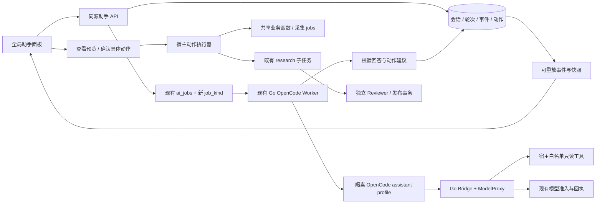

# WeaveSense 全局交互式 OpenCode Agent Implementation Plan

> **For Claude:** REQUIRED SUB-SKILL: Use superpowers:executing-plans to implement this plan task-by-task.
> 执行环境说明：上一行保留 writing-plans 的标准交接格式；实际执行者应使用本环境可用的 executing-plans 技能，不假定存在名为 superpowers 的插件。本文件是实现方案，不是已实现功能声明。

**Goal:** 在 WeaveSense 全站提供可展开/收起的右侧 AI 助手，以已有 OpenCode 为执行引擎，理解当前页面、持续对话、查询项目数据，并通过可预览、可追踪的受控操作管理关键词、信源、采集与深入研究。

**Architecture:** 浏览器负责对话与操作展示；TypeScript 应用持有会话、事实、授权、动作及预算；现有 Go Worker、Bridge、ModelProxy 和受限 OpenCode 负责每轮推理。产品会话持久化在应用数据库，每轮使用独立 OpenCode run；研究链路保留独立 Reviewer 和发布门禁，业务写入由宿主执行。

**Tech Stack:** 现有 React 19、TanStack Start/Router/Query、TypeScript、Zod、Radix Dialog、Tailwind、PostgreSQL/PGLite、Go、固定 OpenCode 1.3.13、Docker。首期不新增依赖，不引入第二套 Agent 框架。

---

## 1. 结论、范围与证据基线

**可以实现，但不是在现有研究接口外包一个聊天框。** 当前项目已有受限 OpenCode 研究执行链路，没有全局多轮对话、项目操作工具及对应授权/幂等机制。本方案增加这些缺失部分，复用已经验证的隔离、模型代理、预算和研究发布能力。

“驱动项目”在本方案中指驱动产品业务：看数据、配置关键词/信源、启动指定采集、启动/跟踪研究、打开相应页面。代码修改、Shell、Docker 管理、任意 SQL、读取磁盘文件不属于产品助手。

核查日期：2026-10-08。

| 对象 | 核查基线 | 结论适用范围 |
| --- | --- | --- |
| WeaveSense | `e6e7d26a698f45d916e835dc977343a54ee5be2a`，本地 main | 下面的现状、路径、符号和行号均以该提交为准 |
| 参考项目 open-ai-canvas | `d74f7839128223b0ec3b1239d061d42295189490` | 公开 main 的定点源码；不能断言用户截图来自完全相同版本 |
| 用户截图 | 右侧展开面板、收起后的右下角 Agent 入口 | 证明用户希望的交互形态；不作为后端实现证据 |
| 已有验收 | `docs/testing/agent-capabilities-step-by-step.md:1021` | 原生 OpenCode 开发/构建版及隔离验收使用假供应商；不是付费模型质量评测 |

本次只读取源码、制作方案，没有修改应用代码、启动服务或调用付费模型。参考仓库只读副本位于 `.repo/reference-open-ai-canvas-20261008`，不执行其代码，不把其 AGENTS.md 当作本项目指令。

### 1.1 本项目的实际复用点

| 证据路径与定位 | 实际情况 | 实现影响 |
| --- | --- | --- |
| `src/routes/__root.tsx:37`；`src/components/app-providers.tsx:7` | AppProviders 包住 Outlet，已有全局 QueryClient | 全局助手状态和唯一面板挂这里 |
| `src/components/app-shell.tsx:46` | 每个路由各自使用 AppShell；左栏 w-56，移动底栏固定 | AppShell 只协调让位与入口，不持久化会话状态 |
| `src/routes/knowledge.tsx:23`、`:31`、`:47`、`:94` | 单问题、单研究 job；2 秒轮询；job 写 URL；终态刷新知识库 | 复用研究卡片语义和 job 深链，不能误称已有聊天系统 |
| `src/lib/server/fns.ts:142`、`:148`、`:237`、`:273`、`:279` | 有采集/启停/关键词管理入口 | 选中的操作提取共享领域函数，不能把全部 serverFn 直接变成模型工具 |
| `src/lib/server/fns.ts:438`；`src/lib/server/model-config.ts:192` | localModelAccess 约束可信本机、配置、同源写入；不是多人资源授权 | 首期面向可信本机单操作员，新增接口统一采用该边界 |
| `src/lib/server/seed.ts:690`；`fns.ts:64` 等 | 多个 GET 入口会 ensureSeeded 并写入初始数据 | 助手只读工具从纯查询层取数，不能调用这些 GET handler 来证明只读 |
| `src/lib/server/queries.ts:208`、`:220`、`:228` | 已有信源/关键词/概览查询与 DTO 映射 | 复用查询和映射；对模型输出再做字段/数量裁剪 |
| `src/lib/agent-contract.ts:91` | 执行协议 mode 只有 analyze_item/briefing/research | 新增独立 assistant 请求/结果 schema，不伪装成 research |
| `migrations/0023_research_runtime.sql:3`、`:29` | DB 明确限制 OpenCode 只能 research | 必须显式迁移，不能只改环境变量 |
| `src/lib/server/agent-queue.ts:157` | claim 以 research: 前缀区分研究与分析 | 新增显式 job_kind 并改所有 claim，避免 assistant 被当作分析领取 |
| `workers/opencode-runtime/server.mjs:54`、`:71`、`:141` | 单 active 实例；每次 prepare 独立目录；stop 删除目录 | 产品历史保存在宿主；每轮短生命周期 session，不能依赖 runtime HOME 存聊天历史 |
| 同文件 `:105`、`:150` 以后 | 固定 research Agent、两种 corpus 工具、批准 Skill、转发白名单及单次派发 | 新增显式 assistant profile；保留 research 默认与原始限制 |
| `workers/agent/internal/opencode/bridge.go:69` | MCP 只注册 search_items/get_item | 项目读工具需要新增授权路径；写操作不交给模型直接执行 |
| `migrations/0025_research_tool_calls.sql:6`；`src/lib/server/agent-data.ts` | 工具账本/运行时路由只接受研究工具 | 新助手读工具使用独立工具回执表，研究账本约束不泛化 |
| `src/lib/server/agent-budget.ts:24`、`:64` | 模型实际发送受准入控制；已有候选后阻止 Producer 再调用 | 共用发送账本；按 mode 新增助手结束条件，保留研究防线 |
| `src/lib/server/agent-completion.ts:27` | 终态、业务写入、预算结算在同一事务边界 | 助手回复通过专用 finalizer 保存，不写 knowledge_notes |
| `src/lib/server/extract.ts:50`、`:83` | OCR/ASR 直接调用付费供应商 | 不能直接纳入助手工具并宣称已有研究预算覆盖 |
| `docker-compose.yml:182`、`:203`、`:229`、`:305` | 三个可选 OpenCode 服务；默认 legacy/eino，异步开关关闭 | 功能必须有真实能力探测和不可用原因，不展示虚假的在线状态 |

路径行号只是导航，实施时同时核对符号。若 HEAD 已变，先重做受影响核查，尤其迁移编号和 schema CHECK。

### 1.2 参考项目哪些值得借鉴

所有链接固定到已读取提交，避免 main 后续变化造成证据漂移。

| 源码 | 已确认机制 | WeaveSense 的应用方式 |
| --- | --- | --- |
| [canvas-cloud-agent-panel.tsx](https://github.com/ddcat-ai/open-ai-canvas/blob/d74f7839128223b0ec3b1239d061d42295189490/web/src/components/canvas/canvas-cloud-agent-panel.tsx#L81) | open/onOpen/onCollapse、会话、运行状态、审批展示；约876行挂载 Launcher | 借鉴入口—面板—历史—任务卡的交互组织，按本项目组件重写 |
| [use-agent-panel-layout.ts](https://github.com/ddcat-ai/open-ai-canvas/blob/d74f7839128223b0ec3b1239d061d42295189490/web/src/components/canvas/use-agent-panel-layout.ts#L7) | 布局偏好、尺寸约束、键盘调整与移动布局 | 首期固定右侧 dock 与移动 Dialog；可调宽度使用已安装组件，不复制依赖 window 的首次渲染逻辑 |
| [services/api/agent.ts](https://github.com/ddcat-ai/open-ai-canvas/blob/d74f7839128223b0ec3b1239d061d42295189490/web/src/services/api/agent.ts#L119) | 提交幂等键、取消、审批决定；事件流有序号及重连游标 | 新接口采用 request_id、持久化 seq、after 游标；不用浏览器断线判断任务失败 |
| [cloud-agent-conversations.ts](https://github.com/ddcat-ai/open-ai-canvas/blob/d74f7839128223b0ec3b1239d061d42295189490/web/src/services/cloud-agent-conversations.ts#L48) | 浏览器按用户/画布保存会话，pending submission 单独持久化 | 本项目采用数据库为事实源；浏览器只保留面板偏好和小型 pending request 标识 |
| [cloud_agent_approval_preview.go](https://github.com/ddcat-ai/open-ai-canvas/blob/d74f7839128223b0ec3b1239d061d42295189490/backend/internal/app/cloud_agent_approval_preview.go#L56) | 宿主生成操作预览，动作与数据实体关联 | 预览从本地业务事实构造，不采用模型自报的影响和执行结果 |
| [yingce-agent/README.md](https://github.com/ddcat-ai/open-ai-canvas/blob/d74f7839128223b0ec3b1239d061d42295189490/yingce-agent/README.md)；[runtime.go](https://github.com/ddcat-ai/open-ai-canvas/blob/d74f7839128223b0ec3b1239d061d42295189490/backend/internal/agent/runtime/runtime.go#L28) | Node runtime 通过 Go bridge 回调模型、工具、事件；源码包含 PI runtime 路径 | 可借鉴宿主持有权限的分工；该参考路径不等于 WeaveSense 的 OpenCode 协议 |

不复制影视画布节点、素材连接器、技能商店、角色动画或媒体生成工作流。这些是参考项目领域能力，不是本项目已有能力。若以后复制其实际代码，另行保留许可证及归属；本方案仅依据机制设计本项目实现。

### 1.3 Word 方案的融合与源码差异裁决

本方案充分参考用户提供的 [WeaveSense_Interactive_Agent_Implementation_Plan.docx](WeaveSense_Interactive_Agent_Implementation_Plan.docx)，版本1.0、2026-10-08，文件SHA256为 `62cfb7433c1595760c43ba92f9d354eeb0f9921e4014df78c6d3eaed4008dad0`。已提取并阅读其19节及源码索引；原文件保持不变。它依据的是 `WeaveSense(1).rar` 快照，不能把其中“现有”直接套到当前main。

| Word内容 | 本次处理与理由 | 对应实现 |
| --- | --- | --- |
| §1“没有OpenCode runtime，只有Eino/opencodex” | **修正旧基线**：当前已有 `workers/opencode-runtime`、Go OpenCode Worker/Bridge/ModelProxy及0023–0025迁移；模型网关仍不等于Agent | §1.1、Task7–10增量扩展现有链路 |
| §5引用OpenCode源码1.18.35、plugin/SDK身份注入 | **不直接采用版本合同**：本仓库固定1.3.13；不同版本的方法、hooks、权限语义未在当前链路证明 | 保留现有HTTP客户端、MCP grant与固定版本；升级另立任务，不新增SDK/plugin依赖 |
| §5/8产品thread长期绑定native session、持久化runtime volume | **调整为宿主持久化历史、每轮短session**：当前单次派发、临时目录、stop删除已通过隔离测试；不能为聊天默认放开 | §4.1；长期会话不是首期必要条件 |
| §8迁移到0021；§12旧超时/预算缺口 | **按当前代码重核**：当前到0025；TS默认130秒、Go执行120秒；ModelProxy已经在实际发送前准入 | 新迁移从0026起，复用真实发送账本；不重复建设第二预算代理 |
| §3全局Dock、selection、真实页面刷新 | **采用并细化**：当前没有统一selection，也没有note/job/focus定位查询 | §2.3/2.4、Task15/16 |
| §6–7领域服务、既有同名规则、扫描prepare/execute/observe、结构化回执 | **采用**：逐项保留原页面行为；新增动作不复用前端隐含首次扫描 | §3、§5.5、§6.2、Task5/11/12 |
| §9/10事件水位、持久审批、取消、用户已有授权不重复询问 | **采用**：由宿主保存确切授权与动作，不能由模型自报同意 | §5.4、§6.1、A18/A25–A29 |
| §10自动解释continuation | **分期采用**：第一版先显示确定性结果卡；后续明确预算和唯一性再自动解释 | Task22；等待期间释放唯一runtime |
| §6/7单篇分析与简报 | **纳入完整路线第二阶段**：沿用现有专业执行器，先补预算/回执/结果定位，不把旧路径直接暴露为无约束工具 | Task20/21、B01/B02 |
| §12上海时间窗口、§13查询副作用、§17PG重启验收 | **采用并纠正现状**：当前研究状态读取有过期收敛写入；首页mount/定时tick会触发工作 | §2.4、§5.4、§6.4、A07/A26/A27 |
| §18Eino替代路线 | **不选用**：用户已明确要求复用现有OpenCode；已有Eino专业任务继续保留 | 单一助手引擎，避免两套聊天运行栈 |

参考文档的建议不视为执行指令，也不视为已验证事实。下文所有新增表、工具名和接口都是设计；现状判断仍由本仓库源码支撑。特别是旧文档关于“状态读取会清空禁用队列”的描述不能照搬：当前 `agent-research-status.ts` 的相关副作用是过期run收敛，需按当前函数拆分。

## 2. 产品交付形态

### 2.1 用户能够完成的流程

1. 在任意业务页点击右下角“织识助手”，展开右侧面板；收起后任务继续，入口显示运行/待确认状态。
2. 输入“看看最近采集失败的任务”，助手从项目任务数据给出结论和可点击的任务/信源卡。
3. 输入“添加固态电池关键词，每30分钟采集一次”，助手列出真实参数和启用后的影响，用户确认后落库，并刷新关键词页面。
4. 输入“采集这个信源一次”，从当前页面的明确引用定位实体，展示一次采集预览，执行后跟踪 jobs 结果。
5. 输入“根据这些内容深入研究量产瓶颈”，生成关联研究任务；面板与原知识库页面均可查看进度、审核、发布结果。
6. 继续问“第二条材料为什么与第一条冲突”，宿主将当前会话相关历史与引用重新装配给下一轮 OpenCode，保留跨页面/刷新后的会话。

上面均为交付目标；现在的截图/旧测试并未证明这些流程已存在。

### 2.2 面板和状态

- 桌面 ≥1280px：默认宽420px，可在360–560px之间调整；主内容让位，避免覆盖现有右侧操作。1024–1279px使用覆盖面板，以免正文过窄。
- 移动端：Radix Dialog 全屏，支持 safe-area、虚拟键盘与焦点返回；入口位于现有底栏上方，触控区域至少44px。
- 顶部：名称、服务状态、新对话、历史、收起。模型名称仅展示宿主批准的当前模型，不提供任意供应商 URL/key 输入。
- 中部：用户消息、助手回答、引用、真实工具状态、操作预览、业务结果卡。执行日志与模型回答分开标记；不展示内部推理链。
- 底部：输入框、当前页引用、发送/停止。Enter发送、Shift+Enter换行，IME composition 时不能提交；忙碌时保留草稿，不自动开启并行轮次。
- 空状态按页面提供最多3个明确建议，不预先调用模型。打开、切页、刷新、加载历史、查询状态均不得发起模型调用。
- 工具失败须呈现可理解的原因；`不可用`、`尚未配置`、`排队中`、`等待确认`、`结果待核实`均为不同状态。
- 首期只流式展示宿主事件与工具进度；完整回答通过结构化结果校验后展示。逐 token 回答不作为首期承诺，避免把 JSON/未审核草稿当最终答案逐字渲染。
- 展示阶段提示，如“读取信源”“生成方案”；不伪造百分比或预计完成时间。

### 2.3 页面上下文规则

发送时冻结 `{ route, filters, references }`，不是实时上传页面 DOM。

| 页面 | 可提交的上下文 | 服务端处理 |
| --- | --- | --- |
| 总览 | route | 查询裁剪后的统计 DTO |
| 关键词/信源 | 用户明确选择的 ID，最多8个 | 回查名称/状态/配置；没有选择时要求消歧，不能猜“这个” |
| 内容列表 | platform/q/media/keyword 白名单过滤，选中 item ID | 限量查询；截断与覆盖范围在结果里标明 |
| 内容详情 | 路由中的 itemId | 回查正文片段、版本、媒体提取状态；不把大文件送模型 |
| 知识库 | 当前 job ID、用户引用的 note ID | 校验存在/来源；研究引用保持证据约束 |
| 任务 | 选定 jobs ID；区分采集任务和 ai_jobs | 返回真实状态、时间、有限错误摘要 |
| 模型设置/节点 | 只标识页面与允许的功能状态 | 不读取密钥输入框、供应商凭据、Telethon 登录身份、Bucket/内部地址 |

引用徽标可以逐个移除；“仅本次发送引用当前页面”为可见默认行为。旧轮次冻结上下文不因后续导航而改变。

### 2.4 结果定位与导航副作用

结果按钮只由服务端返回的类型化实体引用生成，不能接受模型提供的任意URL或JS。当前仅有研究的 `/knowledge?job=...` 和内容详情路由可直接复用。新增 `/knowledge?note=...`、`/jobs?job=...`、`/keywords?focus=...`、`/sources?focus=...` 时必须同时实现 `validateSearch`、按ID取数、过滤/分页外定位、滚动高亮和不存在状态；只拼URL不算完成。

`src/routes/index.tsx:35–58` 在mount及可见页面每120秒调用tick，可能触发真实采集/自动分析。助手展示概览优先使用只读概览卡；不在模型读数据后自动跳首页。用户主动打开首页仍沿用现有行为；本方案不声称整个旧产品已变成无副作用查询系统。

后续单篇分析的“查看本次分析”必须用receipt中的analysis_id，并新增详情页受控 `analysis` 查询及按ID读取。未实现前按钮只能叫“打开原条目”，不能用条目最新分析冒充本次结果。研究的note_id必须来自本次发布回执。

## 3. 业务能力分级与明确边界

以下工具名称和 API 都是**拟新增合同**，不是当前仓库现有函数。

### 3.1 第一版完整交付清单

读工具自动执行，但受 run 授权、参数、次数、数据范围和响应字节数限制。

| 新工具 | 复用点 | 约束 |
| --- | --- | --- |
| `project_overview` | queries.getOverview | 不 ensureSeeded；排除内部配置 |
| `list_keywords` / `list_sources` | queries 的对应函数 | 最多50项；明确截断；只展示业务字段 |
| `search_items` / `get_item` | agent-retrieval/context 的受限取证能力 | 保留语料范围、版本与 evidence ID；需适配 assistant 授权，不直接共享研究令牌 |
| `list_notes` / `get_note` | fns 内现有查询与 mapNote | 最多20项；内容上限；引用研究来源状态 |
| `list_collection_jobs` / `get_collection_job` | jobs 查询 | jobs 与 ai_jobs 分开；最近50项 |
| `get_research_status` | 从getResearchStatus提取纯读取部分 | 仅本会话创建或用户明确引用的job；现函数会收敛过期run，不能直接当纯读工具 |
| `get_operation` | 新增assistant_actions和稳定业务引用查询 | 仅本会话动作或已授权引用；返回持久回执，不触发再次执行 |
| `get_service_status` | 节点查询的脱敏子集 | 精确标记缓存/观测时间；不返回秘密/主机细节 |

写操作由模型产生结构化建议，**通过宿主授权校验后执行**。没有确切授权的动作先展示预览；已有匹配授权不重复询问（见§6.1）。确认的是具体目标、参数和影响。同一批最多4个有序操作；第一版不支持任意DAG，也不自动扩展批次。

| 操作类型 | 首期行为 | 预览/执行必须处理 |
| --- | --- | --- |
| `keyword.create` | 新建一个关键词，可启用 | 同名且唯一时返回existing和记录链接，不覆盖/重启；历史重复且无法唯一定位时返回conflict |
| `keyword.update` | 更改 interval/platforms | 展示旧值→新值；目标版本改变后预览失效 |
| `keyword.set_enabled` | 启用/停用指定关键词 | 显示未来定时采集影响 |
| `source.create` | 新增 RSS 信源，默认停用；可显式选择启用 | 固定平台子集与 adapter；校验 URL；不顺便发起采集 |
| `source.set_enabled` | 启用/停用指定信源 | 与关键词一致；不修改供应商凭据 |
| `source.collect_once` / `keyword.collect_once` | 触发指定对象一次采集 | 持久化动作 ID，稳定关联 jobs ID；显示外部请求与可能的供应商配额消耗 |
| `research.start` | 调用已有受管深入研究 | 独立子任务预算，冻结范围/模型/审核；不得绕过 Reviewer 直接发 note |
| `research.cancel` | 取消明确关联的研究任务 | 用户在已有任务卡点击取消时直接执行；对话提出取消则先明确目标；不回滚已发布笔记 |

业务开关的修改不是“免费而无影响”：启用采集可能触发未来调度，必须明确显示。现有全部网页入口的行为不在本次重做范围；共享领域函数需提供保留原页面行为的明确调用策略。

关键词规范化复用 `src/lib/keyword.ts` 的解析/去重语义；单个create只接收一个规范化词，批次仍受4动作上限约束，不能把原parseKeywordList的20词上限误当4动作能建20词。interval首期只允许现有UI选项 `5/10/30/60/180/1440` 分钟。平台由 `KEYWORD_SEARCH_PLATFORMS` 生成描述：rss/bilibili/youtube是各自声明的search范围；telegram/wechat/douyin/xhs/xigua为已采集材料local匹配，不承诺全网搜索。

助手create及包含platforms的update必须提供非空、去重、严格枚举的平台列表。现有 `collectors/keyword.ts:8` 与 `scheduler.ts:175` 把空数组解释为全部平台；不得过滤未知平台后用空数组回退。第一版不新增隐式all，用户要全部时须将当前批准的平台集合明确列出并冻结，预览区分外部搜索与本地匹配。

原关键词页面在add成功回调中额外扫描返回ID的前3项，`addKeywordsFn`自身不承担这次扫描。助手必须独立表达 `keyword.create` 和 `keyword.collect_once`，不能复用该前端回调隐式多扫。`existing`只表示目标存在：若请求参数与现有配置不同，后续依赖动作暂停并生成明确update建议，不能悄悄以旧配置执行用户以为已修改的采集。

### 3.2 后续能力，不应包装为第一版已交付

| 能力 | 当前障碍 | 进入条件 |
| --- | --- | --- |
| 直接条目分析/生成简报（第二阶段） | legacy/eino路径与新助手运行时不同 | Task20/21补独立限额、回执、幂等、取消和准确结果定位后开放 |
| OCR/ASR/媒体批处理 | extract.ts 直接调用供应商，不走研究预算 | 统一付费发送准入与批处理上限，完成故障验收 |
| 微信导入、批量 Telegram | 外部网关与数据库跨系统写入 | 逐项幂等、可恢复回执和预览，不靠一个事务假装跨系统原子性 |
| 删除/撤销 | 缺乏业务软删除及普遍可逆性 | 独立删除规范和恢复机制；不能提供万能 Undo |
| 模型配置修改/任意技能安装 | 凭据和服务端配置边界 | 另行设计管理员权限与包审核；第一版提供模型设置页导航 |
| 公网多人协作 | 当前业务表无 owner，localModelAccess 非租户授权 | 身份、资源所有权、会话隔离、部署边界专项完成 |
| 代码/终端执行 | 当前 runtime 明确禁止 | 不属于本方案产品目标 |

## 4. 架构选择与复用方式



### 4.1 会话不是 OpenCode session

- `conversation_id` 是持久化产品会话；`turn_id` 是用户一次提交；`run_id` 是一次已计费预算约束的推理执行；`runtime session_id` 只服务本次 run。
- 由宿主装配最近12条完成消息、当前问题、用户引用、真实操作回执。上下文 JSON 上限64KiB，正文采用代码点截断，显式标记 omitted；ModelProxy 现有512KiB硬限额继续有效。
- 第一版不做额外模型摘要，不让标题/自动压缩消耗隐形模型调用。标题由首条用户消息截取；历史全量仍保留，可分页查看。
- 每个会话同时最多一个未结束轮次；提交包含 expected_revision，两个标签页冲突返回409并刷新快照。不同会话可排队，OpenCode 同时只跑一个。
- assistant产出回答/建议后先持久化不可执行的结果并封锁Producer，再撤销grant、确认停止runtime，最后幂等完成模型阶段与预算结算并激活动作（精确顺序见§4.4）。用户在几分钟后确认动作不应占着OpenCode slot或续租模型运行。
- 用户追问/依据结果继续推理，需要新 turn 和独立准入；禁止静默无限“自我改进”循环。

### 4.2 多模式队列，不复制整个研究执行栈

在 `ai_jobs` 增加 `job_kind = analyze_item | research | assistant`，在 `ai_runs` mode 加 assistant。保留旧 item_id 字段兼容，assistant 使用宿主生成的 `assistant:<turn_id>`；判别必须基于 job_kind，而不是“非 research 就是分析”。

共享：租约、run fencing、ai_model_calls、预算日锁、reservation、runtime binding、Go客户端、ModelProxy实际发送边界、进程停止验证。

独立：assistant schema、会话存储、上下文、只读工具回执、动作预览/执行、助手终态写入。research 的候选、审核和知识发布流程继续按 research mode 严格处理。

`handleOpenCodeJobs` 的公共研究 action 不接受浏览器传 provider/profile。新增可信 `assistant_claim/assistant_result/assistant_event/assistant_complete` 分派，或等价的独立 internal assistant-jobs 路由；本方案采用**独立 internal assistant-jobs 路由、共用同一 Worker 循环**，方便保留旧路由语义。Worker 按宿主调度决定轮询顺序，每完成一个 run 交替优先 assistant/research；空队列立即检查另一队列。不得启动第二个未经协调的 Worker 抢同一个 runtime。

动作等待与 research 子任务跟踪在宿主进行，不持有 runtime。否则助手等待自己排入的研究而研究等待唯一 runtime，会形成死锁。首期只向 UI 发子任务状态，不在结束时自动再叫模型总结。

### 4.3 OpenCode assistant profile

修改 `server.mjs` 的 prepare 合同，新增可信枚举 `profile`，省略仍严格等于 research；claim/Bridge grant/宿主冻结请求均携带一致 profile 和 capability digest。

- research profile 的 Agent、Skill、工具、网络与结果协议不变。
- assistant profile 仅暴露本方案只读项目工具；模型通过最终 JSON 返回动作建议，无直接 DB/文件/网络写工具。
- 禁止 shell/edit/browser/webfetch/task/subagent、外部 MCP、自动 title/summary/compaction；继续当前 provider白名单、固定模型、内部隔离网络。
- 新增批准 Skill `project-assistant`。每个 profile 使用自身明确 manifest，research 三个 Skill 的旧 digest 计算不变。assistant 使用新 digest，不能只增目录便宣称旧审核快照仍相同。
- Bridge 根据可信 grant profile 过滤 tools/list，并在每次 tools/call 再校验；过滤展示不等于授权。
- 模型结果严格校验，未知字段/工具/操作全部拒绝。引用 ID、操作目标和范围由宿主重新核对。
- Go `client.go` 的TerminalResult当前检查固定research Agent与ModeResearch。须增加严格的assistant终态解析分支，验证绑定session/message/part、完成原因及profile；不能只改prepare而继续把助手JSON塞进research结果schema。
- 同客户端Prepare还校验Skill数量为3；需按可信profile核验**精确manifest及digest**，不能简单删掉长度校验。research仍为原三个Skill，assistant为已批准的单Skill；两个profile不能互换准备响应。

### 4.4 结果持久化、停止确认与动作激活

必须保持与现有研究“候选保存→清理确认→后续完成”同等强度的边界，采用以下顺序：

1. 可信Worker提交assistant终态JSON，宿主验证绑定/profile/消息身份，原子保存不可变结果为 `result_saved`，立即阻止此run后续Producer发送。此时动作建议保留在结果中，**尚不生成可领取的approved动作**。
2. Worker撤销grant、按协议abort并确认runtime进程组停止；宿主持久化 `runtime_stopped_at`、被验证的runtime epoch及stop回执摘要。只有旧字段或内存 `cleaned=true`不够；stop响应丢失先核对实际runtime，不再次prompt。
3. 幂等finalizer要求 `result_saved + runtime_stopped_at` 两项事实，在同事务完成run/预算、assistant消息、proposal或匹配授权的approved动作、事件。完成响应丢失只重试相同finalize，不重新调用模型或建动作。

清理未确认时保留结果供恢复，UI显示“结果待核实/执行环境停止未确认”，动作不可批准/领取；Worker停止新模型领取。重启从持久记录对账已保存结果及停止事实，再继续finalizer。模型费用unknown仍按原预算规则保留，不因stop成功自动写成零。取消与finalize使用同一锁序，取消在先则不激活动作，已产生的费用按事实记录。

恢复后的finalizer仍须验证当前有效的恢复claim/fence、取消状态、授权有效期与不可变结果摘要；旧租约必须先通过受控恢复领取替换。保存过结果或停止成功不构成绕过这些校验的授权，过期/取消任务可以结算和保留证据，但不能激活写动作。

## 5. 数据与协议合同

### 5.1 新增表及唯一性

使用项目现有 text UUID 风格，应用生成 UUID，不引入数据库扩展。

| 新表 | 必要字段 | 关键约束 |
| --- | --- | --- |
| `assistant_conversations` | id、title、revision、status(open/archived)、created_at、updated_at | 不伪造 user_id；明确单操作员；archive 不删除运行证据 |
| `assistant_turns` | id、conversation_id、request_id、request_hash、status、job_id、run_id、context_json、policy_json、authorization_json、created_at、finished_at | request_id全局唯一；同ID不同内容409；job_id/run_id唯一；每会话一个活动轮次的partial unique index |
| `assistant_messages` | id、conversation_id、turn_id、ordinal、role(user/assistant/action_result)、content_json、created_at | unique(conversation_id,ordinal)；服务端生成role与ordinal |
| `assistant_events` | id、conversation_id、turn_id、seq、type、payload_json、created_at | unique(conversation_id,seq)，seq由会话行锁递增；追加式，不暴露原始runtime事件 |
| `assistant_actions` | id、turn_id、batch_id、ordinal、kind、args_json、intent_digest、preview_json、preview_digest、expected_state_json、authorization_source、status、decision_request_id、claim_token、lease_until、dispatch_started_at、child_job_id、result_json、error_code、expires_at | unique(turn_id,ordinal)、unique(turn_id,intent_digest)；decision_request_id非空时唯一；不可变参数/预览；每个动作有真实结果 |
| `assistant_tool_calls` | run_id、call_id、tool、args_digest、state、result_json、created_at、finished_at | primary key(run_id,call_id)；同call异参拒绝；只存裁剪后的允许数据 |

turn 状态：queued/running/awaiting_confirmation/executing/waiting_child/completed/failed/cancelled/outcome_unknown。模型 run 完成后 turn 仍可等待用户或子任务；不要强迫 ai_runs 的模型状态与整个产品 turn 完全相同。

action 状态：proposed/approved/executing/succeeded/failed/rejected/expired/conflict/cancelled/outcome_unknown。`unknown` 不是成功或“免费”；后台恢复不能重发不确定外部动作。

部分索引的起始 SQL（放在新迁移内；所有表先创建再建索引）：

```sql
create unique index assistant_one_active_turn
  on assistant_turns(conversation_id)
  where status in ('queued','running','awaiting_confirmation','executing','waiting_child');
create unique index assistant_decision_once
  on assistant_actions(decision_request_id)
  where decision_request_id is not null;
create index assistant_action_claim
  on assistant_actions(status,created_at)
  where status='approved';
create unique index assistant_conversation_event_seq
  on assistant_events(conversation_id,seq);
```

新迁移暂定 `0026_assistant_sessions.sql`、`0027_assistant_runtime.sql`。实施前查最新编号；不编辑已执行的0011–0025。0027验证历史 payload/provider/mode 后回填 job_kind，不明记录使整项迁移失败并报告 ID，不猜测。

迁移必须调整 `ai_runs_mode_check`、`ai_runs_opencode_research_check`、`ai_jobs_opencode_research_check`，保留 `opencode` 仅允许 research/assistant，assistant 必须 provider=opencode 且具备关联 turn。旧分析/研究 job 与预算记录不改写成助手。

`ai_runtime_bindings.state` 新增 `result_saved`，专门用于assistant；另增可审计的 `runtime_stopped_at` / `stop_receipt_json`（含epoch，受严格内部schema约束），或同等独立事实字段，不用覆盖result_saved来丢失已保存结果。旧 `candidate_saved` 仍专门代表research。结束后生产者封锁分别检查对应事实，不放宽研究候选防线。

### 5.2 浏览器提交合同示例

以下是计划新增合同的可直接起步代码；操作 union 在 Task 2 按§3完整枚举，不能以 `z.record(z.unknown())` 代替写参数验证。

```ts
import { z } from "zod";

const boundedText = (min: number, max: number) =>
  z.string().trim().refine(v => {
    const n = Array.from(v).length;
    return n >= min && n <= max;
  }, { message: "invalid_text_length" });

const reference = z.object({
  kind: z.enum(["item", "source", "keyword", "note", "collection_job", "research_job"]),
  id: z.string().trim().min(1).max(128),
}).strict();

export const assistantMessageInput = z.object({
  request_id: z.uuid(),
  expected_revision: z.number().int().nonnegative(),
  text: boundedText(1, 4000),
  context: z.object({
    page: z.enum(["overview", "keywords", "sources", "inbox", "item", "knowledge", "jobs", "nodes", "model-settings", "pipeline", "guide", "prd"]),
    filters: z.object({
      platform: z.string().max(32).optional(),
      q: boundedText(0, 200).optional(),
      media: z.string().max(32).optional(),
      keyword: boundedText(0, 80).optional(),
    }).strict(),
    references: z.array(reference).max(8),
  }).strict(),
}).strict();

export const actionDecisionInput = z.object({
  request_id: z.uuid(),
  decision: z.enum(["approve", "reject"]),
  preview_digest: z.string().regex(/^[a-f0-9]{64}$/),
  expected_revision: z.number().int().nonnegative(),
}).strict();
```

platform/media 的合法值在服务层继续使用实际项目枚举核对；ID不是能力凭据，任何实体都要服务端回查。browser请求不得接收 model/key/baseURL、provider、SQL、权限模式或无限预算。

结果合同为 `{version:1, answer:string, citations:Reference[], actions:ActionProposal[], clarification?:{question,options}}`，answer≤12000代码点、citations≤12、actions≤4；clarification 与 actions 互斥。宿主预览与执行结果不能由这个 JSON 的文本取代。操作间引用只允许前一项明确创建的业务对象句柄，由宿主解析；首期没有自由模板表达式。

### 5.3 外部与内部 API

使用 TanStack Start 已有 `createFileRoute(...).server.handlers` 风格，拟新增如下文件。动态文件名中的 `$` 是路由参数，不是 shell变量。

| 方法/路径 | 文件（拟新增） | 行为 |
| --- | --- | --- |
| GET `/api/assistant/capabilities` | `src/routes/api/assistant/capabilities.ts` | 可用能力及不可用原因；不调用模型 |
| GET/POST `/api/assistant/conversations` | `src/routes/api/assistant/conversations.ts` | 分页列表/新建会话 |
| GET/PATCH `/api/assistant/conversations/$conversationId` | 同目录 `conversations.$conversationId.ts` | 快照、历史分页、改标题/归档 |
| POST `/api/assistant/conversations/$conversationId/messages` | 同目录 `conversations.$conversationId.messages.ts` | 严格验证、幂等入队、返回202和turn_id |
| GET `/api/assistant/conversations/$conversationId/events?after=N` | 同目录 `conversations.$conversationId.events.ts` | 可重放SSE；断流可重连 |
| GET `/api/assistant/turns/$turnId` | 同目录 `turns.$turnId.ts` | 恢复指定轮次和稳定业务关联，不创建新任务 |
| POST `/api/assistant/turns/$turnId/cancel` | 同目录 `turns.$turnId.cancel.ts` | 幂等停止当前轮次及其明确归属的未完成动作 |
| GET `/api/assistant/actions/$actionId` | 同目录 `actions.$actionId.ts` | 读取持久化ActionReceipt与确定的结果引用 |
| POST `/api/assistant/actions/$actionId/decision` | 同目录 `actions.$actionId.decision.ts` | 批准/拒绝已冻结的具体动作；不接受新参数 |
| POST `/api/internal/assistant-jobs` | `src/routes/api/internal/assistant-jobs.ts` | Go Worker领取/续租/事件/结果/终态，可信服务令牌 |
| POST `/api/internal/assistant-data` | `src/routes/api/internal/assistant-data.ts` | Bridge读取数据及模型回执；service+run授权 |
| POST `/api/internal/assistant-actions` | `src/routes/api/internal/assistant-actions.ts` | Go Worker领取/驱动已批准动作，不占用runtime |

外部接口复用 localModelAccess，非GET要求同Origin；GET禁止CORS共享、响应no-store。internal接口使用独立的助手worker/service token及run fencing；浏览器绝不能获得这些token。`readAgentJson`在认证后限制字节并做严格UTF-8解析；用户提交32KiB、内部事件64KiB，result上限按schema+UTF-8字节双重限制。

错误合同：`{error:{code,message,retryable},request_id?}`；409用于内容/版本/审批冲突，401/403授权，413大小，429预算/排队上限，503配置/运行时不可用。错误不回传原始SQL、环境变量或供应商响应全文。

### 5.4 事件和刷新恢复

事件类型固定为 `turn.queued`、`turn.started`、`tool.started`、`tool.completed`、`message.completed`、`action.proposed`、`action.updated`、`child.updated`、`entity.changed`、`turn.finished`。每条有schema_version=1、conversation_id、turn_id、seq、created_at与经schema过滤的payload。entity.changed仅含固定领域与实体ID，映射现有Query Key；数据结果与通知同事务保存。

首期采用数据库持久化事件＋每1秒增量查询，不新增消息中间件。SSE每15秒心跳，单连接最长60秒后正常重连；客户端以Last-Event-ID/after重放，按seq去重。网络中断不取消任务。普通快照API作为重连与不支持SSE时的2秒轮询回退。

分配seq、业务状态修改、事件追加在同一短事务，先commit再发送。禁止直接转发OpenCode `/event` 的原始内容，避免泄漏工具参数/内部推理/凭据。若确需观察runtime事件，Worker只将固定白名单阶段映射为宿主事件。

打开面板时先加载快照，再从其last_seq接增量；断线期间多个事件不会因为先订阅/后快照而覆盖新状态。SSE收到越界/非法事件时停止应用该事件并获取快照，不创建新轮次。

快照的last_seq是同一一致性读取中的水位，不是在读取消息之后另查的最大seq。若事件归档后cursor小于最早保留值，返回 `resync_required`，读取包含实体变更水位的完整快照并补偿失效相关缓存；不能默默跳过事件。首期可不清理事件，但合同必须定义此状态。PGlite默认内存库只能证明同进程状态，跨应用/Worker重启恢复使用独立PostgreSQL验收。

只读API和只读工具不调用 `ensureSeeded`、tick或过期收敛。`getResearchStatus`拆出纯DTO查询，原页面仍保留现有必要的收敛入口；后台Worker承担助手子研究的到期处理。审计/工具回执允许写自身账本，“只读”准确含义为不触发业务变更、外部工作或模型调用。

新增internal assistant-jobs的 `reconcile` 操作：Worker每次模型运行之间及空闲2秒轮询调用，每批最多50个待收敛对象，使用锁/版本CAS防并发。它处理queueTTL、执行到期、预览过期、已关联子任务终态、已保存结果的停止恢复，并原子更新action/turn与去重事件；完成全部动作或等待到期后释放会话活动索引。事件幂等键至少覆盖(action_id,业务终态版本,event_type)，不能每轮轮询新增相同child.updated。没有模型、没有外部重发。助手开关关闭仅禁止新工作，保留reconcile与既有预算结算；进程停机时DTO显示最后观测时间，恢复后逐批收敛。`convergeExpiredRun`遇assistant必须分派到助手finalizer/收敛器，不能只completeRun而遗留父turn。长模型运行期间收敛可能延后到该run结束，UI不伪造已实时过期。

### 5.5 业务回执合同

```ts
type ActionReceipt = {
  action_id: string;
  status: "accepted" | "running" | "succeeded" | "failed" | "conflict" | "cancelled" | "outcome_unknown";
  effect?: "created" | "updated" | "existing" | "unchanged" | "skipped";
  result_refs: Array<{
    type: "source" | "keyword" | "item" | "job" | "ai_job" | "ai_run" | "note" | "analysis";
    id: string;
  }>;
  counts?: { inserted: number; matched?: number };
  warnings?: Array<{ code: string; message: string; platform?: string }>;
  error_code?: string;
  partial_effects_possible?: boolean;
  changed_domains: Array<"sources" | "keywords" | "items" | "jobs" | "knowledge" | "overview">;
};
```

实际实现同时有严格Zod schema；不同动作限制可返回的ref类型与统计字段，未知字段拒绝。ActionReceipt是宿主事实，不来自模型自由JSON。没有新增数不能填0；缺业务job_id不能用“最近任务”猜测；`accepted`不能渲染“完成”。source/keyword更新影响0行返回not_found，值原本一致则unchanged。read工具补 `get_operation`，只查询本会话动作或明确授权引用的action→job/run/note关系；不执行/重试该动作。

同轮模型输出出现相同kind/目标/规范化参数的重复建议时，在生成动作前拒绝重复意图；宿主保存intent_digest并约束同turn内唯一。ordinal只用于顺序，不能把相同操作放两个ordinal就执行两次。跨动作引用使用明确的前项创建结果句柄（例如 `{from_action:0, type:"keyword"}`），必须指向更早且类型匹配的创建动作；不接受未来引用/循环。批准时冻结符号依赖及创建参数，执行时核对前项真实receipt后解析ID；无法满足依赖或existing配置不匹配则暂停，不能把预览后换目标解释为合法引用。

## 6. 执行动作：预览、确认、幂等和恢复

### 6.1 确定性执行流程

1. 模型返回动作建议；宿主解析严格union，服务端查目标，生成真实中文预览、expected_state、expires_at及digest。
2. 宿主对照当前轮次的确切授权。未获授权的动作显示“将修改什么”“会触发什么”“费用/配额边界”供一次确认；已经授权的同一动作直接执行并显示回执，不逐步重复确认。读取和用户直接点击任务卡取消不二次确认。
3. 用户决定时只提交action ID、digest、revision与决定。宿主锁定会话/轮次/动作，验证未过期、未被取消、参数未换、目标配置仍相同。
4. SQL内可完成的写入与receipt/event同事务提交。连接失败后再查同action ID，不能因为浏览器没收到响应重复写入。
5. 外部采集先在短事务登记approved→executing与稳定job ID，commit后再执行IO，不持数据库锁等待网络。完成后回填真实job状态与结果。
6. 外部调用发送后状态不明，置outcome_unknown，保留证据，禁止自动重新调用；可通过稳定job ID查询已落库事实。
7. 改页面缓存由宿主返回固定 `effects` 枚举决定，模型不能提供任意query key、脚本或链接。

**授权落地方式**：第一版支持两种可靠入口。（a）自由文本经模型提出规范化动作，用户在具体预览卡批准；（b）页面已有“停用此规则”“采集此信源一次”等明确按钮/结构化快捷任务，提交目标ID、固定操作及参数，宿主冻结为本轮有限授权，可直接执行。第二种入口在请求schema新增严格discriminated `intent`，从允许的UI动作构造；不是接受任意permissions/autoApprove标志。请求hash包括intent，授权绑定本机操作者、conversation、turn、具体目标/新词、参数、数量、预算及有效期，用后不可扩大。未结构化的自然语言语义不通过正则或模型自报 `approved:true` 冒充授权。用户已经批准的参数重复POST/F5直接回放，不再提问；目标配置变化或额外动作才生成新预览。此设计吸收Word的“按请求授权”，同时给出当前MCP只读、终态动作建议架构能实际执行的判定边界。

相同批次可一次批准完整冻结清单；每项保存独立消费记录。若增加批量decision接口，使用batch记录/唯一decision请求，不把同一decision_request_id写进多行违反现有唯一索引。第一版可保留逐动作API，UI顺序批准已明确展示的各项，部分批准失败如实显示，不宣称全批原子批准。

预览摘要由宿主生成：

```ts
const digest = hashCanonical({
  action_id: action.id,
  conversation_id: conversation.id,
  kind: action.kind,
  args: normalizedArgs,
  expected_state: businessConfigSnapshot,
  policy_version: "loom-assistant-v1",
  expires_at: expiresAt,
});
```

前置状态只包括本动作涉及的配置字段；不用全行updated_at造成正常采集统计更新就令配置预览失效。并发同名创建在数据库事务内序列化“查重+创建”，可采用固定命名锁行；已有历史重复不直接创建unique index导致迁移失败，也不能仅靠应用查重防竞态。

全局锁序必须统一：assistant会话/轮次/动作（若有）→ai_jobs→ai_runs→业务实体（按固定类型和ID排序）→budget detail→day。现有研究路径保持原锁序；共享 completeRun 的assistant调用从外层预先取得助手锁，禁止先锁run再回头锁会话。事件seq不应在另一个逆序事务中分配。

### 6.2 采集动作特别处理

`runSourceJob`/`runKeywordJob`目前会自己生成job ID，已有claim只能防并发，不能证明“上次完成后重试不会再采一次”。需增加可选可信执行上下文（稳定job ID、action ID），保留网页旧调用签名。

适配明确分为prepare（事务内稳定job ID、action关联、claim）、execute（发送前保存dispatch_started，使用已绑定job执行既有IO）、observe（只读原job并回填receipt）。ActorContext来自受验证入口，OperationContext来自宿主持久动作；模型参数不得携带它们。领域函数显式接收同一个事务Queryable，禁止内部另getSql写另一事务。

新增持久化关联/唯一约束，保证action与jobs一对一；在claim和jobs创建事务内登记该关联。已有executing/终态job直接返回receipt；外部发送后重启不可盲目重跑。执行器采用Go Worker对internal assistant-actions的受控轮询，调用宿主领域服务；不用浏览器保持连接，不使用未托管的`void promise`充当后台队列。

采集结果区分：已受理、因对象停用/租约冲突未开始、采集完成但0条、部分失败、结果不明。不能把HTTP200或“请求已发送”显示成“采集成功”。后续自动媒体/OCR支线沿用现有配置；若当前采集会触发不在助手限额内的付费支线，capabilities必须禁用此动作或先完成该支线费用治理，不能隐式放行。

`scheduler-outcome.ts` 已区分全外部失败、部分来源失败、本地命中和暂无结果；目前 `runKeywordJob.error` 也承载成功note。新增status/warnings/counts映射基于真实outcome，保留原error字段兼容页面，不能以 `Boolean(error)` 判定失败。

当前scheduler逐条写入内容后，异常或租约丢失路径可能把jobs计数写0（source路径约244–340行、keyword路径约375–414行）。因此失败/丢租约receipt省略未经证明的counts，设 `partial_effects_possible=true` 并显示“可能已有部分内容写入，未重复采集”；不能把旧0值展示为“零新增、没有变更”。成功的items_new=0也可能包含已有条目merge，只能叫“新增0条”。若产品需要失败时准确逐条统计，再增加带job关联的效果账本，本阶段不虚构计数。

### 6.3 深入研究作为子任务

`research.start`通过提取出的现有受管研究提交服务，使用确定性request_id并保存child_job_id；预算批准与入队必须原子。参数必须符合现有400代码点问题上限；过长则要求用户精简，不能静默截断。

父助手模型run已清理后再调度子研究；面板只跟踪原job，复用原状态/取消与审核卡。研究发布成功才显示笔记链接；未通过审核显示草稿和阻断原因。普通助手回答没有经研究Reviewer，不使用“已审核通过”标签，也不自动保存为知识笔记。

用户取消父轮次时：未执行动作直接取消；本轮创建且仍运行的研究发取消请求，已执行配置/采集不回滚；只引用的其他研究不受影响。页面要明确显示“已停止后续步骤，已完成的修改保留”。

### 6.4 专业分析、简报和自动解释的分期边界

Word的完整业务目标保留在第二阶段Task20–22，第一版不展示尚不可执行的建议按钮。专业分析/简报继续调用现有 `analyzeItemWith` / `generateBriefingWith`，OpenCode作为对话控制层；请求schema必须显式复用，不能假设直接调用With会执行Fn的validator。先持久化稳定UUID request_id，再利用beginRun重放/冲突语义；精确保存analysis/run/note ID。若发送或写回不明，遵循该执行器实际能力进入unknown；不包装成助手重试就重新付费。

“今天”由宿主在接受任务时冻结 `timezone=Asia/Shanghai` 和带偏移的半开区间 `[from,to)`，跨午夜重试仍用原值。`generateBriefingWith`当前按 `coalesce(published_at,collected_at)` 范围筛选且只取最近12条；预览和结果须说明样本上限与实际使用条数，不能宣称全量今日总结。全面覆盖需要另改检索策略与相应成本，不隐含在聊天入口中。

自动结果解释只在显式启用且根请求预算已覆盖时执行：action终态、event、continuation_pending同事务；唯一键(action_id,completion_version)，新内部turn保留parent_turn_id和独立发送ID；消费根请求总次数/费用限额。审批重放、SSE重连不会再生成解释。第一版确定性结果卡已经可用，不为一条“已完成”额外调用模型。

## 7. 预算、权限与运行保护

### 7.1 可复用预算和新增策略

- assistant 的每个模型run复用ai_budget_reservations/ai_model_calls，role=producer；不把动作审批伪装为reviewer模型调用。
- 策略初值：单轮最多6次模型、8次只读工具、每次输出1800token、120秒执行期限、10分钟排队TTL。均是设计默认值，真实模型可用性需验收后决定。
- 无模型标题、无自动压缩、无免费重试。unknown/started未解决时继续禁止新发送；上下文超限明确返回，不绕代理调用小模型压缩。
- research子任务另行预留。首期“统一总额”明确覆盖受管assistant+research；不声称覆盖所有旧同步分析、OCR/ASR或采集供应商。两者入队与跨日实际发送都在现有budget day锁下受同一可信宿主总限额约束；assistant/research可有更小子限额。旧分析若共用相同budget day统计，则其用量保留计入，但未改造的发送路径不宣传已受统一准入保护。
- 现有admitBudgetDay接受调用方限额，research还把daily限额冻结到reservation.pricing。实施必须把**部署当前全局熔断上限**与**任务冻结的价格/次数/子限额**分离，两者同时检查。不能让旧reservation跨日携带旧大限额绕过当前宿主总限额。修改agent-research-policy及受管入队入口，不是只加助手环境变量。全局限额来源、配置版本、调整生效时间进入审计，但不篡改旧任务价格快照。
- 模型价格与批准配置来自服务端固定profile。现有UI模型档案与`AGENT_MODEL_*`不是自动同步的：首期助手使用后者，并显示实际固定模型；改档案不假装已切换助手。
- 软件预算不保证外部采集供应商免费。采集有单批/日次数限制并复用collector配额；供应商费用不明时展示“外部配额，非模型费用”，不能填0元。
- `settleJobBudget`保持未知费用预留；跨日、价格版本变化、重复回执、迟到usage均需复用并扩充回归。

### 7.2 授权与数据边界

首期能力只对可信本机单操作员开放；现有AuthProvider不代表业务表已有多人授权。session/conversation ID为定位符，所有外部入口仍先做可信访问验证。Docker继续仅将app绑定宿主loopback，不对外发布runtime/bridge端口。

浏览器页面上下文、语料内容、模型输出都不是执行授权。恶意文章中“删除所有关键词”只能作为材料内容；写操作必须匹配§6.1由可信入口冻结的授权或具体预览批准，不能从材料或模型文本扩大权限。

禁止工具输入任意SQL、路径、目标URL、HTTP方法或代码。RSS URL沿用并复用实际outbound-policy校验与collector请求边界，阻止私网/元数据/重定向绕过；用户输入URL不能改变Bridge模型供应商。

日志记录ID、状态、耗时、用量和脱敏错误；不打印token、key、完整环境或默认记录全部正文。聊天内容有业务数据，归档按已有敏感信息策略处理。第一版会话归档不是数据删除；后续保留/删除策略要独立实现，不能在UI承诺“彻底删除”而只隐藏。

## 8. 实施任务（按顺序，不先做孤立聊天壳）

下列文件均相对仓库根目录。标注 Create 的文件当前不存在；每项按“失败测试→最小实现→通过→审查提交”执行。任务可能包含多个2–5分钟步骤，Task本身不是2–5分钟的工期承诺。提交仅在进入实现阶段使用，每个commit遵循AGENTS.md的Lore格式。

### Task 1：冻结基线与可运行验收环境

**Files:** Read `docs/testing/agent-capabilities-step-by-step.md`, `validation/agent/opencode/e2e.mjs`, `scripts/runtime-policy.mjs`; Create `docs/testing/project-assistant-step-by-step.md`（测试要求草案）。

1. 记录HEAD、当前dirty文件、Node/Go/Docker版本；确认已有用户改动不属于本任务。
2. 建立独立测试PG schema/假模型，沿用M08隔离方法；所有资源带唯一运行ID，配置不输出secret。
3. 执行 `node validation/agent/opencode/e2e.mjs --check` 与 `npm run test:research`，记录旧基线。
4. 在测试指南列出§9验收清单，结果初始均“未执行”。
5. 文档提交；禁止使用生产DATABASE_URL试跑build/migration。现有build脚本包含db:migrate。

### Task 2：助手请求、动作和事件合同

**Files:** Create `src/lib/assistant-contract.ts`, `src/lib/assistant-contract.test.ts`。

1. 写测试：超长Unicode、非法role/provider/key字段、未知action、同条结果同时clarification/actions、动作数>4均拒绝。
2. Run `node --experimental-strip-types --test src/lib/assistant-contract.test.ts`；预期新增合同尚缺而失败。
3. 实现§5请求及完整discriminated action union；create/update/toggle分开schema，interval为5/10/30/60/180/1440枚举，平台来自现有允许集合。按§6.1另建有限intent union，缺省无预授权；不能新增通用autoApprove布尔值。
4. 补结果、事件、DTO边界；每条写操作使用明确字段，禁止通用`command`字段。
5. 运行同命令与typecheck；通过后提交合同。

最小断言示例（测试文件使用项目现有node:test风格）：

```ts
import test from "node:test";
import assert from "node:assert/strict";
import { assistantMessageInput } from "./assistant-contract.ts";

test("browser cannot select provider or send credentials", () => {
  const base = {
    request_id: "11111111-1111-4111-8111-111111111111",
    expected_revision: 0,
    text: "查看关键词",
    context: { page: "keywords", filters: {}, references: [] },
  };
  assert.equal(assistantMessageInput.safeParse(base).success, true);
  assert.equal(assistantMessageInput.safeParse({ ...base, provider: "legacy" }).success, false);
  assert.equal(assistantMessageInput.safeParse({ ...base, apiKey: "forbidden" }).success, false);
});
```

### Task 3：持久化与兼容迁移

**Files:** Create `migrations/0026_assistant_sessions.sql`, `migrations/0027_assistant_runtime.sql`, `validation/agent/assistant/migrations.test.ts`; Read `scripts/migration-plan.mjs`, `src/lib/db.ts`。

1. 写PG/PGLite迁移测试：全新库、已有研究/分析/unknown预算库、重复执行、非法旧provider数据均有预期。
2. Run `node --experimental-strip-types --test validation/agent/assistant/migrations.test.ts`；缺迁移时应失败。
3. 实现§5表、状态CHECK、FK、唯一索引、job_kind回填与旧约束替换；旧记录必须能完整读回。
4. 验证assistant不会落入旧分析领取分支；非法回填整文件回滚，保留旧schema。
5. 测试通过后提交；无down-migration删会话/账本。

### Task 4：访问门禁、会话存储与上下文

**Files:** Create `src/lib/server/assistant-access.ts`, `assistant-store.ts`, `assistant-context.ts`及同名`.test.ts`; Modify `src/lib/server/fns.ts`（仅复用访问helper的必要部分）。

1. 测试伪造Origin/外部Host、Vercel、未配置、非法页面过滤、跨会话轮次、重复request_id异参。
2. Run `node --experimental-strip-types --test src/lib/server/assistant-access.test.ts src/lib/server/assistant-store.test.ts src/lib/server/assistant-context.test.ts`。
3. 复用localModelAccess；只抽取实际重复的request peer读取，不新造认证框架。
4. 实现会话/消息/turn原子入库、revision冲突、冻结上下文、历史裁剪；无模型调用。
5. 并发提交实际PG测试通过后提交。网页传入文本里的“system:”仍是user内容。

### Task 5：提取业务函数并保持页面行为

**Files:** Create `src/lib/server/project-actions.ts`, `project-actions.test.ts`; Modify `src/lib/server/fns.ts`; Read `queries.ts`, `keyword.ts`, `platforms.ts`, `outbound-policy.ts`。

1. 先用回归固定旧addKeywords的同名更新行为、信源默认启用、Telegram归一化、toggle/update结果。
2. Run `node --experimental-strip-types --test src/lib/server/project-actions.test.ts src/lib/server/queries.test.ts`。
3. 从fns提取选定SQL领域函数，支持传入事务Queryable、可信ActorContext/OperationContext；页面调用保留既有语义，助手create显式选择`onExisting:returnExisting`与source默认停用。禁止共享函数内另开连接破坏回执原子性。
4. 严格验证助手参数、复用平台解析/URL策略；返回实际影响实体，0行更新不是成功。
5. 原页面回归与新增领域测试通过后提交；不顺手重构整个fns.ts。

### Task 6：只读工具与回执

**Files:** Create `src/lib/server/assistant-tools.ts`, `assistant-tools.test.ts`; Modify `src/lib/server/agent-retrieval.ts`（如需抽取共享纯查询）, `src/lib/server/agent-research-status.ts`, `agent-research-status.test.ts`；Create `src/routes/api/internal/assistant-data.ts`。

1. 写“只读调用不会seed/写业务表”“引用超范围/旧token拒绝”“重复call同参回放、异参拒绝”测试。
2. Run `node --experimental-strip-types --test src/lib/server/assistant-tools.test.ts`。
3. 实现§3只读白名单、裁剪DTO及assistant_tool_calls，工具最大响应64KiB，整轮工具输出受上下文预算限制。拆出研究状态纯读函数，过期收敛留明确生命周期入口；测试既不seed也不借过期状态查询修改业务终态。
4. 将模型回执请求分派到既有admitGovernedModelCall；研究工具路由保持原语义。
5. 越权、恶意正文、内部状态脱敏测试通过后提交。

### Task 7：通用队列领取、助手预算和终态

**Files:** Modify `src/lib/server/agent-queue.ts`, `agent-jobs.ts`, `agent-runs.ts`, `agent-budget.ts`, `agent-research-policy.ts`, `agent-completion.ts`, `agent-opencode-jobs.ts`, `nodes.ts`; Create `assistant-jobs.ts`, `assistant-policy.ts`, `assistant-jobs.test.ts`, `assistant-budget.test.ts`, `src/routes/api/internal/assistant-jobs.ts`。

1. 写三种job_kind隔离测试、assistant未知费用禁止重试、result_saved后禁止新调用、老research candidate门禁仍生效。
2. Run `node --experimental-strip-types --test src/lib/server/assistant-jobs.test.ts src/lib/server/assistant-budget.test.ts src/lib/server/agent-queue.test.ts src/lib/server/agent-research-budget.test.ts`。
3. 显式mode分派，助手不进入research候选/审核动作；共享租约/结算helper但新增严格助手result finalizer。全仓追踪claim及item_id前缀判断，尤其agent-jobs和nodes的正常领取、过期恢复、队列TTL、禁用收敛及返回DTO，所有调用者改为显式job_kind；原kind:"analyze"调用要明确映射新analyze_item。
4. 按§4.4先result_saved封锁、后stop持久确认、再完成run/预算和消息/动作/event，不新增知识笔记。测试研究+助手各未超子限额但合计超总额、旧reservation跨日遇更小全局上限均阻止真实发送。
5. 执行 `npm run test:research` 与新增测试，确认旧分析/研究不被助手抢领后提交。

### Task 8：Runtime profile 与批准 Skill

**Files:** Modify `workers/opencode-runtime/server.mjs`, `server.test.mjs`, `Dockerfile`; Create `workers/agent/skills/project-assistant/SKILL.md`；Modify `workers/agent/internal/opencode/client.go`, `client_test.go`。现有三个Skill目录已核对位于 `workers/agent/skills/`。

1. 写wrapper测试：profile缺省保持research；未知profile拒绝；assistant工具和Skill集合固定；一次prompt/旧epoch/停止失败行为不变。
2. Run `node --test workers/opencode-runtime/server.test.mjs` 与 `go -C workers/agent test ./internal/opencode -run 'Test.*(Prepare|Profile|Client)'`。
3. 新增assistant profile及独立manifest/digest，显式映射批准Skill，不允许浏览器或模型选择任意配置；Prepare从固定三Skill检查改为profile精确manifest检查；给TerminalResult增加独立assistant decoder，保留research的session、agent、provider、model和最终finish校验。
4. 新增跨profile隔离测试，证明research不能调用assistant工具，stop后旧grant/session无效。
5. 增加“prepare成功但最终Agent/profile错误”“assistant结构送进research decoder”拒绝测试；测试通过后提交。

### Task 9：Bridge 项目工具和ModelProxy准入

**Files:** Modify `workers/agent/internal/opencode/bridge.go`, `bridge_test.go`, `model_proxy.go`, `model_proxy_test.go`, `workers/agent/cmd/agent-bridge/main.go`。

1. 测试assistant grant只能访问assistant-data固定地址，不能由请求参数改变目的地；research grant调用新工具拒绝。
2. Run `go -C workers/agent test ./internal/opencode -run 'Test.*(Bridge|Proxy|Grant)'`。
3. grant增加profile/capability摘要；tools/list和tools/call都检查；模型回执仍在实际发送之前准入。
4. 重放、并发撤销、UTF-8分块、超限、SSE缺usage/中断测试通过；未知保持预留。
5. 提交，不把master token或supplier key加入OpenCode环境。

### Task 10：Worker 助手执行与两队列调度

**Files:** Modify `workers/agent/internal/opencode/worker.go`, `worker_test.go`, `workers/agent/cmd/opencode-worker/main.go`; Create `workers/agent/internal/opencode/assistant.go`, `assistant_test.go`。

1. 测试assistant回答/建议不走Reviewer；research继续走Reviewer；两个队列不饥饿；旧不确定派发不重发。
2. Run `go -C workers/agent test ./internal/opencode`。
3. 新助手请求/结果类型独立于agent.ExecuteRequest；拆分worker.go固定ModeResearch的claim parser，profile贯穿Prepare→RuntimeState→bind→dispatch Agent→终态decoder，复用隔离生命周期。
4. 按§4.4释放slot后激活动作；等待批准/研究子任务不会占用runtime。清理未确认则停止领取下一run。新增result保存后崩溃、stop未确认后重启、finalizer响应丢失测试；恢复不重新prompt。
5. Go测试/vet通过后提交；禁止扩大runtime并发来掩盖调度问题。

### Task 11：动作预览、决定和SQL写入

**Files:** Create `src/lib/server/assistant-actions.ts`, `assistant-actions.test.ts`, `assistant-action-preview.ts`, `assistant-action-preview.test.ts`。

1. 写并发批准、重复request不同digest、过期预览、旧目标配置、模型伪造success、部分批次成功后的停止测试；已授权intent匹配直执行，不匹配不能借用授权。
2. Run `node --experimental-strip-types --test src/lib/server/assistant-actions.test.ts src/lib/server/assistant-action-preview.test.ts`。
3. 实现§6状态机及宿主预览；参数不可变；SQL变更+receipt+event同事务。
4. action与会话revision在同一锁序校验，取消与批准竞态只能有一个有效执行结果。
5. 实际PG并发测试通过后提交。配置写入成功后只用真实receipt构造结果卡。

### Task 12：采集动作后台执行与幂等

**Files:** Modify `src/lib/server/scheduler.ts`, `scheduler-atomic.ts`; Create `src/lib/server/assistant-action-dispatch.ts`, `assistant-collection.test.ts`, `src/routes/api/internal/assistant-actions.ts`; Modify `workers/agent/internal/opencode/assistant.go`。

1. 先锁定原采集回归；新增同action ID在完成后重试仍不再次采集、发送后崩溃不自动重发测试。
2. Run `node --experimental-strip-types --test src/lib/server/assistant-collection.test.ts src/lib/server/scheduler-atomic.test.ts src/lib/server/scheduler-outcome.test.ts`。
3. 按prepare/execute/observe提供稳定jobs ID；action claim与jobs关联持久化、dispatch_started在IO前保存，不长事务包HTTP；结构化映射scheduler-outcome，不能把成功note当失败。
4. Worker定期驱动approved动作，限制一个外部动作在途；完成/超时使用持久化receipt恢复。若模型循环阻塞动作轮询，明确调度到两次run之间并显示排队。
5. collector假IO故障测试通过后提交，包含至少一条已入库后DB/IO失败、丢租约以及merge但新增0条的情况；未经证明的失败计数省略并标明可能部分写入。不能把成功执行后超时重新run当作幂等。

### Task 13：研究子任务与取消收敛

**Files:** Create `src/lib/server/assistant-research.ts`, `assistant-research.test.ts`, `assistant-reconcile.ts`, `assistant-reconcile.test.ts`; Modify `src/lib/server/analyze.ts`, `agent-research-status.ts`, `agent-runs.ts`, `assistant-jobs.ts`, `workers/agent/internal/opencode/assistant.go`（只提取实际公共边界）。

1. 测试research.start重复不双排队/双预留；父模型已停止时子研究可运行；取消只作用自建关联任务。
2. Run `node --experimental-strip-types --test src/lib/server/assistant-research.test.ts src/lib/server/agent-research-status.test.ts`。
3. 新领域入口复用现有governed research，保存child_job_id并经既有审核发布。
4. 实现§5.4有界reconcile与Worker调度、助手convergeExpiredRun分派、审批过期释放活动turn。子任务终态产生唯一child.updated，未审核/unknown不显示已发布；不自动启动下一轮模型。
5. Run `node --experimental-strip-types --test src/lib/server/assistant-reconcile.test.ts`；实际PG重启无需浏览器访问即可收敛、关闭开关仍结算、同runtime无死锁测试通过后提交。

### Task 14：事件存储、SSE与公共路由

**Files:** Create `src/lib/server/assistant-events.ts`, `assistant-http.ts`, `assistant-http.test.ts`, `assistant-events.test.ts`；Create §5.3全部外部路由。

1. 测试同事务水位快照后重放、重复seq去重、断流不取消、过旧cursor的resync_required、非法cursor/大请求、跨会话ID、状态查询0模型调用。
2. Run `node --experimental-strip-types --test src/lib/server/assistant-http.test.ts src/lib/server/assistant-events.test.ts`。
3. 实现小路由适配层，业务逻辑留server文件；SSE有心跳、连接上限、no-store与disconnect清理。
4. capabilities从配置/服务可用性返回明确原因；健康探测不得发起生成调用。
5. route生成/typecheck通过后提交，不手改routeTree.gen.ts来伪造成功。

### Task 15：全局助手状态和面板

**Files:** Create `src/components/assistant/assistant-provider.tsx`, `assistant-panel.tsx`, `assistant-launcher.tsx`, `assistant-composer.tsx`, `assistant-message.tsx`; Create `src/lib/assistant-client.ts`, `assistant-state.ts`, `assistant-state.test.ts`; Modify `src/components/app-providers.tsx`, `app-shell.tsx`, `src/styles.css`。

1. 写状态reducer测试：重复事件、断流、切会话旧响应、版本冲突、用户关闭面板后任务继续。
2. Run `node --experimental-strip-types --test src/lib/assistant-state.test.ts`。
3. 先实现全局唯一Provider/Launcher/Panel，使用现有Radix；本地偏好读取放effect，SSR不得访问window。
4. 接真实API：历史、输入、停止、不可用状态；完整文字使用React文本渲染，禁止dangerouslySetInnerHTML，不为Markdown新增依赖。
5. `npm run typecheck`通过，浏览器验证跨路由会话保持、焦点/IME/移动键盘后提交。

### Task 16：页面引用、动作卡与业务刷新

**Files:** Create `src/components/assistant/assistant-action-card.tsx`, `assistant-reference-card.tsx`, `assistant-research-card.tsx`; Create `src/lib/assistant-effects.ts`, `assistant-effects.test.ts`; Modify `src/routes/inbox.tsx`, `src/routes/inbox.$itemId.tsx`, `src/routes/keywords.tsx`, `src/routes/sources.tsx`, `src/routes/knowledge.tsx`, `src/routes/jobs.tsx`。

1. 测试effect枚举→缓存映射，拒绝任意URL/JS/queryKey；上下文只使用允许字段。
2. Run `node --experimental-strip-types --test src/lib/assistant-effects.test.ts`。
3. 添加明确的“交给助手”/引用动作；没有选择时不默认为全站数据。
4. 卡片展示服务端diff、有效期、执行结果与深链；确认中禁用双击，失败保留原request ID以查询结果。落实§2.4的note/job/focus查询校验、按ID取数与高亮，不以拼URL代替实现。
5. entity.changed和快照补偿的缓存失效覆盖overview/keywords/keyword-hits/sources/items/jobs/knowledge等实际key；用户导航前核对目标资源仍存在，禁止工具读概览后自动跳首页触发tick，验证后提交。

### Task 17：部署配置与运行可用性

**Files:** Modify `docker-compose.yml`, `src/lib/server/config.ts`, `src/lib/server/agent-research-policy.ts`, `workers/agent/Dockerfile.bridge`, `Dockerfile.worker`, `workers/opencode-runtime/Dockerfile`; Create `docs/operations/project-assistant.md`; Modify `docs/operations/opencode-research.md`。

1. 写默认关闭、只有旧research服务时assistant不可用、profile/digest不匹配拒绝的配置测试。
2. 新增开关 `AGENT_ASSISTANT_ENABLED=false`、`AGENT_ASSISTANT_ACTIONS_ENABLED=false`；子限额使用明确助手配置，并由统一全局限额约束。
3. Compose显式传递助手internal URL/token/profile信息；新增secret与现有token分离，不能只写env_file而被environment空默认覆盖。
4. 扩展Worker/Bridge无模型health/readiness检查，capabilities区分“配置齐全”与“最近端到端验收通过”。
5. 文档说明部署顺序和旧Worker不兼容assistant的升级约束；所有开关关闭时旧路径行为不变。

### Task 18：故障、授权、浏览器及真实OpenCode验收

**Files:** Create `validation/agent/assistant/e2e.mjs`, `faults.test.ts`, `isolation.test.mjs`, `baseline.md`; Modify `package.json`（只添加测试脚本），旧research/isolation测试仅增加必要的profile覆盖。

1. 增加 `test:assistant`（显式列出新增TS测试，避免Windows glob差异）、`agent:assistant:integration`、`agent:assistant:pg`。
2. 执行§9全部假模型/真实OpenCode测试，包含三类队列混跑、单runtime子研究、浏览器刷新/移动端、重复批准与崩溃恢复。
3. Run `npm test`、`npm run test:assistant`、`npm run typecheck`、`npm run lint`、`go -C workers/agent test ./...`、`go -C workers/agent vet ./...`。
4. 使用独立测试数据库执行build；浏览器验证dev与built。当前Codex会话用CUA；可复用M08服务harness，不能将`--check`或离线JSON冒充浏览器验收。
5. 保存包含HEAD、镜像ID、profile/digest、结果、限制的baseline并提交。若需要真实模型质量/费用测试，先形成明确模型、样本、价格和限额配置再执行，不能把假模型结果替代它。

### Task 19：使用指南、试运行与交付

**Files:** Complete `docs/testing/project-assistant-step-by-step.md`, `docs/operations/project-assistant.md`; Update `docs/testing/agent-capabilities-step-by-step.md`（只追加新阶段链接，不改旧历史）。

1. 写逐项用户操作：开面板→读数据→预览关键词→确认→采集→研究→刷新→取消→查真实回执。
2. 用未参与实现的操作者/审阅者按指南验证，不将代码测试通过写成真实业务效果通过。
3. 先只读试运行，再开放配置写入、单次采集，最后开放研究子任务；每阶段均有验收与回退开关。
4. 交付变更文件清单、验证结果和未执行项。计划写完不自动实施、不自动修改生产配置。
5. 经实现阶段实际完成后再按用户当时指令提交/合并/推送；本次此前push授权不扩展为未来功能的自动发布。

### Task 20：第二阶段——受管单篇分析

**Files:** Modify `src/lib/assistant-contract.ts`, `src/lib/server/assistant-actions.ts`, `assistant-policy.ts`, `assistant-action-dispatch.ts`, `analyze.ts`, `agent-client.ts`, `src/routes/inbox.$itemId.tsx`; Create `src/lib/server/assistant-analysis.ts`, `assistant-analysis.test.ts`; Modify对应现有Go执行器文件仅限准入/回执缺口，实际调用路径在失败测试前确认。

1. 为 `item.analyze` 写稳定request_id重放、输入版本变化冲突、迟到完成、legacy/eino发送不明、取消后不再发送测试。Run `node --experimental-strip-types --test src/lib/server/assistant-analysis.test.ts`；尚无适配器时失败。
2. 对实际启用的legacy/eino模型路径核对预算覆盖，补齐真实发送前准入和unknown回执；无法满足者在capabilities禁用该动作，不能借OpenCode对话预算声称专业执行器已被覆盖。
3. 新动作只接受item_id和明确分析策略，严格复用现有输入schema。prepare保存request_id/材料hash，执行器返回本次analysis_id与run_id，写receipt后才展示完成；不把普通聊天直接写analyses。
4. 增加详情页 `analysis` 查询：按ID及item_id共同校验获取本次分析；刷新仍看到同一结果。停止按钮准确区分停止后续动作与已发送模型调用无法即时撤回。
5. 假供应商下完成预算/重复提交/PG重启恢复回归和dev/built结果定位，旧单篇分析回归通过后提交；通过B01才在UI打开能力。

### Task 21：第二阶段——有时间范围与覆盖说明的简报

**Files:** Create `src/lib/server/assistant-briefing.ts`, `assistant-briefing.test.ts`; Modify `src/lib/assistant-contract.ts`, `src/lib/server/assistant-actions.ts`, `assistant-policy.ts`, `assistant-action-dispatch.ts`, `analyze.ts`, `src/routes/knowledge.tsx`。

1. 写 `knowledge.briefing` 的Asia/Shanghai跨午夜、from/to必须成对合法、范围上限、空材料0模型调用、最近12条覆盖声明、同request_id唯一note测试。Run `node --experimental-strip-types --test src/lib/server/assistant-briefing.test.ts`，先见失败。
2. 复用Task20已验证的专业模型准入；宿主将“今天”转为冻结绝对时间范围，预览显示时区、日期与采样上限。默认只开放当日/明确最多7天范围，扩大范围是新策略版本。
3. 调用generateBriefingWith保持专业产物协议；返回精确note_id/run_id、使用条目数、覆盖限制，不取最后一条note推断结果。
4. 通过 `/knowledge?note=...` 定位并高亮本次成果，知识页和助手卡保持同一结果。若用户要求全量而当前12条上限不满足，明确范围限制，不悄悄宣称完成全量请求。
5. 运行新增测试与旧briefing/research回归、真实PG故障恢复、dev/built深链验收；通过B02才开放推荐入口。

### Task 22：可选后续——有预算的自动结果解释

**Files:** Create `src/lib/server/assistant-continuation.ts`, `assistant-continuation.test.ts`及下一可用编号 `migrations/<next>_assistant_continuations.sql`; Modify `assistant-store.ts`, `assistant-action-dispatch.ts`, `assistant-policy.ts`, `assistant-jobs.ts`, `workers/agent/internal/opencode/assistant.go`。

1. 写action完成、审批重放、SSE重连、Worker崩溃后恢复均仅创建一次continuation的测试；预算耗尽只显示真实结果卡。Run `node --experimental-strip-types --test src/lib/server/assistant-continuation.test.ts`，先见失败。
2. root_request_id/parent_turn_id、completion_version和唯一键进入迁移；在同事务保存终态、event和pending解释。首期最多一次自动解释，不允许解释再提出写动作形成循环。
3. 原turn结束/释放活动会话约束后才准入内部解释turn；用户新提交与解释竞争时用户优先，旧解释取消或排队，不能撞partial unique index或覆盖新会话revision。结果卡无需等待解释。
4. 自动解释复用根请求剩余额度并做独立发送登记；可另建run reservation但从根额度扣减，不产生第二份可用预算。新短session只读取完成回执，无写操作授权；派发不明不重发。
5. 假模型测试所有恢复分支与总预算上限，通过B03后再启用。逐token渲染不在本任务内；若后续加入，必须区分原生part.updated快照和part.delta，不能重复拼接全文。

### 8.1 提交格式

每项验证通过后，在临时文件写真实多行commit message，使用`git commit --file <file>`；不要照抄“Tested”而没有实际运行。

```text
Preserve user intent across assistant retries

Persist the request fingerprint before enqueueing a turn so refresh and
duplicate submission recover the same execution and budget reservation.

Constraint: OpenCode runtime accepts one dispatch per isolated run
Rejected: Retry with a new request ID | Could execute and bill the request twice
Confidence: high
Scope-risk: moderate
Tested: Duplicate, conflicting and concurrent submissions against isolated PostgreSQL
Not-tested: Paid model answer quality
```

## 9. 验收矩阵与完成标准

| ID | 场景 | 必须观察到的事实 |
| --- | --- | --- |
| A01 | 未启用/缺模型/服务不可达 | UI展示明确原因；打开/刷新/读历史调用模型数0 |
| A02 | 全局入口、桌面/移动、SSR | 入口不遮底栏；跨页会话保留；无水合/控制台错误；390px无横向溢出 |
| A03 | 中文输入与长历史 | IME不误发送；Unicode分块无损；超限显式截断标记；无隐形摘要调用 |
| A04 | 同问题一次提交重复POST/F5 | 同request ID只产生1turn、1job、1reservation；异参409 |
| A05 | 两标签页同时提交 | 一个revision成功，另一冲突；不会双运行 |
| A06 | 页面引用/切页 | 本轮只用发送时冻结范围；非法实体拒绝；模型设置秘密不进入上下文 |
| A07 | 只读查询未初始化库 | 不seed、不写业务表；空库如实返回空 |
| A08 | 正常多轮问答 | 第二轮包含受限历史与真实回执；不同会话无历史串用 |
| A09 | 新建/修改/启停关键词 | 预览准确；重复批准一次写入；已有同名不被隐式覆盖 |
| A10 | 新建RSS/启停信源 | URL策略有效；默认停用；显式启用显示未来调度影响 |
| A11 | 预览后对象被人修改 | digest/配置前置条件冲突，无旧参数强制覆盖 |
| A12 | 一次采集/浏览器断线 | 后台继续；稳定jobs ID；恢复页面只查结果不再次采集 |
| A13 | 外部采集发送后崩溃 | unknown并保留receipt；无自动第二次发送 |
| A14 | 动作批次第2步失败 | 第1步真实结果保留，后续停止；不能显示全批成功或假回滚 |
| A15 | 子研究发布和审核阻断 | 与现有knowledge页同job；审核通过才新增note；失败草稿不发布 |
| A16 | 单runtime助手发起研究 | 助手模型阶段已释放slot；研究可领取，无自等待死锁 |
| A17 | 排队/运行/审批中取消 | 新调用/未批准动作被阻止；停止确认与费用unknown分开；已完成写入不谎称撤销 |
| A18 | SSE断线、重放、越序 | 事件去重；不丢终态；不重复动作；失败回快照 |
| A19 | 跨profile工具/旧grant | research不能调用助手工具；assistant不能使用研究master授权；旧epoch拒绝 |
| A20 | 注入语料/伪造成功 | 语料指令不自动授权写入；卡片结果取自宿主receipt |
| A21 | 模型超预算/跨日/缺usage | 真实发送前拒绝或unknown预留；多入口不能绕过全局额度 |
| A22 | dev/built回归 | 两版含相同业务可见内容；桌面/移动无严重布局问题；console无uncaught error |
| A23 | 原有功能回归 | 普通问答、Eino/原生OpenCode研究、审核/取消、老网页CRUD/collector全部保持预期 |
| A24 | 清理/归档 | 只删除本轮测试资源；报告脱敏；不动真实数据/现有容器 |
| A25 | 已授权动作与权限扩大 | 明确快捷intent/已批准动作不重复询问；模型伪造同意、改目标、增数量或预算均不能复用授权 |
| A26 | 成果深链与分页外目标 | note/job/focus按准确ID查找、高亮；不存在明确报错；打开概览卡不触发首页tick |
| A27 | PostgreSQL与Worker重启 | 会话、待批准动作、终态及seq可恢复；未知外部执行只observe；不以PGlite内存演示代替 |
| A28 | 已有关键词/隐式扫描/平台覆盖 | existing不改配置；不额外扫描前3项；local平台不显示全网搜索；成功note映射warnings |
| A29 | Word完整监测指令 | 两条规则创建/复用与两次扫描有独立action→job；每个扫描至多一次；部分来源失败与新增数真实呈现 |
| A30 | result_saved与停止确认 | 保存后崩溃不重发；stop未确认不能激活/领取动作；重复finalize只有一份消息/动作 |
| A31 | 无浏览器访问的后台恢复 | 预览过期、子研究终态与到期run由reconcile收敛，活动索引释放，事件不重复；关闭新工作开关仍可结算 |
| B01 | 第二阶段单篇分析 | 本次analysis_id准确；材料版本/幂等/预算/unknown有效；详情不显示另一份最新分析冒充 |
| B02 | 第二阶段今日简报 | 上海时间范围冻结、最多12条覆盖说明、唯一note深链；跨午夜重试不换范围 |
| B03 | 可选自动解释 | 完成回执仅生成一次解释，根预算不扩大，不重新执行动作；无预算仍显示结果卡 |

最小端到端用例顺序：纯读→关键词预览/批准→确认列表变化→指定关键词采集→确认真实jobs状态→引用采集内容启动研究→审核发布→多轮追问→运行中刷新→取消→故障恢复。

A01的计数验证在隔离环境清空既有后台队列并关闭自动调度，或选择无首页tick的路由；同时核对没有assistant run/admission。不能把旧首页自动分析的调用误归因于助手。A26覆盖目标在默认窗口之外（旧note超出最近30条、旧采集job超出最近80条）；B01覆盖同条目后来出现第二份分析时仍精确展示第一份指定analysis。

采用Word建议的业务验收指令：“监测GLP-1和药品集采，每30分钟检查新闻/RSS与B站，现在各运行一次，告诉我本次新增内容和失败范围。”空库预期2个create加2个collect_once，共4动作；存在旧规则时如实返回existing，配置不一致先解决，不假装已改为30分钟。使用前项结果句柄把创建与扫描关联。隔离测试暂停cron/首页tick或用受控时钟，通过action→job区分本次2次扫描与自动调度，不能仅数jobs总行数。首期结果由结构化回执卡说明，第二阶段再测“分析当前条目”和“生成上海时区今天的简报并打开本次笔记”。

付费质量试运行单列Q01：使用固定模型/语料/样本，观察工具选择准确率、动作参数正确率、越权率、一次完成率、真实延迟/费用、Reviewer结果。第一版产品验收必须做到无授权写入为0、重复执行为0；回答质量改进必须有样本证据，不以主观“更智能”通过。

## 10. 上线顺序、回退与剩余风险

### 10.1 上线顺序

1. 暂停新增研究/助手任务并等待运行中任务收敛，保存回执；备份数据库。
2. 在隔离环境验证0026/0027及老数据兼容。部署期间禁止旧Worker领取assistant类型。
3. 更新宿主、Bridge、Worker、runtime镜像及批准Skill，保持assistant两个开关关闭；验证旧研究链路。
4. 在实际部署主机重做profile工具隔离、模型代理和网络隔离测试，本机Docker Desktop证据不能替代目标主机证据。
5. 打开assistant只读能力做有上限试运行；再打开动作能力。真实价格与预算由操作者配置，不以0元跳过准入。
6. 宿主仅loopback；记录批准HEAD、镜像内容ID、profile/digest、测试结果、启用人和时间。

### 10.2 回退

先关闭`AGENT_ASSISTANT_ACTIONS_ENABLED`阻止新批准，再关闭新轮次入队；运行中run按既有撤grant/stop确认流程收敛，未执行动作取消，未知结果保留。保留新表、账本、历史消息与执行结果，不做破坏性down-migrate。

功能开关回退可让旧页面与研究继续工作；**直接退回不认识assistant mode/job_kind的旧二进制并不天然安全**。需要先drain助手工作并验证旧代码对保留记录的读取兼容，或使用保持新schema兼容但关闭功能的版本回退。

### 10.3 明确剩余风险和未证明事项

- 当前OpenCode链路虽通过假端点集成，尚未证明新助手工具选择/多轮效果；第一版必须完成A01–A31与受限真实试运行，第二阶段另完成B01/B02，可选解释完成B03。
- 现有网页部分入口缺少统一授权；新助手门禁不能替整个产品补完公网安全，本方案明确本机单操作员。
- 新助手扩展共享队列/预算/完成事务，需重点防止锁序死锁和旧研究约束被放松，不能仅测试新happy path。
- 外部采集一般没有供应商幂等协议。可证明“一次发送或结果待核实”，不能承诺跨崩溃的任意外部操作exactly-once成功。
- 模型设置档案与Agent固定环境配置存在现有差异，首期如实展示；自动同步配置不偷偷加入范围。
- 先前restart.bat的正常部署配置缺失尚未因本方案解决；计划不假定现网已经启动或OpenCode已经默认启用。

## 11. 执行依赖与交接

关键顺序：Task 1→2→3→4；Task 5/6在合同冻结后可独立实施；Task 7→8/9→10形成推理链；Task 11→12/13形成业务执行链；Task 14提供稳定接口后完成15/16；最后17→18→19。

适合分工的边界：领域操作与运行时profile可独立；共享合同/迁移/预算由单一负责人整合；UI须按已冻结API实现。不要让多个实现者同时改agent-budget、agent-queue和迁移约束。

实施时使用writing-plans配套executing-plans逐项执行，每个阶段提交可验证成果。首个实现检查点是“无付费模型的合同、迁移、幂等与授权测试全部通过”；第二个是“原生OpenCode只读多轮”；第三个才是“可确认执行的项目操作”。三者全部完成后，才称为本方案第一版交付。

Word的专业分析/简报目标通过Task20/21补齐，不因分期而丢弃；依赖Task19已验收和专业执行器真实发送治理，完成后才称“完整业务能力阶段”。Task22是体验增强，不能成为第一版交付的隐藏前置。每个Task是一个工作包；执行者把其中多个合同分支逐个拆成失败断言→最小实现→通过检查，避免把整份文档一口气实现再测试。

## 12. 本次方案核查范围

本次交付为源码依据与实现计划，应用功能仍待实施。核查输入包含当前main源码、已存在验收备忘、固定提交的参考项目以及用户Word的全部正文和表格。Word中的旧包行号、版本和接口推论不作为当前仓库的已证事实；本方案列出了采用、修订与分期项。文档校验与源码审阅不能替代未来Task18的实际运行验收。
